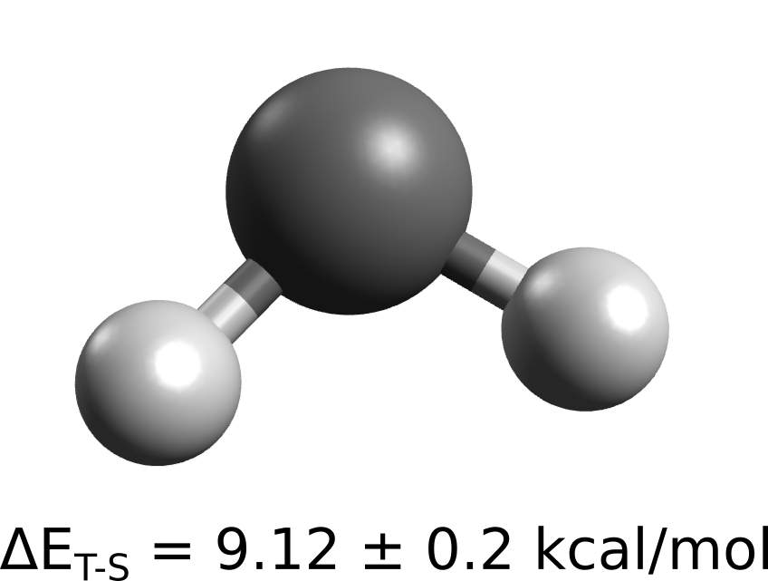

# 相关能

相关能（correlation energy）通常定义为较高理论水平方法（如 MP2 或 CCSD）与参考 Hartree-Fock（HF）之间的能量差。它是精确总能量中的一个重要部分，对性质或能量差的预测有重大影响。

在 ORCA 中实现了多种计算或考虑这一部分的方法，这里我们将讨论其中三种：Møller–Plesset 微扰理论（MP2）；双杂化密度泛函（double-hybrid DFT, DHDF）和耦合簇（coupled cluster, CC）方法，并以亚甲基（methylene）的单重态-三重态能隙作为基准 [[Shavit1985]](../bib.md#shavit1985)：

[](../images/methylene.png)

这是一个不寻常的例子：基态三重态比单重态更稳定。在这里 HF 理论表现很差，而实验测量的性质精度很高。

## Møller–Plesset 微扰理论（MP2）

我们首先使用双杂化泛函 B2PLYP 计算单重态和三重态的参考几何结构，已知该泛函能准确再现实验几何结构 [[Grimme2006]](../bib.md#grimme2006)：

```mol
title: corren #1
theme: chem311
height: 360px
representation: ball-stick
--- xyz ---
3
structure
  C      0.000000    0.000000  -0.092116
  H     -0.905815    0.000000   0.548403
  H      0.905815    0.000000   0.548403
--- input ---
!RI-B2PLYP DEF2-TZVPP DEF2-TZVPP/C OPT
* xyz 0 1
  C      0.000000    0.000000  -0.092116
  H     -0.905815    0.000000   0.548403
  H      0.905815    0.000000   0.548403
*
```

或：

```text
!RI-B2PLYP DEF2-TZVPP DEF2-TZVPP/C OPT
* xyzFILE 0 3 guess_CH2.xyz
```

计算得到的三重态键角为 134°，与实验值完全一致 [[Shavit1985]](../bib.md#shavit1985)

现在让我们使用 MP2 和先前优化好的单重态与三重态结构，计算绝热（adiabatic）单重态-三重态能量差：

```mol
title: corren #3
theme: chem311
height: 360px
representation: ball-stick
--- xyz ---
3
structure
  C      0.000000    0.000000   -0.129289
  H     -0.859359    0.000000    0.566990
  H      0.859359    0.000000    0.566990
--- input ---
!MP2 DEF2-QZVPP
* xyz 0 1
  C      0.000000    0.000000   -0.129289
  H     -0.859359    0.000000    0.566990
  H      0.859359    0.000000    0.566990
*
```

或：

```mol
title: corren #4
theme: chem311
height: 360px
representation: ball-stick
--- xyz ---
3
structure
  C     -0.000000    0.000000    0.056545
  H     -0.990707    0.000000    0.474072
  H      0.990707    0.000000    0.474072
--- input ---
!MP2 DEF2-QZVPP
* xyz 0 3
  C     -0.000000    0.000000    0.056545
  H     -0.990707    0.000000    0.474072
  H      0.990707    0.000000    0.474072
*
```

> **重要**
> 这里必须强调，这些*相关*方法强烈依赖于基组大小，原则上应尽可能使用更大的基组，这就是我们在这里使用 DEF2-QZVPP 基组的原因。

你会在 SCF 之后看到 MP2 表头：

```text
------------------------------------------------------------------------------
                                ORCA  MP2
------------------------------------------------------------------------------

Freezing NCore=2 chemical core electrons

----------
MP2 ENERGY (disk based algorithm)
----------

Dimension of the basis                    ...  117
Memory devoted to MP2                     ...  256 MB
Data format for buffers                   ... DOUBLE
Compression type for matrix containers    ... UNCOMPRESSED
```

随后是与必要积分相关的细节：

```text
-------------------------------
PARTIAL EXCHANGE TRANSFORMATION
-------------------------------

Transformation type                        ... one-operator
Generation of integrals (i,mue|j,nue)      ... ON
Generation of integrals (mue,kappa|nue,tau)... OFF
Generation of integrals (i,mue|a,nue)      ... OFF
Dimension of the basis                     ...  117
Number of internal MOs                     ...    3 (   1-   3)
Pair cutoff                                ... 1.000e-11 Eh
```

最后打印出相关能（以单重态为例）：

```text
-----------------------------------------------
MP2 CORRELATION ENERGY   :     -0.147755815 Eh
-----------------------------------------------
```

它被加到 SCF 能量上，从而生成最终能量：

```text
-------------------------   --------------------
FINAL SINGLE POINT ENERGY       -39.043423495766
-------------------------   --------------------
```

在该理论水平下用单重态能量减去三重态能量，得到 $\Delta E_{MP2} = 14.24 \hspace{3pt} kcal/mol$，大约高出 $5 \ \mathrm{kcal/mol}$，但比 HF 理论得到的 $\Delta E_{HF} = 28.25 \hspace{3pt} kcal/mol$ 好得多。

### 自旋分量标度 MP2（SCS-MP2）

MP2 理论的另一个版本是自旋分量标度 MP2（spin-component-scaled MP2, SCS-MP2，[[Grimme2003]](../bib.md#grimme2003)），它通常优于常规 MP2。通过以下方式即可轻松使用：

```text
!SCS-MP2 DEF2-QZVPP
* xyzFILE 0 1 CH2_optimized.xyz
```

或：

```text
!SCS-MP2 DEF2-QZVPP
* xyzFILE 0 3 CH2_optimized.xyz
```

并打印出类似的输出。在这些情况下，我们计算的能量差为 $\Delta E_{SCS-MP2} = 7.92 \hspace{3pt} kcal/mol$，甚至优于常规 MP2，但仍有偏差。

### 使用密度拟合（resolution of identity, RI）

通过使用库仑积分的密度拟合近似（resolution of identity approximation）[[Komornicki1993]](../bib.md#komornicki1993)，MP2 或 SCS-MP2 计算可以大大加速：

```text
!RI-MP2 DEF2-QZVPP DEF2-QZVPP/C
* xyzFILE 0 1 CH2_optimized.xyz
```

或：

```text
!RI-SCS-MP2 DEF2-QZVPP DEF2-QZVPP/C
* xyzFILE 0 1 CH2_optimized.xyz
```

在这种情况下，需要来自 "/C" 基组家族的专用辅助基组用于*相关*方法。完整的列表可以在 [ORCA 手册](https://www.faccts.de/docs/orca/6.0/manual)中找到，如果没有相应的基组可用，则总是可以使用 AUTOAUX 自动生成一套。

任何近似总会带来固有误差，但在这里它相对较小。如你所见，单重态 RI-MP2 的最终能量为：

```text
-------------------------   --------------------
FINAL SINGLE POINT ENERGY       -39.054461324414
-------------------------   --------------------
```

与参考值仅相差百分之几微哈特里（microhartree）。

> **注意**
> RIJDX 和 RIJCOSX 近似也可以用在 SCF 部分，通过在主输入中使用 !RIJDX 或 !RIJCOSX 来进一步加速计算。

### DLPNO 方案

多年来，ORCA 团队为这些相关方法开发了一种特殊类型的近似，称为基于域的局域对自然轨道（Domain-based Local Pair Natural Orbital, DLPNO）方案。

其思想是相关能可以用电子对能量来描述，而这些能量只需在每个电子对的特定域（domain）内就能高效计算出来。这使得这些计算效率**大大提高**，并能恢复约 99% 的相关能。

要在 MP2 中使用该方案：

```text
!DLPNO-MP2 DEF2-QZVPP DEF2-QZVPP/C
* xyzFILE 0 1 CH2_optimized.xyz
```

或：

```text
!DLPNO-SCS-MP2 DEF2-QZVPP DEF2-QZVPP/C
* xyzFILE 0 1 CH2_optimized.xyz
```

输出中现在有一些额外的打印内容，与轨道定域化有关：

```text
------------------------------------------------------------------------------
                           ORCA ORBITAL LOCALIZATION
------------------------------------------------------------------------------

Input orbitals are from                  ... carb.gbw
Output orbitals are to                   ... carb.loc
Max. number of iterations                ... 128
Localizations seeded randomly            ... off
Convergence tolerance                    ... 1.000e-06
Treshold for strong local MOs            ... 9.500e-01
Treshold for bond MOs                    ... 8.500e-01
[...]
```

随后是预筛选，然后实际的 MP2 计算开始运行：

```text
----------------------------
Local MP2 Energy Calculation
----------------------------
Truncation parameters:
    PAOOverlapThresh    =        1.000e-08
    TCutPNO             =        1.000e-08

    Spin component scaling                      .... not used
    MP2 energy scaling factor                   .... 1.000

    Formation of semicanonical amplitudes.
     10% done.
     20% done.
     30% done.
     40% done.
     [...]
```

然后像往常一样打印出相关能：

```text
------------------------------------------------------
 DLPNO-MP2 CORRELATION ENERGY:      -0.158789484960 Eh
 ------------------------------------------------------
```

其结果与常规 MP2 值的接近程度达 99.99%。

> **重要**
> 使用 DLPNO 的计算也始终需要 /C 辅助基组。

## 双杂化密度泛函（DHDF）

DFT 本身已通过交换相关泛函（exchange-correlation functional）包含了一部分相关能，但有研究表明，通过加入一定量的 MP2 相关能，可以进一步改善结果 [[Grimme2006]](../bib.md#grimme2006)。

这些含 MP2 组分的泛函被称为双杂化泛函（double-hybrids），因为它们同时包含 HF 交换和 MP2 相关。它们也可以与 RI- 和 DLPNO- 近似一起调用。例如使用 B2PLYP 泛函时：

```text
!B2PLYP DEF2-QZVPP
* xyzFILE 0 1 CH2_optimized.xyz
```

或：

```text
!RI-B2PLYP DEF2-QZVPP DEF2-QZVPP/C
* xyzFILE 0 1 CH2_optimized.xyz
```

或：

```text
!DLPNO-B2PLYP DEF2-QZVPP DEF2-QZVPP/C
* xyzFILE 0 1 CH2_optimized.xyz
```

输出遵循常规 DFT 计算的流程，在 SCF 之后进行一次 MP2 计算。最后按照泛函定义将所有能量相加，并打印出最终能量。对于 RI-B2PLYP，亚甲基的单重态-三重态能隙为 $\Delta E_{B2PLYP} = 11.73 \hspace{3pt} kcal/mol$，优于简单的 MP2。

### 双杂化自旋分量标度密度泛函（DSD-DF）

按照与 SCS-MP2 相同的思路，MP2 能量的不同自旋分量也可以对 DHDF 进行标度，这通常会带来更好的预测结果 [[Grimme2011]](../bib.md#grimme2011)。这类泛函的名称前带有 DSD-，例如：

```text
!DSD-PBEB95 DEF2-QZVPP
* xyzFILE 0 1 CH2_optimized.xyz
```

或：

```text
!RI-DSD-PBEB95 DEF2-QZVPP DEF2-QZVPP/C
* xyzFILE 0 1 CH2_optimized.xyz
```

或：

```text
!DLPNO-DSD-PBEB95 DEF2-QZVPP DEF2-QZVPP/C
* xyzFILE 0 1 CH2_optimized.xyz
```

> **重要**
> 目前介绍的所有方法都实现了解析梯度（analytic gradients），这使得它们也非常适合用于几何优化！

## 耦合簇方法（CC）

量子力学中获得相关能最精确的方法之一是所谓的耦合簇方法（coupled cluster methods, CC），尤其是对于单参考问题中精确能量的"金标准"——CCSD(T) 方法。

然而，它随电子数的增加计算量急剧增长，很快就会变得不切实际，将其应用范围限制在约 20 个原子以内。在 ORCA 中，可以使用 DLPNO 方案来显著降低问题的标度，如今已经可以计算数百个原子的真实大小的分子 [[Neese2013a]](../bib.md#neese2013a) [[Neese2013b]](../bib.md#neese2013b)。

要计算我们前面示例中的能量，可以使用：

```text
!DLPNO-CCSD DEF2-QZVPP DEF2-QZVPP/C
* xyzFILE 0 1 CH2_optimized.xyz
```

在常规 HF 输出之后，矩阵驱动 CI 模块（Matrix Driven CI, MDCI）开始运行：

```text
-------------------------------------------------------------------------------
                              ORCA-MATRIX DRIVEN CI
-------------------------------------------------------------------------------

Wavefunction type
-----------------
Correlation treatment                      ... CCSD
Single excitations                         ... ON
Orbital optimization                       ... OFF
Calculation of Z vector                    ... OFF
Calculation of Brueckner orbitals          ... OFF
Perturbative triple excitations            ... OFF
Calculation of F12 correction              ... OFF
Frozen core treatment                      ... chemical core (2 el)
Reference Wavefunction                     ... RHF
  Internal Orbitals:     1 ...    3 (  3 MO's/  6 electrons)
  Virtual  Orbitals:     4 ...  116 (113 MO's              )
Number of AO's                             ...    117
Number of electrons                        ...      8
Number of correlated electrons             ...      6
```

随后是与定域化、筛选和积分变换相关的打印内容，之后 CCSD 计算开始：

```text
------------------------------------------------
                  RHF COUPLED CLUSTER ITERATIONS
------------------------------------------------

Number of PNO amplitudes to be optimized   ...        22277
Number of non-PNO amplitudes               ...        76614
Untruncated number of regular amplitudes   ...        76614

Iter       E(tot)           E(Corr)          Delta-E          Residual     Time
  0    -39.042828320     -0.146989446      0.000167865      0.017754515    4.35
                           *** Turning on DIIS ***
  1    -39.056621207     -0.160782333     -0.013792887      0.014559282    4.14
```

收敛后，会打印出包含不同能量组分和本次计算一些诊断指标的摘要：

```text
----------------------
COUPLED CLUSTER ENERGY
----------------------

E(0)                                       ...    -38.895667683
E(CORR)(strong-pairs)                      ...     -0.170828218
E(CORR)(weak-pairs)                        ...     -0.000171190
E(CORR)(corrected)                         ...     -0.170999408
E(TOT)                                     ...    -39.066667092
Singles Norm <S|S>**1/2                    ...      0.022256446
T1 diagnostic                              ...      0.009086156
```

如你所见，这里的相关能比 MP2 的更负，这正是更高水平方法的预期结果。

> **警告**
> 请务必检查打印出的 T1 诊断值（T1 diagnostic）。经验法则：当诊断值大于 0.02 时，结果不可信，HF 参考波函数可能较差。

> **注意**
> ORCA 中可以使用许多不同的耦合簇和耦合对方法，详情请查阅 [ORCA 手册](https://www.faccts.de/docs/orca/6.0/manual)。

这里预测的能量差为 $\Delta E_{CCSD} = 10.54 \hspace{3pt} kcal/mol$，优于 MP2，但仍存在一定误差。如果改用更精确的 DLPNO-CCSD(T) 运行同样的计算，该差值会降至 $\Delta E_{CCSD(T)} = 9.70 \hspace{3pt} kcal/mol$，几乎与实验值完全一致！

### 外推至 CBS 极限

正如前面 MP2 部分提到的，这些方法需要大基组才能真正准确，只有接近基组极限（complete basis set limit, CBS）时才能展现其真正威力。即便如此，也不需要使用极大的基组才能达到极限，还可以从较小基组的计算中外推得到 CBS 结果。

在 ORCA 中使用这些外推方案很容易。例如，如果你想计算接近 CBS 的 DLPNO-CCSD(T) 能量，可以使用：

```text
!DLPNO-CCSD(T) EXTRAPOLATE(3) cc-pVQZ/C
* xyzFILE 0 1 CH2_optimized.xyz
```

这里的 EXTRAPOLATE(3) 关键词意味着将使用 cc-pVxZ 系列基组（其中 x 分别为 D、T 和 Q）进行三次计算，并由此外推得到 CBS 结果。

> **注意**
> /C 辅助基组不会被自动选择，因此最好使用与最大基组相对应的那个。关于 EXTRAPOLATE 各种可能性的完整说明，请查阅 [ORCA 手册](https://www.faccts.de/docs/orca/6.0/manual)。

回到亚甲基的三重态-单重态能隙，外推得到的能量差为 $\Delta E_{CCSD(T)-CBS} = 9.26 \hspace{3pt} kcal/mol$，实际上已在实验误差范围之内。

下表总结了计算结果。很明显，随着相关方法越来越精确，误差越来越小：

| 方法 | $\Delta E_{TS}$ | 误差 |
| --- | --- | --- |
| HF | 28.25 | 19.13 |
| B3LYP | 11.74 | 2.62 |
| MP2 | 14.24 | 5.11 |
| SCS-MP2 | 7.92 | -1.22 |
| RI-B2PLYP | 11.73 | 2.60 |
| RI-DSD-PBEB95 | 11.63 | 2.50 |
| DLPNO-CCSD | 10.54 | 1.42 |
| DLPNO-CCSD(T) | 9.70 | 0.58 |
| DLPNO-CCSD(T)-CBS | 9.26 | 0.14 |
| 实验值 [[Shavit1985]](../bib.md#shavit1985) | 9.12 | ± 0.2 |
