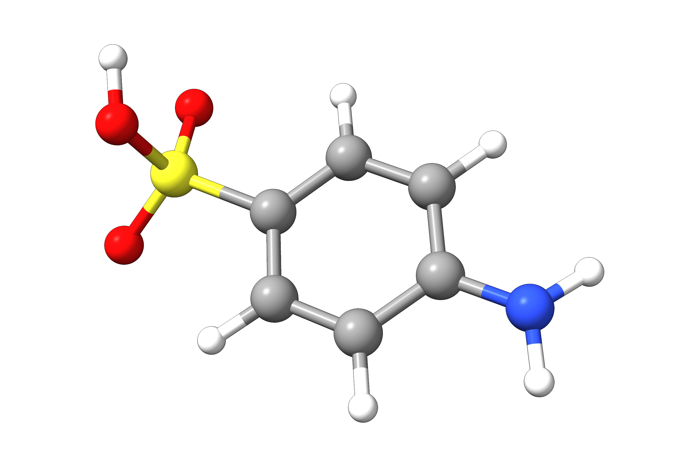
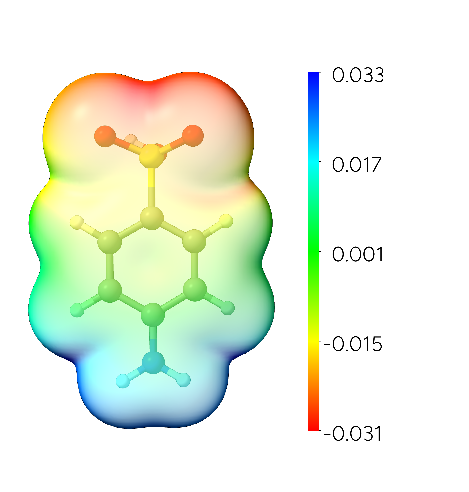

# 静电势（ESP）

分子静电势（Molecular Electrostatic Potentials, ESP、MESP 或 MEP）可以描述为一个正试探电荷与分子电荷云相互作用的势能。
尽管它不描述任何极化效应，ESP 仍是一个有用的工具，可用于识别分子内的亲电位点（electrophilic sites），从而为其反应性提供线索。

从 ORCA 6.1 开始，可以通过 `orca_plot` 工具为 ORCA 电子结构计算中生成的任何态密度生成 ESP。

## 示例：磺胺酸的静电势

在本例中，我们将计算磺胺酸（sulfanilic acid）的 ESP，它是合成卢格斯试剂（Lunges reagent）和重氮染料的关键试剂。

[](../images/struc-sulfanilic-acid.png)

*图：磺胺酸的分子结构。*

```mol
title: 磺胺酸
theme: chem311
height: 360px
representation: ball-stick
--- xyz ---
18
structure
S           2.08443867368608      0.01150368288142      0.05720303334503
O           2.38875576499517     -0.06253827476629     -1.53931866863108
O           2.59369424486808      1.27853646709922      0.49680955691418
O           2.58032212431162     -1.18437170724428      0.65506996167388
N          -3.80589584494646     -0.00595074219057     -0.14653911657384
C           0.31986447482960      0.00918095295591      0.04956754384400
C          -0.36032955767096      1.21076111641175      0.04772781917135
C          -0.34943863168736     -1.19795306360443      0.01002738276096
C          -2.44289084701488     -0.00151155821425     -0.04013159677112
C          -1.73892446730943      1.20904420485890      0.00645966467702
C          -1.72752335754488     -1.20654954499767     -0.03395221590021
H           0.20398105565077      2.12817324075176      0.09524042083817
H           0.22592765284959     -2.10892161589953      0.02432502420802
H          -2.28739759171160      2.13920645524485      0.00885193989838
H          -2.26798081327169     -2.14084398651155     -0.06493505822491
H          -4.30136964887817      0.84144825273866      0.06983261137791
H          -4.29185107402319     -0.86722349002251      0.03407022316045
H           2.81671784286773      0.75060961050856     -1.81090852576819
```

原则上，我们可以使用 ORCA 中任何生成密度的电子结构方法来计算 ESP。本例中我们选择 r²SCAN0/def2-SVP 理论水平。首先，我们在该水平下对先前[优化好的磺胺酸几何结构](../prop/geoopt.md)进行 SCF
计算。

```text
! r2SCAN0 def2-SVP

*xyzfile 0 1 sulfanilicacid.xyz
```

该计算会将所需的电子密度文件存储在其 `orca.densities` 容器中。为了可视化 ESP，我们必须
生成两个 `.cube` 文件：一个包含电子密度，另一个包含静电势。

两者都可以通过 `orca_plot` 生成。`orca_plot` 的图形界面通过 `orca_plot orca.gbw -i` 调用。

```text
[...]

Current-settings:

PlotType id    ... 2
PlotType       ... DENSITY-PLOT
ElDens File    ... orca.scfp
Output file    ... MyElDens
Format         ... Grid3d/Cube
Resolution     ... 100 100 100
Boundaries     ...   -15.128411    12.322825 (x direction)
                     -11.045609    11.042514 (y direction)
                     -10.422121     8.237903 (z direction)

       1 - Enter type of plot
       2 - Enter no of orbital to plot
       3 - Enter operator of orbital (0=alpha,1=beta)
       4 - Enter number of grid intervals
       5 - Select output file format
       6 - Plot CIS/TD-DFT difference densities
       7 - Plot CIS/TD-DFT transition densities
       8 - Set AO(=1) vs MO(=0) to plot
       9 - List all available densities
      10 - Perform Density Algebraic Operations

      11 - Generate the plot
      12 - exit this program
Enter a number:
```

> **提示**
> 在本例中，我们通过选项 `4 - Enter number of grid intervals` 将网格点数增加到 100x100x100。
> 这对于发表用途通常已经足够。请注意，更大的网格也会导致更大的文件和更长的生成时间。

要生成包含电子密度的 cube 文件，我们选择 `1 - Enter type of plot`$\rightarrow$`2 - (scf) electron density`

```text
-----------------------------------------------------------------------
Reading Over   2 Saved Densities                                    ...
-----------------------------------------------------------------------
-----------------------------------------------------------------------
Plot-Type is presently: 2
-----------------------------------------------------------------------
Searching for Ground State Electron or Spin Densities:              ...
-----------------------------------------------------------------------
     1 -   molecular orbitals                          
     2 -   (scf) electron density                              ......  (scfp                     )  => AVAILABLE
[...]
```

并确认使用密度容器中的默认密度 `orca.scfp`。

```text
The default name of the density would be: orca.scfp
Is this the one you want (y/n)? y
```

现在我们可以通过 `5 - Select output file format`$\rightarrow$`7 - 3D Gaussian cube` 将输出格式设置为 `.cube`，并使用 `11 - Generate the plot`
生成 `orca.eldens.cube` 文件。
接下来，我们通过 `1 - Enter type of plot`$\rightarrow$`43 - Electrostatic Potential` 生成静电势。

```text
[...]
    41 -   ROCIS QDPT unrelaxed transition AO density          ......  (Tdens-ROCISQDSOC         )  - NOT AVAILABLE
    42 -   LFT QDPT unrelaxed transition AO density            ......  (Tdens-LFTQDSOC           )  - NOT AVAILABLE
-----------------------------------------------------------------------
    43 -   Electrostatic Potential 
```

系统再次询问应使用哪个密度，我们选择标准电子密度 `orca.scfp`。

```text
---------------------
List of density names
---------------------

Index:                                                   Name of Density
------------------------------------------------------------------------
    0:                                                         orca.scfp
    1:                                                       orca.P0.tmp

Enter Name for an STATE Density: orca.scfp
```

最后，我们可以通过 `11 - Generate the plot` 开始静电势的计算。请注意，根据所选网格点数的不同，这可能需要一些时间。静电势数据随后将存储在 `orca.scfp.esp.cube` 文件中。

原则上，我们现在应该已准备好以下文件，可用 [ChimeraX](../first_steps/GUI.md) 绘制 ESP：

1. `sulfanilicacid.xyz`，包含输入分子的笛卡尔坐标
2. `orca.eldens.cube`，包含电子密度
3. `orca.scfp.esp.cube`，包含静电势

我们现在按此顺序将三个文件加载到 ChimeraX 中，并在其命令行中输入以下命令（有时需要按两次回车才能应用着色）：

```text
volume #3 hide; volume #2 level 0.001; color electrostatic #2 map #3 range full palette ^rainbow key true transparency 60
```

基本上，这会隐藏原始的 esp 文件，将电子密度的等值面值设为 0.001 a.u.，并用静电势数据为密度表面着色。ChimeraX 还提供了多种额外的可视化选项。该图现在可以保存为 `.PNG` 文件，我们可以很容易地识别出与正点电荷相互作用强烈的区域——这些区域以红色显示。

[](../images/esp-sulfanilic-acid.png)

*图：映射到磺胺酸电子密度上的分子静电势。等值面值 = 0.001 a.u.。*
