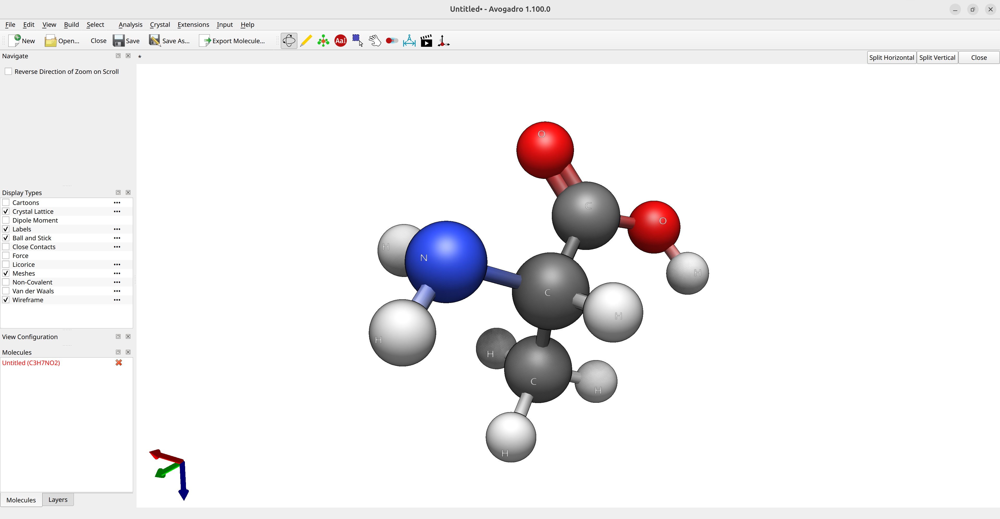
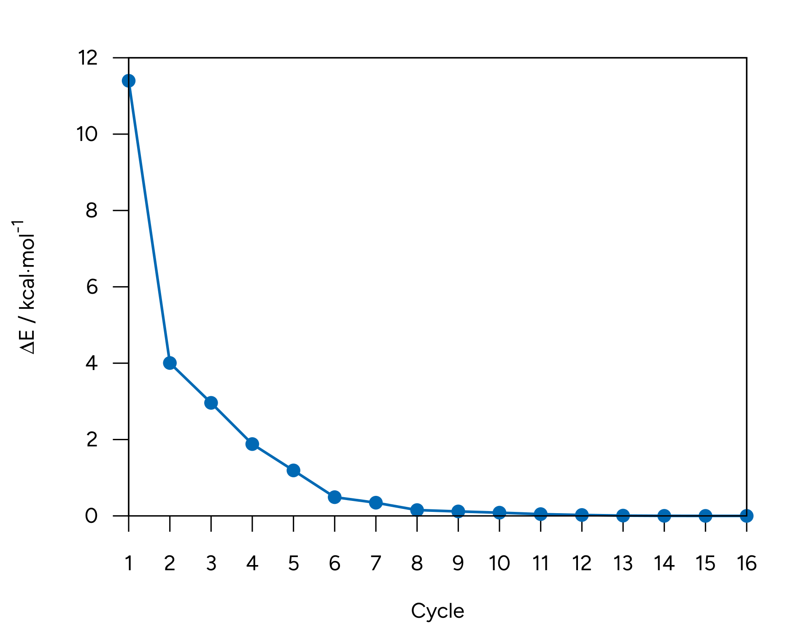

# 几何优化

## 基本用法

优化几何（geometry optimization）意味着在给定方法下找到使总能量最小的几何结构。

现在，假设你要计算氨基酸**丙氨酸**在某给定方法下的优化几何。第一步是获得某种猜测几何。你可以使用 [Avogadro 2](../first_steps/GUI.md) 绘制其结构，并运行 Open Babel 优化器（通过 `Extensions`$\rightarrow$`Open Babel`$\rightarrow$`Optimize Geometry`）得到合理的原子排布：



*图：在 Avogadro 中创建输入结构。*

有了这些坐标，就可以设置你的 ORCA 输入了！

> **注意**
> 可以直接用 Avogadro 生成输入，把分子保存为 .xyz 文件再读入（参见[从外部文件读取](../first_steps/input_output.md#reading-external)），或者使用 "xyz" 标志将坐标直接添加到输入的[结构部分](../first_steps/input_output.md#geo-sec)。

如果要优化几何，例如使用 DFT，只需选择一个泛函（functional）和一个基组（basis set），并在主输入中加入 OPT：

```mol
title: geoopt #1
theme: chem311
height: 360px
representation: ball-stick
--- xyz ---
13
structure
N         -0.83911        0.76325       -0.31843
C          0.61442        0.72014       -0.25075
C          1.01669       -0.56167        0.49740
O          0.20095       -1.36984        0.93753
H         -1.37884        0.05803        0.17605
H          1.00414        0.66192       -1.27362
C          1.17285        1.95192        0.45211
H          0.87124        2.87150       -0.05988
H          0.81191        2.01288        1.48492
H          2.26726        1.92903        0.48485
H         -1.30551        1.57618       -0.71069
O          2.33980       -0.77979        0.66176
H          3.04559       -0.08055        0.28096
--- input ---
!PBE D4 DEF2-SVP OPT
* xyz 0 1
N         -0.83911        0.76325       -0.31843
C          0.61442        0.72014       -0.25075
C          1.01669       -0.56167        0.49740
O          0.20095       -1.36984        0.93753
H         -1.37884        0.05803        0.17605
H          1.00414        0.66192       -1.27362
C          1.17285        1.95192        0.45211
H          0.87124        2.87150       -0.05988
H          0.81191        2.01288        1.48492
H          2.26726        1.92903        0.48485
H         -1.30551        1.57618       -0.71069
O          2.33980       -0.77979        0.66176
H          3.04559       -0.08055        0.28096
*
```

> **重要**
> 纯 DFT 和 HF 在分子间相互作用或弱相互作用方面表现不佳，这是众所周知的。
> 一般建议使用 Grimme 的 D4 [[Grimme2017]](../bib.md#grimme2017) 这类色散校正（dispersion correction），它会同时校正能量和梯度（gradient），从而得到好得多的结果。
> 示例参见[色散校正教程](../prop/disp.md)。

如果一切正常，首先应该在输出的主标题之后看到：

```text
*****************************
                       * Geometry Optimization Run *
                       *****************************

Geometry optimization settings:
Update method            Update   .... BFGS
Choice of coordinates    CoordSys .... (2022) Redundant Internals
Initial Hessian          InHess   .... Almloef's Model
Max. no of cycles        MaxIter  .... 50  

Convergence Tolerances:  
Energy Change            TolE     ....  5.0000e-06 Eh  
Max. Gradient            TolMAXG  ....  3.0000e-04 Eh/bohr    
RMS Gradient             TolRMSG  ....  1.0000e-04 Eh/bohr
Max. Displacement        TolMAXD  ....  4.0000e-03 bohr
RMS Displacement         TolRMSD  ....  2.0000e-03 bohr
Strict Convergence                .... False
[...]
```

其中列出了若干优化参数。

随后 SCF 开始运行，接着计算梯度，并给出与当前步骤相关的信息：

```text
                                .--------------------.
          ----------------------|Geometry convergence|-------------------------
          Item                value                   Tolerance       Converged
          ---------------------------------------------------------------------
          RMS gradient        0.0111840906            0.0001000000      NO
          MAX gradient        0.0602175515            0.0003000000      NO
          RMS step            0.0320147074            0.0020000000      NO
          MAX step            0.1623430770            0.0040000000      NO
          -------------------------------------------------------------------------
          ........................................................
          Max(Bonds)      0.0859      Max(Angles)    4.45
          Max(Dihed)        2.73      Max(Improp)    0.00
          ---------------------------------------------------------------------

The optimization has not yet converged - more geometry cycles are needed
```

由于初始猜测几何远不够好，第一步没有达到任何收敛判据（convergence criterion）。几何随后按照默认算法（拟牛顿法，quasi-Newton method）进行调整，接下来可以看到几何的变化：

```text
    ---------------------------------------------------------------------------
                         Redundant Internal Coordinates
                            (Angstroem and degrees)

        Definition                    Value    dE/dq     Step     New-Value
    ----------------------------------------------------------------------------
     1. B(C   1,N   0)                1.4557  0.012562 -0.0153    1.4404
     2. B(C   2,C   1)                1.5377  0.001421 -0.0031    1.5347
     3. B(O   3,C   2)                1.2297  0.028017 -0.0145    1.2152
     4. B(H   4,N   0)                1.0164  0.000572 -0.0004    1.0160
     5. B(H   4,O   3)                2.2615  0.001277 -0.0100    2.2515
[...]
```

该过程不断重复，直到满足收敛判据：

```text
.--------------------.
          ----------------------|Geometry convergence|-------------------------
          Item                value                   Tolerance       Converged
          ---------------------------------------------------------------------
          Energy change      -0.0000017309            0.0000050000      YES
          RMS gradient        0.0000411287            0.0001000000      YES
          MAX gradient        0.0001226561            0.0003000000      YES
          RMS step            0.0004552473            0.0020000000      YES
          MAX step            0.0014707390            0.0040000000      YES
          -------------------------------------------------------------------------
          ........................................................
          Max(Bonds)      0.0008      Max(Angles)    0.03 
          Max(Dihed)        0.08      Max(Improp)    0.00 
          ---------------------------------------------------------------------
    
                    ***********************HURRAY********************
                    ***        THE OPTIMIZATION HAS CONVERGED     ***
                    *************************************************
```

> **警告**
> 务必检查 `HURRAY` 消息，以确认几何优化已完全收敛。如果几何优化接近但未完全收敛，即使 ORCA 声称运行成功，该消息也不会出现！此时应考虑重新启动优化以达到完全收敛。

这里可以看到优化过程中几何结构的变化：

[](../images/opt.gif)

*图：丙氨酸的优化过程。*

尽管初始猜测看起来不错，但可以看到 B3LYP 泛函预测的几何与所给输入有所不同。初始猜测中氨基处于更接近平面的构型，优化修正了这一点，同时也校正了键长。

> **重要**
> 几何优化结束后，会输出一个名为 `basename.xyz` 的文件，其中包含最终几何坐标，可在后续计算中使用。优化轨迹也保存在 `basename_trj.xyz` 中。

用 Avogadro 2 打开 `basename.out` 文件并进入 `Analysis`$\rightarrow$`Properties`$\rightarrow$`Conformer Properties...`，即可找到优化能量表。

可以看到，随着优化推进，分子能量逐渐下降并趋于收敛：

[](../images/enconv.png)

*图：丙氨酸优化的能量收敛曲线。*

## 这是真正的极小值吗？

如何判断这是否为真正的极小值（minimum）？梯度的范数在鞍点（saddle point）处同样为零；也可能梯度虽小却还不够小。

可以通过在最终几何上计算[振动频率](../prop/freq.md)来检验，只需在主输入中加入 `FREQ` 关键词：

```text
!PBE D4 DEF2-SVP FREQ
*XYZFILE 0 1 optimized_structure.xyz
```

然后，在计算出精确的黑塞矩阵（Hessian）后，会打印出频率：

```text
-----------------------
VIBRATIONAL FREQUENCIES
-----------------------

Scaling factor for frequencies =  1.000000000  (already applied!)

     0:       0.00 cm**-1
     1:       0.00 cm**-1
     2:       0.00 cm**-1
     3:       0.00 cm**-1
     4:       0.00 cm**-1
     5:       0.00 cm**-1
     6:      63.32 cm**-1
     7:     224.15 cm**-1
     8:     238.66 cm**-1
     9:     254.16 cm**-1
    10:     313.45 cm**-1
[...]
```

可以看到，除最初的平动和转动模式外，所有频率都是正的，这意味着我们确实得到了一个真正的极小值。

> **重要**
> 全部为正的频率只能保证是**局域**极小值（local minimum），而不一定是**全局**极小值（global minimum）！
> 可以使用 [GOAT](../prop/goat.md) 自动搜索全局极小值和构象系综（conformer ensemble）。

## 数值梯度

最终几何的质量取决于所选方法的质量。如果要对某种目前尚无解析梯度（analytical gradient）的方法优化几何，可以用 `NUMGRAD` 标志请求数值梯度（numerical gradient）：

```text
!DLPNO-CCSD(T) cc-pVTZ cc-pVTZ/C OPT NUMGRAD
```

> **警告**
> 使用数值梯度时要当心，若体系较大，计算耗时会**长得多**。

## 如何消除负频率？

几何优化结束后出现一个或多个负频率并不罕见，尤其是当体系存在弱分子间相互作用时。这可能意味着你停留在了鞍点上，或者优化判据不够严格。

如果有很多小的负频率，很可能只需要更严格的收敛：

```text
!TIGHTOPT
```

或者在更极端的情况下：

```text
!VERYTIGHTOPT
```

这样应该就可以了。

如果体系只有一个较大的负频率，它可能更接近鞍点而非极小值。此时最好的办法是取最终结构并沿该模式的方向做位移。更多信息参见[消除负频率](../prop/freq.md#negative-freq)。

## 氢原子的优化

在某些情况下，只优化氢原子的位置会很有用。为此，可以将 `optimizehydrogens true` 加入 `%geom` 块：

```text
!r2SCAN-3c OPT

%geom 
 optimizehydrogens true
end

*XYZFILE 0 1 structure.xyz
```
