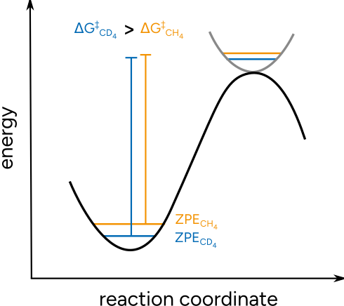
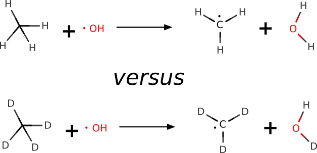
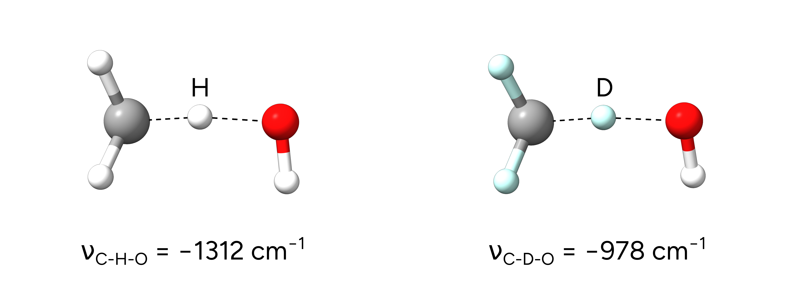

# 动力学同位素效应（KIE）

动力学同位素效应（kinetic isotope effect, KIE）是指分子中某个同位素发生改变所引起的反应速率变化。这是由质量差异造成的，质量会影响振动频率和/或隧穿概率。

当反应中存在与某个可被同位素取代的原子相关的键断裂或键形成时，常利用这一效应来研究反应机理。
这些 KIE 取决于质量比因而是可预测的，因此可用于验证所提出的反应机理。
KIE 的起源与体系**零点能**（Zero Point Energy, ZPE）的变化有关：质量改变导致振动频率升高或降低，从而影响零点能。
对于较重的氘，振动频率降低，因而零点能降低，自由能势垒也随之改变。

[](../images/kie.png)

*图：KIE 起源的示意图。*

通常，KIE 用两个反应的速率之比 $\frac {k_H} {k_D}$ 来定量。这可以根据两个反应的自由能势垒按下式计算：

$$
\frac {k_H} {k_D} = e^{-(\Delta G^{\ddagger}_H - \Delta G^{\ddagger}_D) / RT}
$$

为了获得这些势垒，我们可以使用 ORCA 中常规的[过渡态搜索与优化](../react/nebts.md)算法，只需调整相应原子的质量来模拟对应的同位素即可。这可以通过 ORCA 输入文件中的几何输入轻松实现：

```text
!wB97X-3c

* XYZ 0 1
  H     -2.411352    1.128722    0.029849		<= Hydrogen
  H     -1.342943    1.352019   -0.097229 M 2.0141	<= Deuterium
*
```

这里我们将 H 的质量调整为 2.0141 amu，对应于氘。

## 示例 1：氢原子摘取

在本例中，我们用 ORCA 对羟基自由基从甲烷上摘取氢原子的反应进行 KIE 的量子力学预测。相应的 KIE 比值已由高精度气相实验得知（$6.75 \pm 0.83$）。[[Tully1993]](../bib.md#tully1993)

[](../images/reaction2.png)

首先，我们用 [NEB-TS](../react/nebts.md) 方法搜索了相应反应的过渡态。在本例中，我们采用了 ωB97X-3c 复合方法。它基于一种范围分离杂化泛函，专门适合以合理的计算代价计算过渡态和反应势垒。请注意，我们还调整了[热化学计算](../prop/thermo.md)的温度，以获得与实验相同条件（T = 293 K）下的自由能。我们还对两种情况下的孤立反应物进行了优化。相应的输入可以在下面的标签页中找到：

NEB-TS $CH_4$

```mol
title: KIE #2
theme: chem311
height: 360px
representation: ball-stick
--- xyz ---
7
structure
C     -2.42007     1.14475     0.00503
H     -1.37176     1.42602    -0.24888
H     -2.95035     0.87504    -0.97240
H     -2.97696     2.02414     0.50780
H     -2.39461     0.26127     0.72431
O      1.11295     1.79481    -0.12688
H      0.85814     0.90892     0.95813
--- input ---
!wB97X-3c NEB-TS FREQ

%FREQ   
 TEMP 293     
END

%NEB 
 NEB_END_XYZFILE "products.xyz"
 PREOPT_ENDS true
END

*XYZ 0 2
C     -2.42007     1.14475     0.00503
H     -1.37176     1.42602    -0.24888
H     -2.95035     0.87504    -0.97240
H     -2.97696     2.02414     0.50780
H     -2.39461     0.26127     0.72431
O      1.11295     1.79481    -0.12688
H      0.85814     0.90892     0.95813
*
```

NEB-TS $CD_4$

```mol
title: KIE #3
theme: chem311
height: 360px
representation: ball-stick
--- xyz ---
3
structure
C     -2.42007     1.14475     0.00503
O      1.11295     1.79481    -0.12688
H      0.85814     0.90892     0.95813
--- input ---
!wB97X-3c NEB-TS FREQ

%FREQ   
 TEMP 293     
END

%NEB 
 NEB_END_XYZFILE "products-deuterated.xyz"
 PREOPT_ENDS true
END

*XYZ 0 2
C     -2.42007     1.14475     0.00503
H     -1.37176     1.42602    -0.24888 M 2.0141
H     -2.95035     0.87504    -0.97240 M 2.0141
H     -2.97696     2.02414     0.50780 M 2.0141
H     -2.39461     0.26127     0.72431 M 2.0141
O      1.11295     1.79481    -0.12688
H      0.85814     0.90892     0.95813
*
```

Opt OH

```mol
title: KIE #4
theme: chem311
height: 360px
representation: ball-stick
--- xyz ---
2
structure
O      1.11295     1.79481    -0.12688
H      0.85814     0.90892     0.95813
--- input ---
!wB97X-3c OPT FREQ

%FREQ   
 TEMP 293 
END

*XYZ 0 2
O      1.11295     1.79481    -0.12688
H      0.85814     0.90892     0.95813
*
```

Opt $CH_4$

```mol
title: KIE #5
theme: chem311
height: 360px
representation: ball-stick
--- xyz ---
5
structure
C     -2.42007     1.14475     0.00503
H     -1.37176     1.42602    -0.24888
H     -2.95035     0.87504    -0.97240
H     -2.97696     2.02414     0.50780
H     -2.39461     0.26127     0.72431
--- input ---
!wB97X-3c OPT FREQ

%FREQ   
 TEMP 293 
END

* XYZ 0 1
C     -2.42007     1.14475     0.00503
H     -1.37176     1.42602    -0.24888
H     -2.95035     0.87504    -0.97240
H     -2.97696     2.02414     0.50780
H     -2.39461     0.26127     0.72431
*
```

Opt $CD_4$

```mol
title: KIE #6
theme: chem311
height: 360px
representation: ball-stick
--- xyz ---
1
structure
C     -2.42007     1.14475     0.00503
--- input ---
!wB97X-3c OPT FREQ

%FREQ 
 TEMP 293 
END

* XYZ 0 1
C     -2.42007     1.14475     0.00503
H     -1.37176     1.42602    -0.24888 M 2.0141
H     -2.95035     0.87504    -0.97240 M 2.0141
H     -2.97696     2.02414     0.50780 M 2.0141
H     -2.39461     0.26127     0.72431 M 2.0141
*
```

NEB-TS 计算成功后，我们得到了相应优化的过渡态：

[](../images/kie-ts.png)

*图：从甲烷和氘代甲烷上摘取氢原子反应的过渡态。*

氢代情形的单一虚频为 -1312.67 $cm^{-1}$，氘代过渡态的为 -977.51 $cm^{-1}$，这验证了这些结构是真正的过渡态，并且已经反映出 KIE。

活化势垒 $\Delta G_H^{\ddagger}$ 现在按过渡态自由能与孤立反应物自由能之和的差值计算。
在本例中，我们分别得到 47.63 和 53.14 $kJ \cdot mol^{-1}$。由这些数值计算出 $\frac {k_H} {k_D}$ 比值为 9.2。该值与实验值 $6.75 \pm 0.83$ 相当吻合。

> **重要**
> 仅仅像这样按自由能势垒的变化来计算 KIE，我们并未考虑任何隧穿效应。隧穿效应可能相当重要，有时需要用不同的方法之一来包含，例如 [[Aquilanti2019]](../bib.md#aquilanti2019)。

### 结构

### 相遇复合物反应物

```mol
title: KIE #7
theme: chem311
height: 360px
representation: ball-stick
--- xyz ---
7
structure
C     -2.42007     1.14475     0.00503
H     -1.37176     1.42602    -0.24888
H     -2.95035     0.87504    -0.97240
H     -2.97696     2.02414     0.50780
H     -2.39461     0.26127     0.72431
O      1.11295     1.79481    -0.12688
H      0.85814     0.90892     0.95813
```

### 相遇复合物产物

```mol
title: KIE #8
theme: chem311
height: 360px
representation: ball-stick
--- xyz ---
7
structure
C     -2.640806    0.931381    0.002030
H      0.593417    1.397564   -0.537054
H     -3.426646    1.364904   -0.619289
H     -1.670863    1.425720    0.075351
H     -2.839810    0.009183    0.550600
O      0.590809    2.120231    0.105838
H      0.558140    1.654177    0.952824
```

### OH

```mol
title: KIE #9
theme: chem311
height: 360px
representation: ball-stick
--- xyz ---
2
structure
O           1.07245474036562      1.65402139061456      0.04555342747891
H           0.89863525963438      1.04970860938544      0.78569657252109
```

### CH4

```mol
title: KIE #10
theme: chem311
height: 360px
representation: ball-stick
--- xyz ---
5
structure
C          -2.42279670517834      1.14622317818710      0.00323817339640
H          -1.40192098310125      1.43684600255195     -0.23012434766673
H          -2.93991006551667      0.87362369062480     -0.91291202682640
H          -2.93736663378777      1.97868527517785      0.47584250425215
H          -2.41175561241597      0.29584185345830      0.67981569684457
```

### CD4

```mol
title: KIE #11
theme: chem311
height: 360px
representation: ball-stick
--- xyz ---
5
structure
C          -2.42279665366144      1.14622313561044      0.00323814877091
H          -1.40192106623947      1.43684582662702     -0.23012433408547
H          -2.93991000369491      0.87362377747566     -0.91291195537196
H          -2.93736668375609      1.97868503351161      0.47584254392506
H          -2.41175559264808      0.29584222677526      0.67981559676145
```

### TSH

```mol
title: KIE #12
theme: chem311
height: 360px
representation: ball-stick
--- xyz ---
7
structure
C          -0.77611078480638     -0.11113494264923     -0.05780330905632
H           0.40528667930059      0.09836365588496     -0.23895997983456
H          -1.25333044819185      0.33081699664358     -0.92613288529126
H          -1.05358753581224      0.38209040934547      0.86689883085638
H          -0.89078558373194     -1.18834497089553     -0.01594155651396
O           1.67913078304498      0.31070162375100     -0.28088078119606
H           1.88939689019685      0.17750722791974      0.65281968103578
```

### TSD

```mol
title: KIE #13
theme: chem311
height: 360px
representation: ball-stick
--- xyz ---
7
structure
C          -0.77763363568364     -0.10797089595840     -0.04542126753852
H           0.39770017833434      0.12502500664978     -0.23608569551649
H          -1.27059074160330      0.33349472967111     -0.90517953709156
H          -1.05192912823705      0.37375855786028      0.88624232462495
H          -0.87633089384211     -1.18706486112168     -0.01146605413402
O           1.66719744479660      0.35805425386556     -0.29402167824388
H           1.91158677623516      0.10470320903337      0.60593190789951
```
