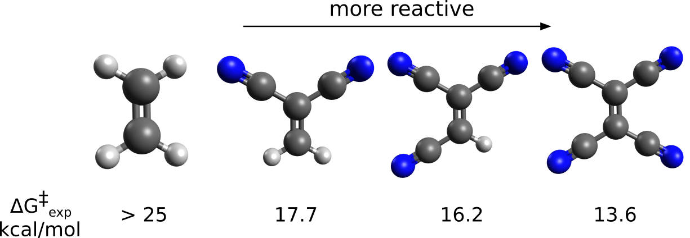
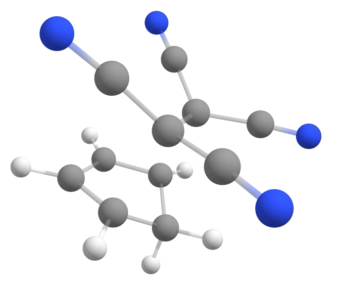
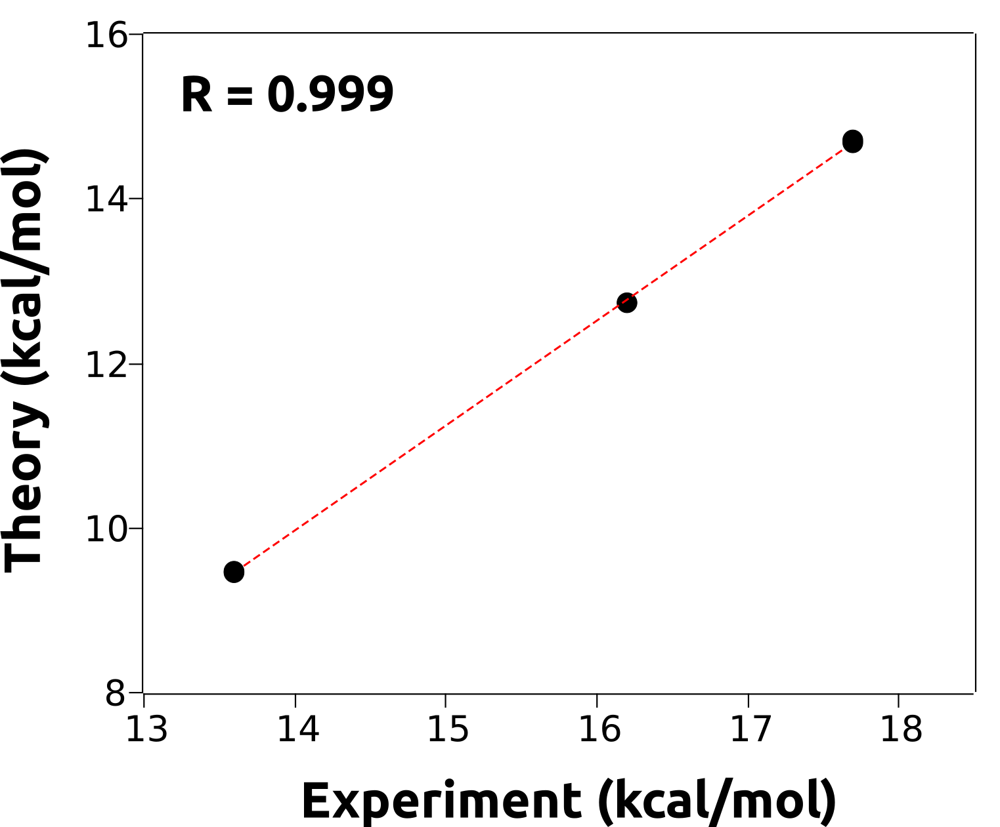

# 计算精确的能垒

除了研究化学反应的机理细节外，ORCA 还可用于计算精确的能垒，从而以一定的精度预测反应速率。

这里必须明确的是，将实验能垒的绝对值与计算值进行比较是相当困难的。首先，这些"实验"值从来不是直接测量得到的，而是在一系列假设之后才从测量数据导出的。

其次，除非你显式地对溶剂建模，否则溶剂化总是伴随着相对较大的误差。更何况如果还不考虑构象熵、透射系数等因素的话。

## 研究案例：Diels-Alder 反应

尽管如此，比较**相对**反应能垒和速率还是有意义的，这里我们将展示如何对环戊二烯与某些亲双烯体之间的经典 Diels-Alder（DA）反应做到这一点：

[](../images/reaction3.png)

这是一个重要的反应，反应物中的所有原子都被保留下来，对于合成手性化合物尤其有用。其反应速率随反应物性质剧烈变化，从 $10^{-8}$ 到 $10^{2} s^{-1}$ [[Guo2012]](../bib.md#guo2012)，并且已知亲双烯体上的吸电子基团会加速环状产物的生成：

[](../images/dienophiles.png)

让我们尝试用 [NEB-TS](../react/nebts.md) 方法寻找过渡态，研究环戊二烯与上述氰基化合物反应的相对势垒高度，并考察加入适当[相关能](../prop/corren.md#corren)修正的效果。

### 反应物 2 CN

```mol
title: 反应物 2 CN
theme: chem311
height: 360px
representation: ball-stick
--- xyz ---
19
structure
C         -3.69069       -0.24255       -3.05179
C         -3.57337       -0.78190       -1.82588
C         -4.57294       -0.54798       -0.84072
N         -5.39811       -0.33921       -0.05153
C         -2.43977       -1.57564       -1.49371
N         -1.51125       -2.22351       -1.23872
C         -2.11514        2.97164       -2.46395
C         -2.75801        2.94686       -1.10748
C         -1.82097        2.05962       -0.34096
H         -3.76291        2.51806       -1.15405
H         -2.80319        3.94828       -0.67099
C         -0.81416        1.66412       -1.13627
C         -0.99670        2.22898       -2.45201
H         -2.92766       -0.38759       -3.81222
H         -4.53742        0.38354       -3.32077
H         -1.94095        1.79488        0.69929
H         -2.49714        3.51913       -3.31237
H         -0.32049        2.07163       -3.27893
H          0.01334        1.02833       -0.85638
```

### 产物 2 CN

```mol
title: 产物 2 CN
theme: chem311
height: 360px
representation: ball-stick
--- xyz ---
19
structure
C         -3.20025        0.72134       -2.78548
C         -3.00842        0.13368       -1.34492
C         -4.31274       -0.11620       -0.70067
N         -5.34079       -0.28100       -0.18784
C         -2.20903       -1.10215       -1.36536
N         -1.58073       -2.07860       -1.39072
C         -2.57948        2.13393       -2.67804
C         -2.95544        2.53312       -1.25252
C         -2.28011        1.30743       -0.61598
H         -4.03779        2.57885       -1.09093
H         -2.51589        3.48780       -0.93519
C         -0.88730        1.50339       -1.17636
C         -1.08955        1.99428       -2.51692
H         -2.70739        0.12618       -3.56413
H         -4.26210        0.80563       -3.04971
H         -2.31744        1.29698        0.47604
H         -2.88251        2.84043       -3.45175
H         -0.33630        2.05640       -3.28724
H          0.03572        1.09522       -0.79171
```

### 反应物 3 CN

```mol
title: 反应物 3 CN
theme: chem311
height: 360px
representation: ball-stick
--- xyz ---
20
structure
C         -3.69898       -0.23681       -3.01835
C         -3.57195       -0.75519       -1.78419
C         -4.80664        0.54628       -3.43654
C         -4.55433       -0.56516       -0.77237
N         -5.70215        1.19542       -3.78131
N         -5.35261       -0.39983        0.05254
C         -2.39886       -1.49200       -1.46183
N         -1.42999       -2.08557       -1.22834
C         -2.16113        2.90081       -2.48911
C         -2.79788        2.88278       -1.12904
C         -1.84985        2.00691       -0.36196
H         -3.80037        2.44838       -1.16469
H         -2.84751        3.88655       -0.69946
C         -0.83661        1.62434       -1.15570
C         -1.03013        2.17737       -2.47476
H         -2.91467       -0.37452       -3.75726
H         -1.96469        1.74575        0.68017
H         -2.55493        3.43897       -3.33913
H         -0.34955        2.03081       -3.30051
H          0.00267        1.00519       -0.87184
```

### 产物 3 CN

```mol
title: 产物 3 CN
theme: chem311
height: 360px
representation: ball-stick
--- xyz ---
20
structure
C         -3.21165        0.73346       -2.79907
C         -3.05715        0.14686       -1.35153
C         -4.59355        0.81756       -3.28802
C         -4.33041       -0.09422       -0.64696
N         -5.67828        0.90014       -3.68685
N         -5.32012       -0.26103       -0.06541
C         -2.26700       -1.09612       -1.38224
N         -1.63017       -2.06502       -1.43179
C         -2.59535        2.15521       -2.66873
C         -2.94766        2.54448       -1.23191
C         -2.28872        1.30023       -0.62078
H         -4.02563        2.61090       -1.05062
H         -2.48524        3.48659       -0.90886
C         -0.89880        1.47289       -1.19641
C         -1.10174        2.00115       -2.52318
H         -2.63399        0.15306       -3.53289
H         -2.30987        1.27987        0.47185
H         -2.89272        2.88862       -3.42118
H         -0.36528        1.99552       -3.31368
H          0.01318        1.01032       -0.84542
```

### 反应物 4 CN

```mol
title: 反应物 4 CN
theme: chem311
height: 360px
representation: ball-stick
--- xyz ---
21
structure
C         -3.76429       -0.37684       -3.05298
C         -3.60332       -0.85967       -1.80350
C         -4.84674        0.48726       -3.38148
C         -2.83647       -0.67438       -4.09120
C         -4.50871       -0.52662       -0.75671
N         -5.72595        1.19981       -3.63289
N         -2.07298       -0.91406       -4.92930
N         -5.24903       -0.23911        0.08783
C         -2.49977       -1.69300       -1.46447
N         -1.59559       -2.36605       -1.19547
C         -2.03189        2.63992       -2.56556
C         -2.72195        2.85001       -1.24813
C         -1.92245        1.95807       -0.34275
H         -3.76788        2.53469       -1.29212
H         -2.66422        3.89444       -0.93118
C         -0.93044        1.37401       -1.03374
C         -0.99859        1.79618       -2.41214
H         -2.10952        1.83559        0.71465
H         -0.18080        0.70157       -0.64011
H         -0.30576        1.47983       -3.17969
H         -2.31440        3.12647       -3.48834
```

### 产物 4 CN

```mol
title: 产物 4 CN
theme: chem311
height: 360px
representation: ball-stick
--- xyz ---
21
structure
C         -3.23690        0.57004       -2.84697
C         -3.10513        0.02214       -1.37198
C         -4.63139        0.84698       -3.24961
C         -2.62174       -0.28568       -3.87624
C         -4.40033       -0.15824       -0.68769
N         -5.71978        1.10212       -3.55657
N         -2.13314       -0.94274       -4.69748
N         -5.40972       -0.27525       -0.12983
C         -2.34560       -1.23731       -1.26251
N         -1.73491       -2.21857       -1.16631
C         -2.48050        1.94339       -2.75503
C         -2.88270        2.43329       -1.35852
C         -2.33206        1.18899       -0.65239
H         -3.96105        2.57301       -1.23004
H         -2.38120        3.36434       -1.06181
C         -0.90638        1.26474       -1.14799
C         -1.00346        1.72997       -2.50778
H         -2.41730        1.22638        0.43690
H         -0.03865        0.78453       -0.71547
H         -0.22189        1.63333       -3.24983
H         -2.68691        2.66265       -3.55212
```

### 首先，过渡态

DA 反应的过渡态（transition state, TS）没有什么特别之处，只不过同时有三个双键断裂和两个单键形成，这一点用依赖于单一内坐标搜索的常规过渡态搜索算法有时难以跟踪。

使用 ORCA 的 [NEB-TS](../react/nebts.md) 方法，过渡态搜索就简单多了，所需的只是反应物和产物的结构。要用例如 B3LYP 和良好的 DEF2-TZVP 基组优化这些结构，可以使用：

```text
!B3LYP D4 DEF2-SVP OPT FREQ CPCM(TOLUENE)
* XYZFILE 0 1 4CN_reactant.xyz
```

这里我们使用 D4 校正 [[Grimme2017]](../bib.md#grimme2017) 来考虑色散相互作用（这在本例中是关键），并使用 CPCM 溶剂化模型 [[Truhlar2009]](../bib.md#truhlar2009) 在一定程度上包含溶剂化效应。

在检查反应物和产物都是真正的极小点（没有[负频率](../prop/freq.md)）之后，就可以用优化后的结构开始 NEB-TS 计算了：

```text
!B3LYP D4 DEF2-SVP NEB-TS FREQ CPCM(TOLUENE)
%NEB
      NEB_END_XYZFILE "4CN_product_optimized.xyz"
END
* XYZFILE 0 1 4CN_reactant_optimized.xyz
```

这里新的关键词是主输入行中的 NEB-TS 和 FREQ，以及 %NEB 下包含产物几何结构的文件名。如果一切顺利，会自动找到一个具有约 $-368cm^{-1}$ 单一负频率的过渡态：

[](../images/tsmode.gif)

### 计算能垒

有了过渡态和反应物，就可以立即从它们之间的[吉布斯自由能](../prop/thermo.md#gibbs)之差计算 $\Delta G^{\ddagger} = G^o_{TS} - G^o_{reactant}$。下表总结了上面三种氰基化合物的结果：

| 化合物 | B3LYP | 实验值 |
| --- | --- | --- |
| 2 CN | 9.90 | 17.7 |
| 3 CN | 10.69 | 16.2 |
| 4 CN | 10.21 | 13.6 |

嗯，这实际上帮助不大，因为连一个清晰的趋势都没有！B3LYP 计算没有给出清晰的趋势，但几何结构看起来不错，过渡态也确实是势能面上的鞍点。我们能得到比这更好的结果吗？

## 用 DLPNO-CCSD(T) 修正电子能量

一般而言，DFT 以其低成本就能给出质量尚可的几何结构和频率，但能量绝对是其弱点。而且如果所研究的体系超出了泛函的训练集，结果还会更差——训练集通常不包含过渡态或非典型的成键情形。

这正是应当使用更高水平的从头算（*ab initio*）方法来计算这些体系电子能量的场合。CCSD(T) 等相关方法不含经验参数，基于真实的物理原理，理应真正再现实验结果。

将这些方法与 ORCA 团队开发的 [DLPNO 方案](../prop/corren.md#dlpno)相结合，就可以快速而精确地计算这些能垒。为了在本例中计算精确的电子能量，我们可以采用 DFT 几何结构并运行：

```text
!DLPNO-CCSD(T) DEF2-TZVPP DEF2-TZVPP/C
* XYZFILE 0 1 4CN_reactant_optimized.xyz
```

对反应物和过渡态都做一次。

### 将 $E_{el}$ 转换为 $G^o$

为了把 DLPNO-CCSD(T) 电子能量（$E_{el}$）转换为真正的 $G^o$，我们必须包含[热力学](../prop/thermo.md#thermo)章节中已经讨论过的振动校正。由于 DFT 对频率的预测相对较好，这里可以直接使用先前得到的校正。

为了考虑溶剂化，我们还可以取[隐式溶剂化模型](../prop/cpcm.md#solvation)一节中给出的 $\Delta G_{solv}$（用 DFT 计算），把它们加起来得到更好的最终 $\Delta G^{\ddagger}$：

$$
\Delta G^{\ddagger}_{solv} = E_{el}(DLNPO-CC) + \Delta G_{correction} (DFT) + \Delta G^o_{solv} (DFT)
$$

使用这些结果，我们更新后的表格如下：

| 化合物 | B3LYP | CCSD(T) | 实验值 |
| --- | --- | --- | --- |
| 2 CN | 9.90 | 14.71 | 17.7 |
| 3 CN | 10.69 | 12.73 | 16.2 |
| 4 CN | 10.31 | 9.48 | 13.6 |

趋势现在清晰可见。我们甚至可以画一张图，表明计算能垒与实验能垒之间确实存在线性相关：

[](../images/linearfit.png)

这意味着，原则上我们现在可以用这个模型来预测未知化合物的实验反应势垒，精度相当不错——算出来再拟合即可！

> **重要**
> 再说一次：预测的能垒与测量的能垒几乎不可能相等，除非纯属巧合。我们计算的未必是被测量的同一个量，但应该存在像上面所展示的那样的关系。
