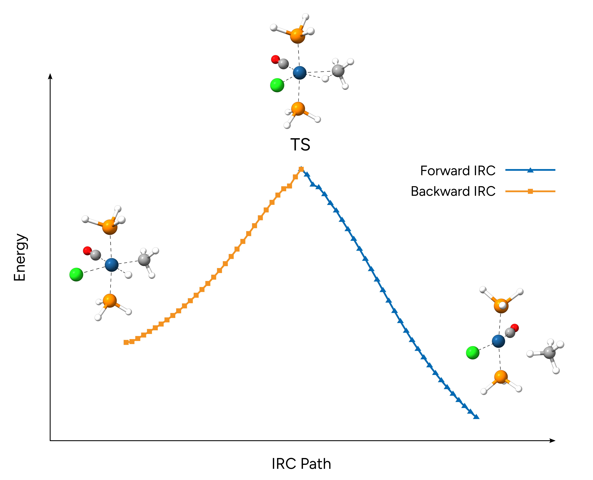

# 内禀反应坐标（IRC）

内禀反应坐标（Intrinsic Reaction Coordinate, IRC）是最小能量路径的一种特殊形式，它将过渡态（transition state, TS）与下坡方向上最近的中间体连接起来。
因此，确定 IRC 的方法有助于判断一个过渡态是否直接与给定的反应物和/或产物相连。
ORCA 实现了 Morokuma 等人的常用方法。[[Morokuma1977]](../bib.md#morokuma1977) 可通过 `IRC` 简单关键词请求 IRC 方法：

```text
!r2SCAN-3c IRC

*XYZFILE 0 1 ts.xyz
```

## 示例：C-H 活化

在本例中，我们将计算甲烷对 Vaska 配合物简化版本 *trans*-IrCl(CO)[P($CH_3$)_3]_2 氧化加成反应过渡态的 IRC。该过渡态此前已用 [NEB-TS](../react/nebts.md) 方法找到并精修。

```mol
title: C-H 活化过渡态
theme: chem311
height: 360px
representation: ball-stick
--- xyz ---
17
structure
  Ir         -0.00143203185660     -0.40016488969675      0.03600314399579
  Cl          0.27432628484078     -1.83023426743014     -2.03825688023739
  P           2.30014009485774     -0.48172068528262     -0.14772560683377
  C          -0.02121270169362     -1.23605900736449      1.73436404624705
  P          -2.27594323302349     -0.58761407009326     -0.21317913320443
  H          -2.68663330488284     -1.37330032274147     -1.30871960349281
  H          -3.05919038571534     -1.15082285974451      0.81663891095385
  H          -3.03113073166368      0.58692361406174     -0.44014225111597
  H           2.84623185761250      0.07294458775872     -1.32086169502718
  H           3.14186888192656      0.12479537665057      0.81660238174806
  H           2.85543190418513     -1.77235084163730     -0.18646215265715
  O          -0.07230769468533     -1.69639717783789      2.79715324662842
  C          -0.05176600095842      1.93204198398446      0.03356757877794
  H          -0.04515219643699      0.93288193095392     -0.99727302980658
  H           0.69877281269545      2.50898477621244     -0.51346377818299
  H          -1.03674756641744      2.35694073296797     -0.16633235178920
  H           0.16474401121560      2.01315111923861      1.09808717399636
```


> **注意**
> 请注意，IRC 方法可以直接与 `OPTTS`、`SCANTS`、`NEB-TS`、`FREQ` 和 `NUMFREQ` 关键词一起请求。默认情况下，IRC 代码会检查
> 在 IRC 运行之前是否已经计算过 Hessian。如果没有计算过，且未通过 `%IRC` 块提供 Hessian，则会在 IRC 运行开始时计算一个新的 Hessian。

> **重要**
> IRC 计算应使用与几何优化和频率计算相同的方法和基组！

现在我们对给定的过渡态请求 IRC 计算。请注意，我们通过 `%IRC` 块将最大迭代次数从 20（默认）示例性地增加到 30。
关于可用 IRC 设置的更多细节，请参见 [ORCA 手册](https://www.faccts.de/docs/orca/6.0/manual/contents/detailed/frequencies.html#sec-frequencies-irc-detailed)的相应章节。

```text
!r2SCAN-3c IRC

%IRC
 MAXITER 30
END

*XYZFILE 0 1 ts.xyz
```

在初始的能量和梯度计算之后，IRC 流程开始：

```text
--------------------------------------------------------------------------------
                   Intrinsic Reaction Coordinate Calculation
--------------------------------------------------------------------------------

System:
Nr. of atoms                        .... 17
Algorithm: SD (steepest descent step) plus correction
Settings:
Max. no of cycles        MaxIter    .... 50
Direction                           .... Forward and backward
Initial displacement Hessian type   .... Compute numerically
Following Hessian mode              .... 0
Initial displacement type           .... Energy
  Initial displacement energy change.... 2.000 mEh
Coordinate system following type    .... Cartesian
Length of steepest descent step     .... 0.150 bohr
Do parabolic fit
  if SD step is uphill              .... YES
Do Correction to SD step            .... YES
Scaling for length of correction
  compared to SD step               .... 0.333
Do parabolic fit to SD correction   .... YES
Only interpolate for parabolic fit  .... YES
Do update to length of
  SD step and correction            .... YES
Convergence Tolerances:
  Max. Gradient            TolMAXG  ....  2.0000e-03 Eh/bohr
  RMS Gradient             TolRMSG  ....  5.0000e-04 Eh/bohr
Storing full IRC trajectory in      .... orca_IRC_Full_trj.xyz
Storing forward trajectory in       .... orca_IRC_F_trj.xyz
Storing backward trajectory in      .... orca_IRC_B_trj.xyz
```

由于我们没有提供 Hessian，也没有在输入中指定 Hessian 计算，ORCA 将首先进行数值 Hessian 计算：

```text
----------------------------------------------------------------------------
                           ORCA NUMERICAL FREQUENCIES
----------------------------------------------------------------------------
```

随后，会自动读取计算得到的 Hessian，并开始正向 IRC 计算：

```text
*************************************************************
         *                          FORWARD IRC                      *
         *************************************************************

Iteration    E(Eh)      dE(kcal/mol)  max(|G|)   RMS(G)
Convergence thresholds                0.002000  0.000500
    0     -1404.718702   -0.809101    0.020193  0.004018
[...]
```

接下来，计算反向 IRC：

```text
*************************************************************
         *                          BACKWARD IRC                     *
         *************************************************************

Iteration    E(Eh)      dE(kcal/mol)  max(|G|)   RMS(G)
Convergence thresholds                0.002000  0.000500
    0     -1404.719178   -1.108245    0.014077  0.003383
[...]
```

最后，汇总 IRC 路径：

```text
---------------------------------------------------------------
                       IRC PATH SUMMARY
---------------------------------------------------------------
All gradients are in Eh/Bohr.

Step        E(Eh)      dE(kcal/mol)  max(|G|)   RMS(G)
   1     -1404.757622   -25.231708    0.004829  0.001679
[...]
  31     -1404.717412    0.000000    0.000149  0.000056 <= TS
[...]
  61     -1404.775014   -36.145667    0.005752  0.002294
```

此外，还会写出多个有用的文件：

1. `basename_IRC_F.xyz`：正向运行的终点。
2. `basename_IRC_F_trj.xyz`：正向运行的轨迹。
3. `basename_IRC_B.xyz`：反向运行的终点。
4. `basename_IRC_B_trj.xyz`：反向运行的轨迹。
5. `basename_IRC_Full_trj.xyz`：完整 IRC 运行的全部轨迹。

如果我们现在查看反向 IRC 的终点，可以看到它是甲烷氧化加成（即 C-H 活化）的预期产物，甲基和氢取代基呈 *cis* 排布，位于八面体产物配合物的赤道平面上。正向 IRC 的终点则是弱配位甲烷分子的平面四方形 Vaska 型配合物。

[](../images/irc-full.png)

*图：IRC 路径以及起始过渡态和终点的分子结构。*

> **重要**
> IRC 的终点并非完全优化的结构，应随后进行[几何优化](../prop/geoopt.md)以获得最终的反应物和产物结构！
