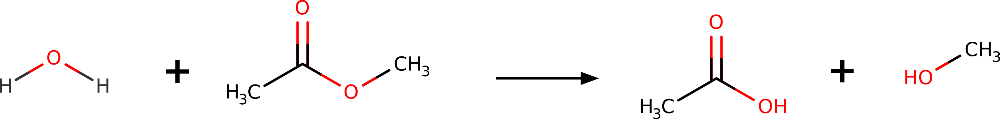
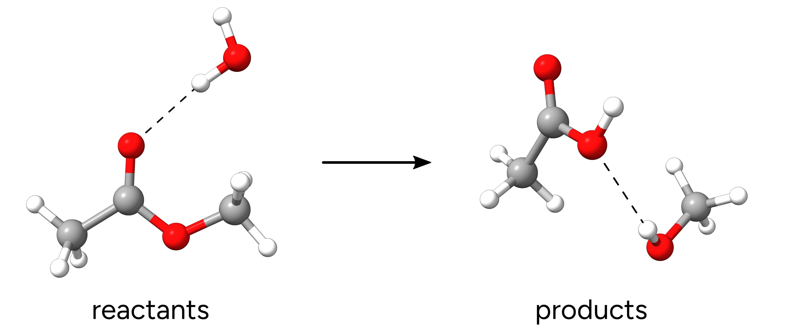
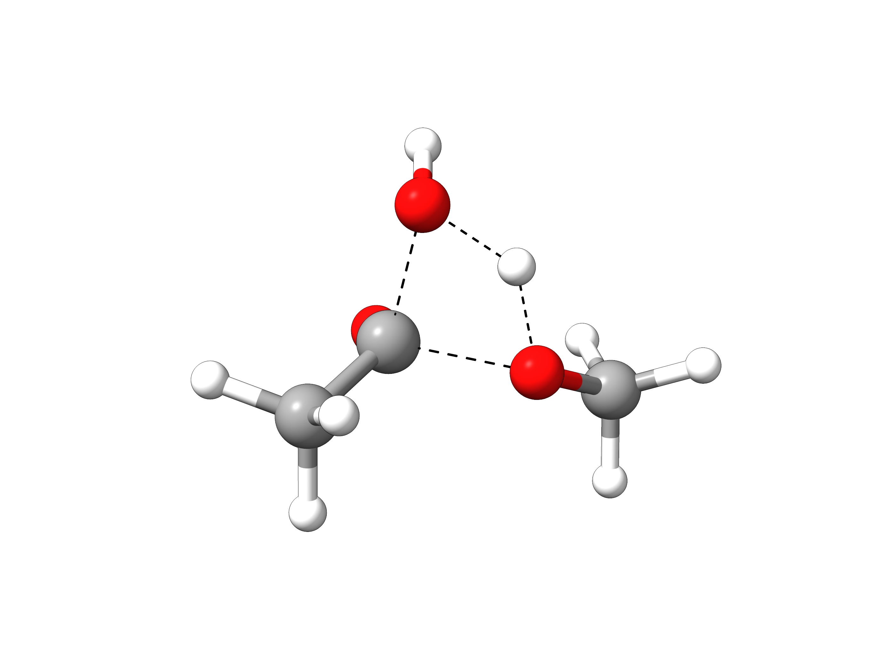
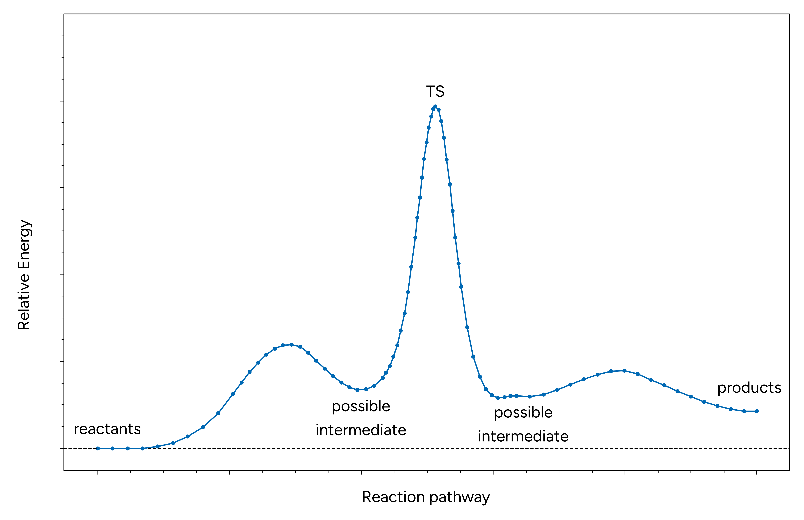

# 用 NEB-TS 寻找过渡态

假设你想预测乙酸甲酯水解生成乙酸和甲醇的过渡态（transition state, TS）：

[](../images/react_2d.png)

*图：乙酸甲酯的水解反应。*

也许你需要研究反应机理，甚至计算 $\Delta G^\ddagger$ 并尝试预测反应速率。如何用理论做到这一点呢？

ORCA 中有一个名为 NEB-TS（Nudged Elastic Band with TS optimization，微动弹性带加过渡态优化）的黑箱方法，仅凭反应物和产物的几何结构就能找到过渡态结构！

## 定义你的反应物和产物

因此第一步是[优化](../prop/geoopt.md)"反应物"和"产物"。

> **重要**
> 请注意，反应物和产物指的是箭头左右两侧的所有物质。
> 因此，反应分子的相遇复合物必须提供在同一个结构文件中。
> 产物方面的要求也是一样。

> **提示**
> 取向合理的相遇复合物会显著提高过渡态搜索成功的概率。

在本例中，我们将使用 Grimme 高效的 PBEh-3c 复合方法。相应的输入如下：

```text
!PBEh-3c OPT
```

[](../images/reac-prod.png)

*图：优化后的反应物和产物。*

```mol
title: 反应物 水解
theme: chem311
height: 360px
representation: ball-stick
--- xyz ---
14
structure
C          -3.91182471867804     -0.29740337562449     -0.08146991239299
C          -2.55541244064569      0.30686965486155      0.14448997964370
H          -4.04778109653590     -1.17478518607501      0.55114544766598
H          -4.01760096751969     -0.62864793467515     -1.11447676001953
H          -4.68756038254056      0.42811501690492      0.14372689072078
O          -1.58890277145472     -0.55120693780504     -0.15332142945001
C          -0.24124898702283     -0.11849073979619      0.01881053299661
H          -0.00551048853087      0.73223540459326     -0.62014731745322
H           0.37809289862192     -0.96512901217128     -0.26312407178767
H          -0.03357349341397      0.15523590534200      1.05285605881498
O          -2.36577790365828      1.42614928705777      0.54645130784169
O           0.16419926236366      2.97730296461285      1.12447893057070
H          -0.05730841690068      3.84720465678396      1.45600240984125
H          -0.68288049408434      2.54915029599085      0.96617793300773
```

```mol
title: 产物 水解
theme: chem311
height: 360px
representation: ball-stick
--- xyz ---
14
structure
C          -2.95446510188526     -0.23525275443810     -0.10550187831397
C          -2.20930026825989      0.97989509541554      0.35668736033914
H          -3.59995668590411     -0.60519475737244      0.69227878475167
H          -2.26734074134479     -1.04298213356273     -0.35902842132034
H          -3.56563817887517      0.01067253660282     -0.96824180822463
O           0.06594033182687     -1.89635100025044      0.33206273764187
C           0.96141448329986     -1.23467580278127     -0.52101365975636
H           0.50574570186175     -0.39870488204523     -1.06652943738273
H           1.30859855820204     -1.95448015263317     -1.26125442630102
H           1.84593979621532     -0.84847254373077     -0.00020954863231
O          -2.31618373645267      2.08782431296547     -0.08278492123435
O          -1.36964775834650      0.69085118655374      1.37267097866883
H          -0.93013901170627      1.50922486419084      1.64014730723366
H          -0.23867738863116     -1.26789396891424      0.99098693253054
```

> **重要**
> 为了使 NEB-TS 正常工作，反应物和产物几何结构中的**原子编号必须一致**。也就是说，反应物中某个给定的碳原子，在产物的 xyz 表中应当具有相同的顺序。保证这一点的最佳方式是从一个几何结构出发，复制一份并移动原子来画出下一个结构。

> **注意**
> 如果使用 Avogadro，必须禁用 `Adjust Hydrogen` 功能，否则断键时原子会被自动放置，而且不一定是你想要的位置。

## NEB-TS 输入

有了优化好的反应物和产物，我们就可以创建 NEB-TS 输入，它非常简单。NEB-TS 通过 `NEB-TS` 关键词请求，所有其他设置都在 `%NEB` 块中定义。为了验证我们可能找到的过渡态是否合理，我们还请求最后进行一次[振动频率](../prop/freq.md)计算。

```text
!PBEh-3c NEB-TS FREQ

%NEB 
 NEB_END_XYZFILE "product.xyz" 
END

*XYZFILE 0 1 reactant.xyz
```

如果你也有一个潜在过渡态的猜测结构，可以这样包含进来：

```text
!PBEh-3c NEB-TS FREQ

%NEB 
 NEB_END_XYZFILE "product.xyz"
 NEB_TS_XYZFILE "guessTS.xyz"
END

* XYZFILE 0 1 reactant.xyz
```

> **重要**
> 请确保产物和反应物结构是在与 NEB-TS 运行所选水平相同的理论水平下优化的。这可以通过随后的 `!OPT` 运行完成，或者在 `%NEB` 块中设置 `%NEB PREOPT TRUE END`。也可以使用 `%NEB FREE_END TRUE END` 来进行自由端 NEB-TS 计算。

> **重要**
> 请注意，默认情况下 ORCA 会在随后的过渡态优化中使用近似 Hessian！这在更复杂的过渡态情形下可能引起问题，此时可能需要计算精确 Hessian。这可以通过在输入中加入 `%GEOM CALC_HESS TRUE` 来实现。

## 运行 NEB-TS

输入设置好后，我们就可以开始 NEB-TS 计算。最初的输出包含该方法的一些细节。

```text
----------------------
NEB settings
----------------------
Method type                             ....  climbing image
Threshold for climbing image            ....  2.00e-02 Eh/Bohr
Free endpoints                          ....  off
Tangent type                            ....  improved
Number of intermediate images           ....  8
Number of images free to move           ....  8
Spring type for image distribution      ....  distance between adjacent images
Spring constant                         ....  energy weighted (0.0100 -to- 0.1000) Eh/Bohr^2
Spring force perp. to the path          ....  none
Generation of initial path              ....  image dependent pair potential
Initial path via TS guess               ....  off
[...]
```

接下来是构建初始路径：

```text
Generation of  the initial path:
Two fragments detected in initial structure. Preparing initial structure... Done
Minimize RMSD between reactant and product configurations     .... done
       RMSD before minimization         ....  2.1833 Bohr
       RMSD after minimization          ....  1.7369 Bohr
Performing linear interpolation         ....  done
Fragment preparation                           ....  true
Bond cutoff factor                             ....  1.200e+00
Max. fragment distance                         ....  3.500e+00 Ang.
Interpolation using                            ....  IDPP (Image Dependent Pair Potential)
IDPP-Settings:
       Initial path for IDPP optimization      ....  Linear interpolation
       Pairwise distance interpolation         ....  Linear
       Remove global transl. and rot.          ....  true
       Convergence tolerance                   ....  0.0100 1/Ang.^3
       Max. number of iterations               ....    7000
       Spring constant                         ....  1.0000 1/Ang.^4
       Time step                               ....  0.0100 fs
       Max. movement per iteration             ....  0.0500 Ang.
       Full print                              ....  false
idpp initial path generation successfully converged in 130 iterations
Displacement along initial path:             12.1839 Bohr
Writing initial trajectory to file      ....  nebts_initial_path_trj.xyz
```

初始路径保存在 `basename_initial_path_trj.xyz` 中，建议检查它是否合理。在本例中，我们得到如下八个"映像"的序列：


*动画：来自 NEB-TS 的初始路径映像。*

看起来是合理的：质子从水转移到甲醇，同时甲醇离去。

> **注意**
> 轨迹文件就是依次包含多个结构的 multixyz 文件。Chemcraft、Molden 和一些其他软件可以直接打开它们。Avogadro 需要进入 "Extensions" -> "Animation..."，然后就可以打开该文件，甚至可以播放动画。

然后，迭代过程开始：

```text
Starting iterations:

Optim.  Iteration  HEI  E(HEI)-E(0)  max(|Fp|)   RMS(Fp)    dS 
Switch-on CI threshold               0.020000
   LBFGS     0      5    0.372340    0.129615   0.029150  12.1839
   LBFGS     1      5    0.352980    0.104320   0.024586  12.1349       
   LBFGS     2      5    0.340743    0.140351   0.026619  12.1315
   LBFGS     3      5    0.326472    0.097524   0.019838  12.1426
[...]
```

在一定收敛之后，会找到一个"爬坡映像"（climbing image, CI）：

```text
Image  6 will be converted to a climbing image in the next iteration (max(|Fp|) < 0.0200)

Optim.  Iteration  CI   E(CI)-E(0)   max(|Fp|)   RMS(Fp)    dS     max(|FCI|)   RMS(FCI)
Convergence thresholds               0.020000   0.010000            0.002000    0.001000
   LBFGS    49      6    0.130964    0.016940   0.003526  15.3056    0.017426    0.005167
   LBFGS    50      6    0.129316    0.045416   0.007419  15.4226    0.040132    0.010358
   LBFGS    51      6    0.126481    0.067751   0.011014  15.6647    0.050468    0.013683
   LBFGS    52      6    0.124766    0.022067   0.004391  15.6905    0.022698    0.006567
[...]
```

这是我们对过渡态最终结构的第一次猜测。

## 过渡态的优化

经过若干次迭代后，NEB-CI 收敛：

```text
.--------------------.
          ----------------------| CI-NEB convergence |-------------------------
          Item                value                   Tolerance       Converged 
          ---------------------------------------------------------------------
          RMS(Fp)             0.0013467524            0.0100000000      YES
          MAX(|Fp|)           0.0142691584            0.0200000000      YES
          RMS(FCI)            0.0006034194            0.0010000000      YES
          MAX(|FCI|)          0.0016044259            0.0020000000      YES
          ---------------------------------------------------------------------  

The elastic band and climbing image have converged successfully to a MEP in 102 iterations!

                    *********************H U R R A Y*********************
                    ***        THE NEB OPTIMIZATION HAS CONVERGED     ***
                    *****************************************************
```

随后过渡态优化开始。首先，利用之前 NEB 的信息构建一个猜测 Hessian 矩阵，并启动鞍点搜索。

当过渡态完全优化后，会打印整个 NEB-TS 的总结：

```text
***********************HURRAY************************
                    ***        THE TS OPTIMIZATION HAS CONVERGED      ***
                    *****************************************************

          
          
---------------------------------------------------------------
                      PATH SUMMARY FOR NEB-TS             
---------------------------------------------------------------
All forces in Eh/Bohr. Global forces for TS.

Image     E(Eh)   dE(kcal/mol)  max(|Fp|)  RMS(Fp)
  0    -344.08225     0.00       0.00014   0.00003
  1    -344.07675     3.45       0.00232   0.00071 
  2    -344.07387     5.26       0.01427   0.00363
  3    -344.07067     7.27       0.00282   0.00105
  4    -344.04841    21.23       0.00130   0.00058
  5    -344.01506    42.16       0.00124   0.00056
  6    -343.99728    53.32       0.00150   0.00060 <= CI
 TS    -343.99864    52.47       0.00013   0.00005 <= TS
  7    -344.03091    32.22       0.00151   0.00061 
  8    -344.06788     9.02       0.00179   0.00073
  9    -344.07676     3.45       0.00026   0.00009
```

然后计算过渡态的频率，以验证它是否只有一个负频率。本例的结果是：

```text
-----------------------
VIBRATIONAL FREQUENCIES
-----------------------

Scaling factor for frequencies =  1.000000000  (already applied!)

     0:       0.00 cm**-1
     1:       0.00 cm**-1
     2:       0.00 cm**-1
     3:       0.00 cm**-1 
     4:       0.00 cm**-1
     5:       0.00 cm**-1
     6:   -1192.35 cm**-1 ***imaginary mode***   
     7:      40.41 cm**-1
     8:     136.38 cm**-1
     9:     209.70 cm**-1
[...]
```

证明优化后的过渡态结构确实是一个鞍点。

从反应物到产物的最终轨迹可以从 `basename_MEP_trj.xyz` 中读取，保存在 `basename_NEB-TS_converged.xyz` 中的最终过渡态几何结构为：

[](../images/ts1.png)

*图：优化后的过渡态结构。*

可以看到，该过渡态具有一个四面体碳原子，正如实验机理所预期的那样，并且质子向离去的甲氧基发生协同转移。

> **注意**
> 为简化说明，该计算是在气相中进行的。如果包含溶剂，机理将更为复杂，质子转移有可能通过一个外部水分子发生。

## 可能的中间体

在 NEB-CI 过程中，可能会出现如下信息：

```text
Possible intermediate minimum found at image(s): 7
  => have a look at the .interp file.
  => it is often a good idea to divide the path calculation into smaller fragments.
```

该信息表明在反应路径上检测到了一个局部极小点。实际上，可能还不止一个。如果情况如下面示例反应势能图所示，就应考虑进一步优化这些中间体，并重新运行 NEB-TS 来定位连接它们的过渡态，从而获得反应机理的完整图景。

[](../images/interp-2.png)

*图：含两个中间体的示例反应路径。*

## NEB 的变体

尽管默认的 NEB-TS 对大多数任务来说都是良好而稳健的选择，ORCA 中还实现了一些变体，可在更特殊的挑战或效率需求方面提供帮助：

- **`FAST-NEB-TS`**

  - 用于非常快速筛选的选项，通常足以处理定义明确的跃迁和相对较高的势垒。
- **`LOOSE-NEB-TS`**

  - 使用 NEB-TS 论文中默认收敛判据的选项。
- **`TIGHT-NEB-TS`**

  - 收敛判据更严格的选项（适用于平缓的过渡态）。
- **`ZOOM-NEB-TS`**

  - 自动两步流程，适用于陡峭/尖锐的过渡态：1. 进行 CI-NEB 计算以大致收敛最小能量路径（MEP），并在能量极大值附近创建一组新的映像；2. 从这条新路径出发进行自由端 CI-NEB 计算。

为了比较这些 NEB-TS 的"口味"，我们可以用下面的输入（配合不同的 NEB-TS 选项）考察一个[叠氮-炔烃 Huisgen 环加成反应](https://en.wikipedia.org/wiki/Azide-alkyne_Huisgen_cycloaddition)。

```text
!r2SCAN-3c FAST-NEB-TS FREQ PAL4

%NEB 
 NEB_END_XYZFILE "product.xyz" 
END

*XYZFILE 0 1 reactant.xyz
```

```mol
title: 反应物 Huisgen 环加成
theme: chem311
height: 360px
representation: ball-stick
--- xyz ---
14
structure
N          -1.14346110096689      0.50116480655462      0.91141647055235
N           0.06911542015431      0.47459932328925      0.75161037575465
N           1.20525581883840      0.42822863452117      0.72590428949488
C          -1.95283194677139      0.35529952593245     -0.31606475238963
H          -1.73277196311495     -0.59193662680300     -0.82438944122805
H          -2.99723343711262      0.35970799491328     -0.00263315163949
H          -1.78684038604877      1.19154452356692     -1.00722240394814
C          -0.62594916519367     -2.87268209959617      0.67069727182037
C           0.46629082151838     -2.85717147445571      0.16332578805722
H          -1.58061802724523     -2.87214331269831      1.13816431353644
C           1.78485933175982     -2.84510056683519     -0.43784052822072
H           2.54348404200474     -3.14953961836553      0.29055540880420
H           1.83558186280726     -3.52837928179351     -1.29184593031030
H           2.04397377077063     -1.83870071923024     -0.78234038558379
```

```mol
title: 产物 Huisgen 环加成
theme: chem311
height: 360px
representation: ball-stick
--- xyz ---
14
structure
N          -0.92586823552493     -0.10069433632158     -0.11899662289894
N           0.19408753279655      0.60558138495038     -0.35980123595515
N           1.19815186914064     -0.22531751256977     -0.32838839167046
C          -2.21948847916704      0.55737137779614     -0.09066384558336
H          -2.88057374866644      0.13811352279228     -0.85598195571335
H          -2.68594258361546      0.44699067517436      0.89372717927794
H          -2.05256190946873      1.61627648028350     -0.29546147502317
C          -0.63127031270948     -1.41215051290495      0.07042659924314
C           0.73717006700411     -1.48379997945437     -0.06583241126031
H          -1.38683998332593     -2.15552751365918      0.27758097755181
C           1.65115285739964     -2.65579748695372      0.03231269785265
H           2.38112162665496     -2.51197066739300      0.83535425809547
H           1.09146364401807     -3.57256735850174      0.23418107893136
H           2.21033422346404     -2.78909902003832     -0.89920507904762
```

对于该反应，所有 NEB-TS 变体都成功定位并优化了过渡态，最终结构几乎完全相同。所有结构得到的虚频相近，进一步证实了这一点。

就计算时间而言，`FAST-NEB-TS` 明显快于其他方法；但代价是对于更复杂体系稳健性有所下降。对于这个特定反应，`ZOOM-NEB-TS` 所需计算时间略少于 `LOOSE-NEB-TS`，但由于其专门化的工作流程，预计它能以更高的概率成功优化过渡态，即使是对过渡态区域陡峭的困难体系也是如此。请注意，相对计算时间可能随所研究反应的性质及相应的过渡态优化而有所不同。

[](../images/nebts_flavors_ts.png)

*图：不同 NEB-TS 变体所得优化过渡态的叠加。*

| 方法 | 过渡态已优化 | 虚频 / cm$^{-1}$ | 计算时间 / 分钟 |
| --- | --- | --- | --- |
| `FAST-NEB-TS` | ✓ | -412.21 | 7.3 |
| `LOOSE-NEB-TS` | ✓ | -410.02 | 22.3 |
| `TIGHT-NEB-TS` | ✓ | -413.41 | 47.3 |
| `ZOOM-NEB-TS` | ✓ | -415.35 | 18.6 |

## 激发态的 NEB

NEB 和 NEB-TS 算法也可以与 TD-DFT 结合用于激发态。为此，只需在输入中加入相应的 `%tddft` 块：

```text
! NEB-TS

%NEB
 PRODUCT "product.xyz"
END
%TDDFT
 NROOTS 1
 IROOT 1
END
```
