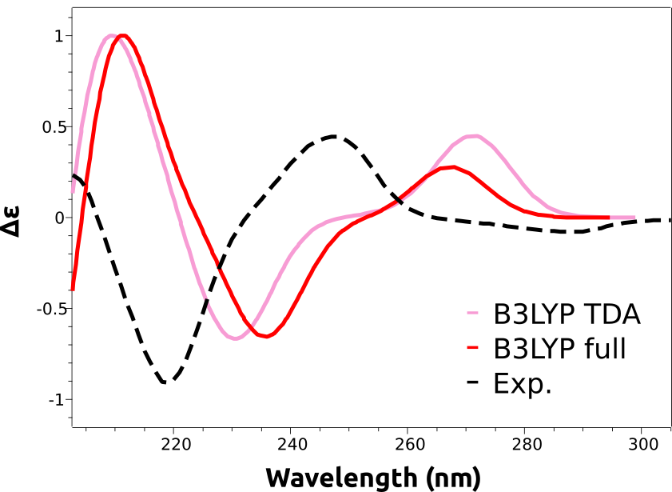
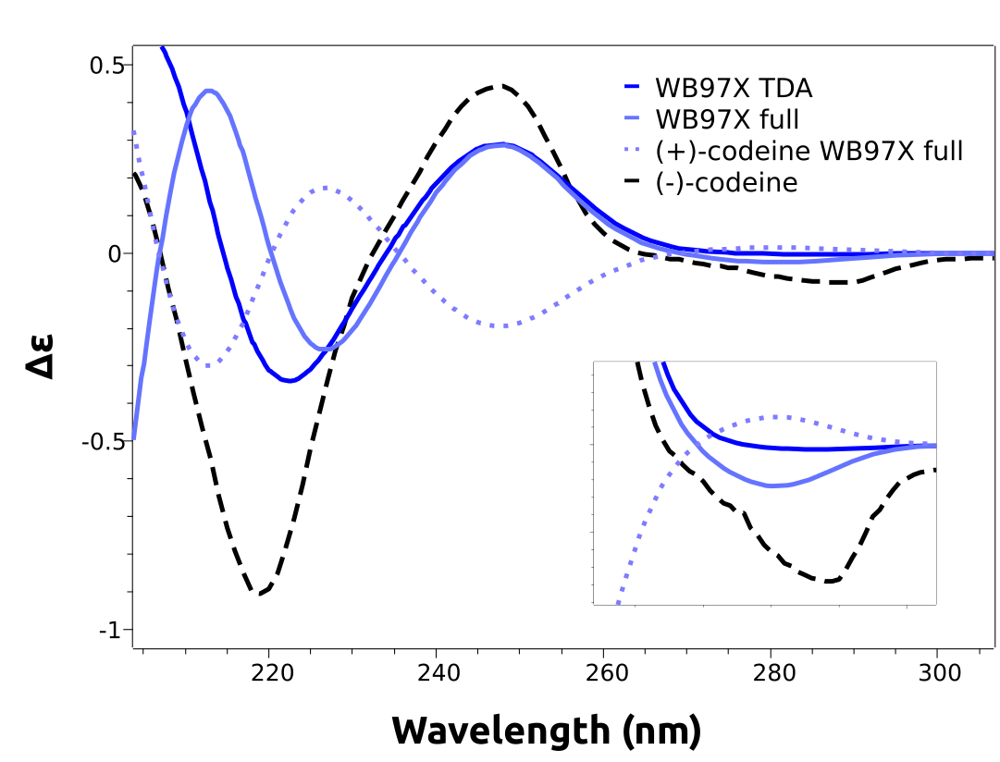

# 电子圆二色谱（ECD）

电子圆二色谱（electronic circular dichroism, ECD）是一种与紫外-可见光谱（UV/Vis spectroscopy）密切相关的方法，它使用圆偏振光而非"常规"非偏振光，在鉴定手性化合物方面极为有用。

举个例子，假设你需要确定某个化合物的绝对构型，例如阿片类药物可待因（codeine）。它可以以 (+) 或 (-) 异构体的形式获得，假如没有其他结构证据，你能做些什么呢？

[](../images/cod_struct.png)

```mol
title: (-)-可待因
theme: chem311
height: 360px
representation: ball-stick
--- xyz ---
44
structure
C          0.27861       -2.51771       -1.18929
C          1.62027       -2.60915       -0.76912
C          2.22334       -1.60792        0.00987
O          3.54007       -1.82025        0.28510
C          1.43672       -0.52943        0.36578
O          1.82325        0.61959        1.00916
C          0.09858       -0.48519        0.01418
C         -0.55354        0.74611        0.55554
C          0.72840        1.57467        0.78794
C          1.08903        2.56775       -0.35541
O          2.47118        2.53561       -0.68410
C          0.30918        2.41405       -1.62915
C         -0.90175        1.83953       -1.69766
C         -1.56787        1.27202       -0.47255
C         -2.56293        0.10674       -0.76050
N         -3.31366       -0.16885        0.56397
C         -4.50113       -1.08483        0.41229
C         -2.41884       -0.59039        1.70688
C         -1.27044        0.40261        1.87918
C         -1.88442       -1.17437       -1.33429
C         -0.50047       -1.42947       -0.80310
C          4.17091       -0.93416        1.20079
H         -0.12034       -3.29174       -1.84231
H          2.21941       -3.46198       -1.08750
H          0.64670        2.15619        1.71529
H          0.88257        3.58363        0.00417
H          2.81653        1.66581       -0.40960
H          0.75014        2.85301       -2.52332
H         -1.42425        1.82856       -2.65248
H         -2.13625        2.10396       -0.03138
H         -3.34042        0.44534       -1.45658
H         -5.10054       -0.72966       -0.42961
H         -5.08559       -1.02485        1.33453
H         -4.15126       -2.10599        0.24932
H         -2.06881       -1.60774        1.50636
H         -3.03858       -0.61066        2.61016
H         -1.66742        1.32913        2.31529
H         -0.56791       -0.00565        2.61746
H         -2.50583       -2.06189       -1.18461
H         -1.78792       -1.03545       -2.41928
H          5.17371       -1.32388        1.40176
H          3.63531       -0.89593        2.15499
H          4.28807        0.06211        0.76383
H         -3.72689        0.73229        0.84204
```

- (+)-可待因通过反射得到！

(-) 异构体是具有重要医疗应用的那种，因此可能需要确定哪个化合物对应哪种三维结构。借助 ORCA 理论计算可以解决这个问题：测量纯化合物的 ECD 光谱，并与预测光谱进行比较。

## 预测 ECD 光谱

让我们尝试用 TD-DFT 预测两种对映体在水中的 ECD 光谱，从 (-)-可待因开始，该分子近期已在文献中被研究过 [[Horváth2016]](../bib.md#horvath2016)。

> **重要**
> 从 TD-DFT 获得 ECD 光谱的主要步骤与 UV/Vis 相同。请先阅读相关的[紫外-可见光谱（UV/Vis）](../spec/UVVis.md#uvvis)一节，然后再继续。此后将默认你已了解这些内容。

第一步是绘制并优化该分子的正确几何结构：

```text
!B3LYP DEF2-TZVP D4 OPT FREQ CPCM(WATER)
* XYZFILE 1 1 minuscodeine_guess.xyz
```

这里我们使用 +1 电荷，因为我们想重现这种生物碱在水中的光谱，其 pKa 约为 8。需要在上述结构的氮基团上添加一个质子，以考虑 pH 7 下的质子化。

当请求 TD-DFT 计算时，ECD 光谱会自动计算，因此输入遵循相同的原则：

```text
!B3LYP DEF2-TZVP CPCM(WATER)
%TDDFT
      NROOTS  25
END
* XYZFILE 1 1 codeine_optimized.xyz
```

作为考虑水对电子结构影响的[溶剂化模型](../prop/cpcm.md)，基态将使用 CPCM 模型，激发态使用 LR-CPCM（它随 !CPCM 自动选择）。

> **注意**
> 极性溶剂对带电分子的激发态可能有很大影响，在这种情况下不要忘记考虑它们！

由于 ECD 对预测的跃迁强度特别敏感，我们还将使用完整的 TD-DFT 而不是默认的 TDA 近似来进行计算。一般来说，TDA 更稳定并能给出可靠结果，但使用完整 TD-DFT 时 ECD 的预测往往更好。输入如下：

```text
!B3LYP DEF2-TZVP CPCM(WATER)
%TDDFT
      NROOTS  25
      TDA     FALSE
END
* XYZFILE 1 1 codeine_optimized.xyz
```

其中现在加入了 TDA FALSE 来关闭它。

输出与之前 UV-Vis 中所示的完全一样，最后会打印出 ECD"光谱"：

```text
-------------------------------------------------------------------
                             CD SPECTRUM
-------------------------------------------------------------------
State  Energy     Wavelength     R         MX        MY        MZ
       (cm-1)       (nm)     (1e40*cgs)   (au)      (au)      (au)
-------------------------------------------------------------------
   1   38539.1    259.5     -7.97318  -0.08936  -0.09057   0.28910
   2   39977.7    250.1     32.07887   0.18900  -0.02049  -0.22614
   3   43324.1    230.8     12.30861  -0.09352  -0.02155   0.30521
   4   44246.4    226.0    -85.09304   0.38524   0.23404  -0.59099
   5   46657.1    214.3     50.33474   0.08844  -0.07182   0.09990
```

如你所见，激发态后面跟着它们的能量、激发的 R 值（与 ECD 强度成正比）以及磁偶极矩的分量。关于这些态的更详细描述可以从[激发态分析](../spec/UVVis.md#tddftesanalysis)中获得。

## 平移预测光谱

计算完成后，可以按照[绘制计算光谱](../spec/UVVis.md#plotuvspec)中描述的类似方式绘制光谱，只是需要在左侧下拉菜单中选择"CD"。结果如下：

[](../images/b3lyp.png)

如你所见，主要特征都得到了重现，只是计算光谱向右平移了。这是这些预测中的常见情况，是由计算激发态能量的预期误差引起的。这些误差通常是相当系统性的，可以通过对预测进行反向平移来消除：

[](../images/b3lyp_shifted.png)

现在 250 nm 和 220 nm 附近的两个峰都与实验结果一致了。

> **重要**
> 平移量不是以纳米为单位给出的，而是以能量单位给出的，因为波长与能量并不成正比。尽管在文献中很常见，但在波长尺度上施加平移并没有太大意义，因为每个峰的能量校正是不同的！

## 比较泛函

仔细观察预测光谱会发现，它们缺少低能区的负谱带，而正是这个负谱带导致了该立体异构体名称中的 (-)。这是 B3LYP 泛函造成的错误，无法*先验*得知。

我们可以做的是使用更高水平的无经验参数方法，如 [DLPNO-STEOM](../spec/UVVis.md)，或者换用其他泛函，这也是我们在这里要做的。根据 [[Horváth2016]](../bib.md#horvath2016) 的参考文献，范围分离泛函在这个案例中应该效果更好。因此我们可以尝试现代的 wB97x 泛函：

```text
!wB97X DEF2-TZVP CPCM(WATER)
%TDDFT
      NROOTS  25
END
* XYZFILE 1 1 codeine_optimized.xyz
```

分别使用 TDA 和完整 TD-DFT 进行计算。结果（已包含必要的平移）符合得好多了：

[](../images/wb_shifted.png)

如你所见，低能谱带现在被正确预测了。我们甚至还绘制了另一个立体异构体 (+)-可待因的计算光谱，其模拟光谱确实几乎是 (-)-可待因的镜像，与实验结果一致。

> **注意**
> 寻找立体异构体时无需重新优化几何结构。可以很容易地生成它们：选择一个坐标轴（例如 z 轴），并将沿该轴的所有坐标分量乘以 -1。这相当于对 xy 平面做一次反射，从而生成目标分子的"镜像"。

> **重要**
> ECD 光谱对微小的几何变化非常敏感！通常只有计算低能构象并进行玻尔兹曼求和，才能得到接近实验的结果。在本例中，分子相当刚性，问题被降到了最低限度，但通常并非如此。
