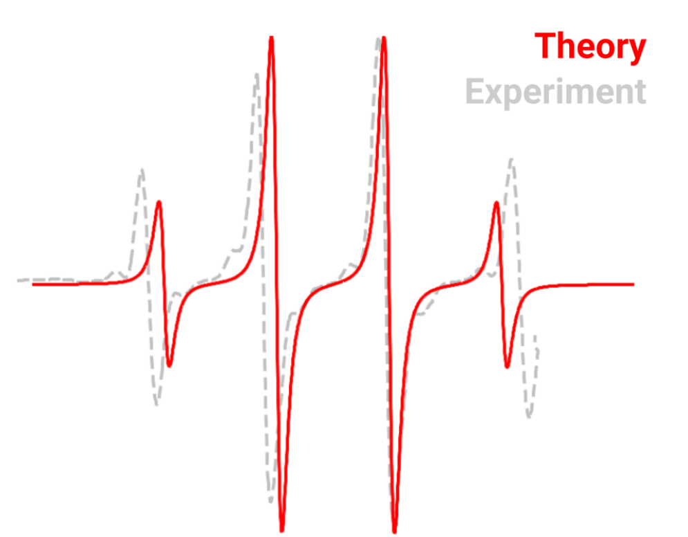
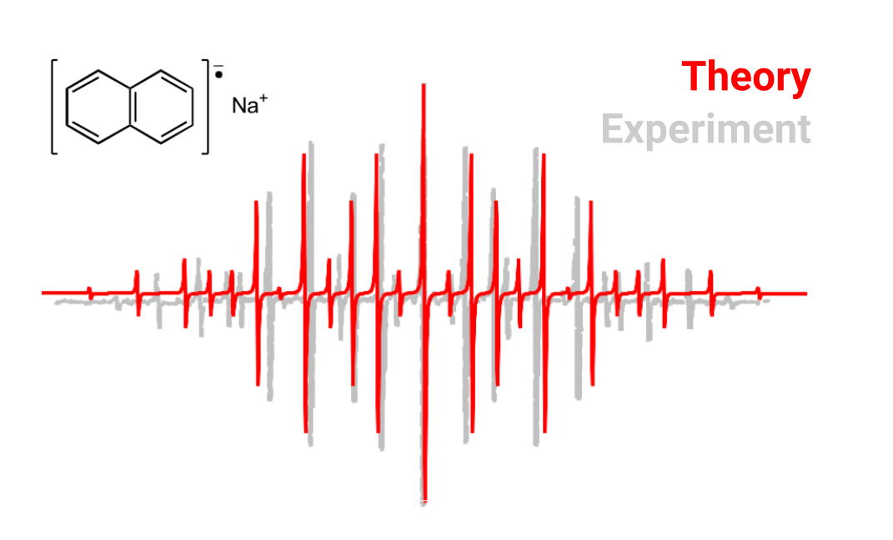
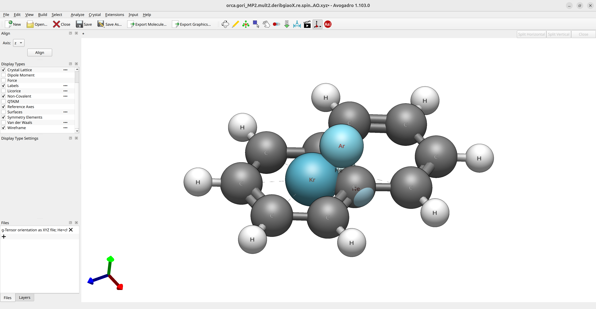
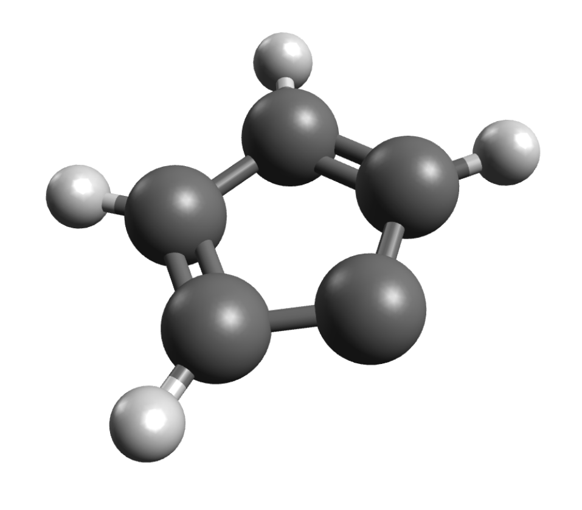

# 电子顺磁共振（EPR）

这里我们将演示使用 ORCA 预测电子顺磁共振（electron paramagnetic resonance, EPR）性质和光谱的基础知识，它甚至可以包含许多所涉及的复杂因素，如自旋轨道耦合（spin-orbit coupling, SOC）及其他相对论效应。

## $CH_3$ 自由基

甲基自由基是一个平面分子，其平面性部分由 EPR 谱学所证实。它的 $g$ 值为 $2.0025$ [[Gordy1966]](../bib.md#gordy1966)，超精细耦合（hyperfine coupling, HFC）为 $A_{xx} = -31.4, A_{yy} = -93.7   ,$ 和 $A_{zz} = -60.30$ MHz [[Dmitriev2004]](../bib.md#dmitriev2004)，让我们尝试从第一性原理来预测它！

首先，可以用以下方式优化几何结构：

```mol
title: EPR #1
theme: chem311
height: 360px
representation: ball-stick
--- xyz ---
4
structure
C   3.20276693914010      2.91777006829308     -1.46614904250634
H   4.21682401439677      3.22254500904168     -1.25560882817865
H   2.69109288861722      3.31313693290047     -2.33037576806431
H   2.69057615784592      2.24676798976475     -0.79431636125068
--- input ---
!B3LYP DEF2-TZVP OPT
* xyz 0 2
C   3.20276693914010      2.91777006829308     -1.46614904250634
H   4.21682401439677      3.22254500904168     -1.25560882817865
H   2.69109288861722      3.31313693290047     -2.33037576806431
H   2.69057615784592      2.24676798976475     -0.79431636125068
*
```

如预期那样，你会得到平面三角形的坐标：

[](../images/ch3.png)

下一步是计算 EPR 性质，这可以通过设置 `%EPRNMR` 选项来完成。

> **重要**
> 这些是 ORCA 输入中唯一应该放在几何结构部分**之后**的选项，绝不要放在其前。

一个用 B3LYP 泛函计算氢原子的 *g* 张量和 HFC 的输入可以是：

```text
!B3LYP EPR-II AUTOAUX
* XYZFILE 0 2 CH3_opt.xyz
%EPRNMR
        GTENSOR   TRUE
        NUCLEI    = ALL H {AISO, ADIP, AORB}
END
```

对此需要做一些说明：

- `GTENSOR` 标志必须设置为 TRUE 才能计算它，默认为 `FALSE`。
- `NUCLEI` 定义进行 HFC 计算的原子。ALL H 计算所有氢原子上的 HFC，或用 ALL N、ALL C 等来指定不同原子。你也可以用 `NUCLEI = 1,5,8`，即**按原子类型**各给一个列表，原子编号从 1 开始。
- `AISO`、`ADIP`. 和 `AORB` 标志分别请求 HFC 的各向同性部分、其偶极部分以及来自 SOC 的二阶贡献。
- `AORB` 项计算代价高昂，但对没有重原子的有机分子贡献很小，在这些情况下可以忽略。
- 计算 EPR 性质推荐使用大基组。这里我们使用了专用基组 EPR-II，更多信息可以查阅 [ORCA 手册](https://www.faccts.de/docs/orca/manual)。
- 自旋轨道耦合积分默认使用 SOMF(1X) [[Neese2005]](../bib.md#neese2005) 方法计算，但也有更高效的选项可用。

> **警告**
> 如果你使用原子列表（如 NUCLEI = 1,5,8），每种原子类型都应有一个列表！

### 输出文件

成功的单点计算之后，第一步是计算用于 SOC 处理的积分：

```text
------------------------------------------------------------------------------
                      ORCA SPIN-ORBIT COUPLING CALCULATION
------------------------------------------------------------------------------

GBW file                                    ... epr.gbw
Input density                               ... epr.scfp
Output integrals                            ... epr
Operator type                               ... Mean-field/Effective potential
   One-Electron Terms                       ... 1
   Coulomb Contribution                     ... 2
   Exchange Contribution                    ... 3
   Correlation Contribution                 ... 0
   Maximum number of centers                ... 4
```

然后是：

```text
------------------------------------------------------------------------------
                              ORCA EPR/NMR CALCULATION
------------------------------------------------------------------------------

GBWName                      ... epr.gbw
Electron density file        ... epr.scfp
Spin density file            ... epr.scfr
Spin-orbit integrals         ... epr
Origin for angular momentum  ... Center of electronic charge
Coordinates of the origin    ...    6.05064281    5.51881078   -2.76743570 (bohrs)
```

请注意，这里的 `Origin for angular momentum`（角动量原点）是 `Center of electronic charge`（电子电荷中心），这意味着这些结果**不是**规范不变的，可能随你的坐标而改变。

通常，在基组足够大时，结果应该几乎是不变的，但如果想要精确结果，就需要规范无关原子轨道（gauge-invariant atomic orbitals, GIAOs）[[Ditchfield1973]](../bib.md#ditchfield1973), [[Pulay1990]](../bib.md#pulay1990)。它们可以从所有基组构建，要使用它们，只需在 %EPRNMR 部分添加 `ORI GIAO`：

```text
%EPRNMR
        GTENSOR   TRUE
        NUCLEI    = ALL H {AISO, ADIP, AORB}
        ORI       GIAO
END
```

> **注意**
> 涉及 GIAO 的积分计算比常规的昂贵得多，所以请做好计算时间更长的准备。

### *g* 张量

如果接下来的 CP-SCF 收敛，你将得到 *g* 张量矩阵：

```text
-------------------
ELECTRONIC G-MATRIX
-------------------

      The g-matrix:
                   2.0027537    0.0001534    0.0001065
                   0.0001534    2.0024625   -0.0002479
                   0.0001065   -0.0002479    2.0026476

      gel          2.0023193    2.0023193    2.0023193
      gRMC        -0.0001271   -0.0001271   -0.0001271
      gDSO(tot)    0.0000289    0.0000680    0.0000680
      gPSO(tot)    0.0000034    0.0005594    0.0005595
                  ----------   ----------   ----------
      g(tot)       2.0022245    2.0028196    2.0028196 iso=  2.0026213
      Delta-g     -0.0000948    0.0005003    0.0005004 iso=  0.0003020
```

这里给出了 *g* 张量的分量（见 [[Neese2001]](../bib.md#neese2001)），x、y 和 z 方向的总分量打印在 `g(tot)` 之后，其后是各向同性值。所示的 `Delta-g` 是与自由电子 g 值之差。

如你所见，考虑到我们完全忽略了任何基质效应，预测值已经相当接近实验值，而且它与自由电子的最大偏差来自 SOC 效应，正如 Gordy 所指出的 [[Gordy1966]](../bib.md#gordy1966)。

### 超精细耦合

*g* 张量计算之后，是每个原子的 HFC：

```text
-----------------------------------------
ELECTRIC AND MAGNETIC HYPERFINE STRUCTURE
-----------------------------------------

-----------------------------------------------------------
Nucleus   1H : A:ISTP=    1 I=  0.5 P=533.5514 MHz/au**3
               Q:ISTP=    2 I=  1.0 Q=  0.0029 barn
-----------------------------------------------------------
Solving for nuclear perturbation:
Forming RHS of the CP-SCF equations         ...
```

这里 `I=` 表示该给定原子的自旋，`P=` 是所用的比例因子 $\mu_e \mu_N \beta_e \beta_N$。之后，又请求了一次 CP-SCF 求解，并打印出 HFC 信息：

```text
Raw HFC matrix (all values in MHz):
-----------------------------------
              -30.0552              10.8247               7.4998
               10.8247             -77.0049              20.6090
                7.4998              20.6090             -92.4037

A(FC)         -66.5005             -66.5005             -66.5005
A(SD)          41.0835              -0.8524             -40.2311
A(ORB+DIA)      0.0114              -0.0006               0.0271    A(PC) =   0.0126
A(ORB)          0.0065               0.0006               0.0258    A(PC) =   0.0109
A(DIA)          0.0050              -0.0012               0.0013    A(PC) =   0.0017
            ----------           ----------           ----------
A(Tot)        -25.4056             -67.3536            -106.7045    A(iso)=  -66.4879
```

同样，各个分量被打印出来，最后显示 `A(iso)`。如你所见，结果与实验数据吻合得相当好。

在最末尾，打印出 ORCA EULER 输出，其中包含关于 g 张量与 HFC 之间相对角度的信息，它们在计算中具有任意的关系：

```text
-------------------------------------------------------------------------
          Euler rotation of hyperfine tensor to g-tensor
-------------------------------------------------------------------------

-------------------------------------------------------------------
 Atom  |   Alpha    Beta    Gamma   |   Ax       Ay       Az
       |          [degrees]         |           [MHz]
-------------------------------------------------------------------
  1H      -90.1     42.7     89.9     -67.35   -25.41  -106.70
  2H       90.0     17.4    -90.0     -67.36   -25.41  -106.71
  3H      -90.1     12.7     90.0     -67.36  -106.72   -25.42
-------------------------------------------------------------------
```

如果出于任何特定应用需要旋转其中任何一个，稍后可以使用 `orca_euler` 软件。

### 与实验的比较

总结我们的结果，下表比较了计算数据和预测数据：

| 性质 | 实验值 | 理论值 |
| --- | --- | --- |
| $g$ | 2.0025 | 2.0026 |
| $A_{xx}$ | -31.4 | -25.4 |
| $A_{yy}$ | -93.7 | -106.7 |
| $A_{zz}$ | -60.3 | -67.3 |
| $A_{iso}$ | -61.8 | -66.5 |

有了这些，就可以使用 [EasySpin](http://easyspin.org/easyspin/documentation/orca.html) 这类工具了，它已经有读取 ORCA 输出并模拟 EPR 谱的专用函数。理论预测与在 $CH_4$ 基质中 4K 下测得的 EPR 谱之间的比较如下：

[](../images/ch3_eprspec.png)

当然，由于杂质和基质效应，这里存在差异是预料之中的，而且该图已被平移以匹配 $g$。

> **重要**
> HFC 对分子的几何结构相当敏感！在计算它们之前，请确保有一个好的几何结构。

## 另一个例子：萘阴离子自由基

在非质子溶剂中并有碱金属存在时，萘等多环芳烃可以被还原形成自由基阴离子 [[Garst1971]](../bib.md#garst1971)，例如：

[](../images/NAP_anion.png)

这些会呈现出漂亮的 EPR 谱，有两组各四个质子，因而谱线更复杂。要预测其光谱，同样可以先优化阴离子的几何结构：

```text
!RI-B2PLYP DEF2-TZVP DEF2-TZVP/C TIGHTOPT
* XYZFILE -1 2 nap.xyz
```

我们使用双杂化泛函添加 RI-MP2 相关以获得更好的密度，并用 `TIGHTOPT` 获得好的对称几何结构。

现在我们运行 EPR 计算，使用专用的 EPR-III 基组和 RI-SOMF(1X) 来加速 SOC 部分的积分计算：

```text
!RI-B2PLYP EPR-III AUTOAUX RI-SOMF(1X)
* XYZFILE -1 2 nap_optimized.xyz
%eprnmr
        gtensor true
        nuclei = all H {aiso, adip, aorb}
end
```

可以对两组相似的 $H_{\alpha}$ 和 $H_{\beta}$ 耦合（由 MP2 弛豫密度计算得到）取平均，然后再次使用像 [EasySpin](http://easyspin.org/easyspin/documentation/orca.html) 这样的软件计算预测光谱并与实验比较。结果如下所示：

[](../images/NAP_spec.png)

## 可视化 *g* 张量的取向

你可以用 Avogadro 2 来可视化 *g* 张量的取向。其工作原理如下：ORCA 会打印 `basename.gori_*.xyz` 文件，其中用赝原子来表示 g 张量矢量。请注意，默认情况下，ORCA 按分量的大小对 g 张量取向排序，并以 He 为原点，$g_{min}$ 指向 He-Ne 轴，$g_{mid}$ 指向 He-Ar，$g_{max}$ 指向 He-Kr。ORCA 输出澄清了默认情况下 $g_{min}$ 对应 $g_{x}$，$g_{mid}$ 对应 $g_{y}$，$g_{max}$ 对应 $g_{z}$：

```text
g-tensor ordering              ...  |g_min> --> |gx>
                                    |g_mid> --> |gy>
                                    |g_max> --> |gz>
```

在这个例子中，我们将使用基于弛豫 MP2 密度的输出，它存储在 `basename.gori_MP2.mult2.deribgiaoX.re.spin..AO.xyz` 中。在 Avogadro 2 中的后续步骤如下：

1. 打开该文件并选择 `Align` 选项。
2. 然后选择 He-Ne 键并对齐 x 轴（红色），再按顺序对 y（He-Ar，绿色）和 z（He-Kr，蓝色）轴重复此操作。
3. 点击"Reference Axes"，即左侧 `Display Types` 的第一个选项。就是这样！
4. 如果你愿意，可以删除稀有气体原子。

[](../images/naphthalin_epr_tensor_withrgatoms.png)

## 零场分裂（ZFS）

如果你的体系有 $S>1/2$，你可能会对零场分裂（zero-field splitting, ZFS）值感兴趣。`ORCA_EPRNMR` 模块也可以用来预测这些。让我们试试环戊二烯基卡宾（cyclopentadienylidene carbene）的例子，它已知的 D 值为 $0.408 cm^{-1}$，$E/D$ 比值为 $0.046$ [[Kirmse1971]](../bib.md#kirmse1971)。首先，用以下方式优化几何结构：

```text
!B3LYP DEF2-TZVP OPT
* XYZFILE 0 3 carb.xyz
```

得到平面卡宾：

[](../images/carbene.png)

随后可以在简单的 DFT 水平上用以下方式计算 ZFS：

```text
!B3LYP EPR-II AUTOAUX UNO
* XYZFILE 0 3 carb_optimized.xyz
%EPRNMR DTENSOR SSANDSO
        DSS     UNO
        DSOC    CP
END
```

`DTENSOR` 标志要求包含 $D$ 的自旋-自旋和自旋轨道分量（`SSANDSO`），而 `DSS` 和 `DSOC` 控制具体的算法。更多信息请查阅
[ORCA 手册](https://www.faccts.de/docs/orca/manual)。

计算完与 SOC 相关的积分后，应当看到如下表头：

```text
------------------------------------------------------------------------------
                                ORCA EPR/NMR CALCULATION
------------------------------------------------------------------------------

GBWName                      ... ZFS.gbw
Electron density file        ... ZFS.scfp
Spin density file            ... ZFS.scfr
Spin-orbit integrals         ... ZFS
Multiplicity                 ... 3
g-tensor                     ... 0
NMR chemical shifts          ... 0
D-tensor                     ... spin-spin and spin-orbit
D(SS)-algorithm              ... spin-density from UNOs
D(SOC)-algorithm             ... CP (=Coupled-perturbed)
```

它说明了计算的细节。实际结果在 CP-SCF 之下：

```text
D   =     0.425943  cm**-1
E/D =     0.015874
```

考虑到我们使用的是 DFT 和单参考方法，这同样与实验接近。

> **重要**
> 这只是一个简单的演示。一般而言，从 CASSCF 或 MRCI 等多参考理论可以得到好得多的 ZFS 结果。尽管如此，这个结果仍然相当不错，而且易于应用于大体系。

## 结构

### 萘阴离子输入

```mol
title: EPR #17
theme: chem311
height: 360px
representation: ball-stick
--- xyz ---
18
structure
C          2.41963        0.74477        0.00000
C          2.44765       -0.64677       -0.00000
C          1.25295       -1.36872        0.00000
C          0.01423       -0.70692        0.00000
C         -0.01423        0.70692       -0.00000
C          1.19684        1.41804       -0.00000
C         -1.25295        1.36871        0.00000
C         -2.44765        0.64677       -0.00000
C         -2.41963       -0.74477        0.00000
C         -1.19684       -1.41804       -0.00000
H          3.34913        1.30792       -0.00000
H          3.39906       -1.17205        0.00000
H          1.29505       -2.45547       -0.00000
H          1.19516        2.50560        0.00000
H         -1.29505        2.45547       -0.00000
H         -3.39906        1.17205        0.00000
H         -3.34913       -1.30792       -0.00000
H         -1.19516       -2.50561        0.00000
```

### 萘阴离子优化结构

```mol
title: EPR #18
theme: chem311
height: 360px
representation: ball-stick
--- xyz ---
18
structure
C           2.44849761146892      0.74315010835023      0.00000642647849
C           2.47642356332595     -0.64398771559183     -0.00000409695304
C           1.27464183435983     -1.37205073931180     -0.00000815308077
C           0.01456359767340     -0.72320735552508      0.00000140553888
C          -0.01456417827701      0.72320572702380      0.00000244096960
C           1.21835930331016      1.42224984223440      0.00000548054002
C          -1.27464208650547      1.37204918341938     -0.00000362072933
C          -2.47642352292680      0.64398504763604     -0.00000674237390
C          -2.44849751298556     -0.74315249799282      0.00000899743181
C          -1.21835914212065     -1.42225248901015      0.00000755118515
H           3.37570954083871      1.30686821014789      0.00001119029674
H           3.42556924575509     -1.16994207183959     -0.00001023505141
H           1.29787534146066     -2.45750547862698     -0.00001603840844
H           1.19791026467988      2.50775980371031      0.00000709572992
H          -1.29787684947279      2.45750473809228     -0.00000824918241
H          -3.42556972453278      1.16993775718460     -0.00001606690192
H          -3.37571011247593     -1.30686976069713      0.00000967382773
H          -1.19790717357561     -2.50776230920355      0.00001294068287
```

### 环戊二烯基卡宾

```mol
title: EPR #19
theme: chem311
height: 360px
representation: ball-stick
--- xyz ---
9
structure
C         -1.73238        3.09526        0.00000
C         -2.43358        1.94496       -0.00000
C         -0.30953        2.77063        0.00000
C         -0.17373        1.43249       -0.00000
C         -1.48252        0.90001       -0.00000
H         -2.13310        4.09634        0.00000
H         -3.50614        1.82921       -0.00000
H          0.48447        3.50033        0.00000
H          0.74363        0.86480       -0.00000
```
