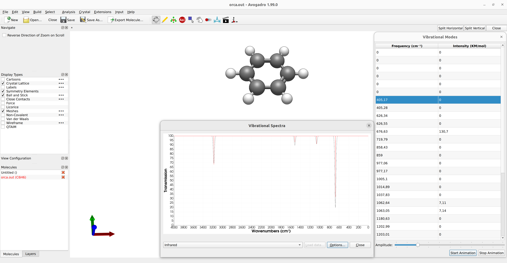

# 红外与拉曼

如今，在计算化学中预测红外（IR）和（非共振）拉曼光谱已是一项简单直接的任务。让我们用 ORCA
来预测苯的基频和强度。

[](../images/benzene.png)

*图：苯的 $D_{6h}$ 对称结构。*

```mol
title: 苯 (D6h)
theme: chem311
height: 360px
representation: ball-stick
--- xyz ---
12
structure
H       -1.242909   -2.152782    0.000000
C       -0.695566   -1.204756    0.000000
C        0.695566   -1.204756    0.000000
H        1.242909   -2.152782    0.000000
C        1.391133    0.000000    0.000000
H        2.485819    0.000000    0.000000
C        0.695566    1.204756    0.000000
H        1.242909    2.152782    0.000000
C       -0.695566    1.204756    0.000000
H       -1.242909    2.152782    0.000000
C       -1.391133    0.000000    0.000000
H       -2.485819    0.000000    0.000000
```

由于其对称性，选择定则预言这些谱带是互斥的：$A_{2u}$ 和 $E_{1u}$ 模式具有最强的红外活性（$B_{1u}, B_{2u}$ 和 $E_{2u}$ 模式强度较弱），而 $A_{1g}, E_{1g}$ 和 $E_{2g}$ 则是拉曼活性的。作为对比，完整的实验值可以在 [NIST 网站](https://webbook.nist.gov/cgi/cbook.cgi?ID=C71432&amp;Mask=800#Electronic-Spec)上找到。

## 预测红外光谱

分子结构的优化以及随后振动频率的计算（例如用 DFT）可以通过简单的关键词 `OPT` 和 `FREQ` 来调用：

```text
!BP86 DEF2-SVP OPT FREQ

*XYZFILE 0 1 structure.xyz
```

对于 Grimme 高效的 r^2SCAN-3c 组合 DFT 方法，相应的输入为：

```text
!r2SCAN-3c OPT FREQ
```

如果所选方法没有解析 Hessian 矩阵，可以使用 `NUMFREQ` 关键词来请求数值 Hessian 计算。

计算成功完成后，将会打印出振动频率：

```text
-----------------------
VIBRATIONAL FREQUENCIES
-----------------------

Scaling factor for frequencies =  1.000000000  (already applied!)

     0:       0.00 cm**-1
     1:       0.00 cm**-1
     2:       0.00 cm**-1
     3:       0.00 cm**-1
     4:       0.00 cm**-1
     5:       0.00 cm**-1
     6:     405.17 cm**-1
     7:     405.28 cm**-1
     8:     626.34 cm**-1
     9:     626.55 cm**-1
[...]
```

随后是振动模式和红外光谱。

```text
-----------
IR SPECTRUM
-----------

 Mode   freq       eps      Int      T**2         TX        TY        TZ
       cm**-1   L/(mol*cm) km/mol    a.u.
----------------------------------------------------------------------------
  6:    405.17   0.000000    0.00  0.000000  ( 0.000000  0.000000 -0.000000)
  7:    405.28   0.000000    0.00  0.000000  ( 0.000000 -0.000000  0.000109)
  8:    626.34   0.000000    0.00  0.000000  ( 0.000000  0.000000  0.000000)
  9:    626.55   0.000000    0.00  0.000000  (-0.000000  0.000000 -0.000000)
 10:    676.63   0.025862  130.70  0.011928  (-0.000000  0.000000 -0.109214)
[...]
```

其中，计算红外强度所需的偶极矩导数会打印在每个频率之后。

> **提示**
> 如果在输入中指定 `!UseSym`，简正模式将根据其在检测到的点群中所属的不可约表示自动标记。

### 绘制红外光谱

随后可以立即用任何合适的 [GUI](../first_steps/GUI.md)
（如 Avogadro 2）生成红外光谱。只需打开保存的输出文件 `basename.out`，点击 `Analysis` → `Plot Spectra...` 即可打开一个新窗口，其中将绘制出红外光谱：

[](../images/irspectrum-avogadro2.png)

*图：用 Avogadro 2 绘制的红外光谱。*

### 可视化振动模式

为了更好地指认红外谱峰，可以在 Avogadro 主窗口中点击相应的频率，然后点击 `Start Animation`，即可生成一段展示模式位移的小动画。

例如，如果选择 $668 cm^{-1}$ 处的 $A_{2u}$ 红外活性模式——在教科书中通常指认为面外 C-H 弯曲振动——就会得到：

[](../images/benzene.gif)

*动画：苯的 $A_{2u}$ 红外活性模式。*

结果与预期完全一致。对称性破缺在苯分子上产生了一个瞬时偶极矩，从而使红外跃迁具有强度。

> **注意**
> 这里的谱线展宽必须*临时*（ad hoc）加入，因为它与振动激发态的寿命以及计算中未考虑的结构参数有关，并且可能随实验条件而变化。

> **重要**
> 请注意，我们预测的只是基频跃迁，不包括倍频和组合频！

下表比较了红外基频的计算值和[实验值](https://webbook.nist.gov/cgi/cbook.cgi?ID=C71432&amp;Mask=800#Electronic-Spec)：

| 模式 | 实验 / $\mathrm{cm}^{-1}$ | 预测 / $\mathrm{cm}^{-1}$ |
| --- | --- | --- |
| $E_{2u}$ 环变形 | 410 | 405 |
| $A_{2u}$ C-H 弯曲 | 673 | 676 |
| $B_{1u}$ 环变形 | 1010 | 1005 |
| $E_{1u}$ C-H 弯曲 | 1038 | 1037 |
| $B_{2u}$ C-H 弯曲 | 1150 | 1180 |
| $E_{1u}$ C=C 伸缩 | 1486 | 1511 |
| $B_{1u}$ C-H 伸缩 | 3068 | 3179 |
| $E_{1u}$ C-H 伸缩 | 3063 | 3116 |

## 预测拉曼光谱

类似地，也可以预测由基频跃迁组成的非共振拉曼光谱。这里的主要区别在于极化率的导数必须通过数值方法计算，因此需要使用 !NUMFREQ 标志，并配合 %ELPROP 下的一个关键词来请求计算极化率：

```text
!r2SCAN-3c OPT FREQ

%ELPROP
   POLAR 1
END

*XYZFILE 0 1 structure.xyz
```

> **注意**
> 自 ORCA 6.1 起，对于 HF 和 DFT 方法可以使用解析极化率导数计算拉曼光谱。在之前的 ORCA 版本中，或对于没有解析导数的方法，则必须通过 `!NUMFREQ` 调用（慢得多的）数值微分过程。

这里的 `POLAR 1` 表示通过求解 CP-SCF 方程解析地计算极化率。不过，此选项仅对常规 DFT 和 HF 可用。请查阅 [ORCA 手册](https://www.faccts.de/docs/orca/6.0/manual)了解所有可用选项。

计算成功结束后，拉曼光谱会打印在红外部分之后，并且可以像红外光谱一样用 Avogadro 绘制拉曼光谱。

```text
--------------
RAMAN SPECTRUM
--------------

 Mode    freq (cm**-1)   Activity   Depolarization
-------------------------------------------------------------------
   6:       405.17      0.000000      0.000000
   7:       405.29      0.000000      0.000000
   8:       626.30      6.040566      0.749994
   9:       626.51      6.007768      0.750000
  10:       676.71      0.000000      0.000000
  11:       720.26      0.001076      0.750000
  12:       858.46      3.005071      0.750000
  13:       859.04      3.135090      0.750000
[...]
```

> **提示**
> 如果在输入中指定 `!UseSym`，简正模式将根据其在检测到的点群中所属的不可约表示自动标记。

需要特别指出的是，拉曼强度是一个比红外强度复杂得多的问题，而且更依赖于实验装置，这就是为什么我们在这里打印所谓的"拉曼活性"（Raman Activity）[[Hess2002]](../bib.md#hess2002)，因为它是与装置无关的。

同样，我们可以整理一个表格来比较拉曼基频的计算值和[实验值](https://webbook.nist.gov/cgi/cbook.cgi?ID=C71432&amp;Mask=800#Electronic-Spec)：

| 模式 | 实验 / $\mathrm{cm}^{-1}$ | 预测 / $\mathrm{cm}^{-1}$ |
| --- | --- | --- |
| $E_{2g}$ 环变形 | 606 | 620 |
| $E_{1g}$ C-H 弯曲 | 849 | 859 |
| $A_{1g}$ 环伸缩 | 992 | 977 |
| $E_{2g}$ C-H 弯曲 | 1178 | 1197 |
| $A_{2g}$ C-H 弯曲 | 1326 | 1374 |
| $E_{2g}$ 环伸缩 | 1606/1585 | 1630 |
| $E_{2g}$ C-H 伸缩 | 3047 | 3177 |
| $A_{1g}$ C-H 伸缩 | 3062 | 3186 |

## 频率标度

另请注意输出中在频率值之前打印的 `Scaling factor for frequencies`（频率标度因子）。这些是经验因子，可用于乘以所有频率，以校正理论方法带来的误差 [[Martin2014]](../bib.md#martin2014)。可以通过在 `%FREQ` 下设置 `SCALFREQ` 标志来控制它。例如，上述参考文献建议 BP86/DEF2-SVP 的标度因子为 0.9956。

```text
!BP86 DEF2-SVP FREQ
%FREQ
   SCALFREQ 0.9956
END
* XYZFILE 0 1 structure.xyz
```

> **注意**
> 如果使用 Avogadro，这些标度因子可以稍后通过在前面所示的"Infrared Spectra Settings"选项卡中设置"Scale Factor"来添加。

> **警告**
> 负频率意味着你的体系并不处于真正的极小点！请查看[消除负频率](../prop/freq.md#negative-freq)一节了解更多信息。
