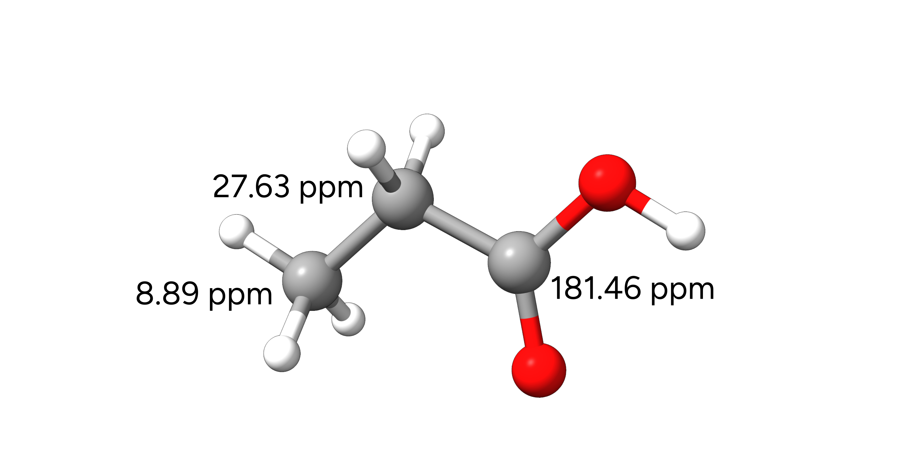
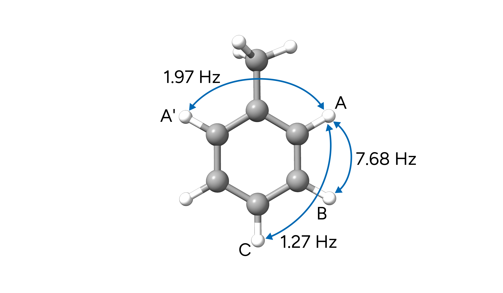
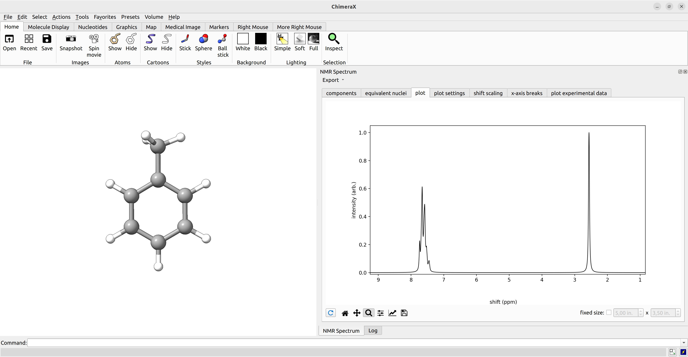

# 核磁共振（NMR）

## 一般用法

核磁共振（NMR）谱学是分析任何分子结构特征的强大工具。在 ORCA 中，可以计算 NMR 谱学性质，如屏蔽
张量和化学位移、*J* 耦合常数以及 NMR 自旋-转动常数。这些性质可以用多种不同的方法计算，我们一般建议查阅近期的基准研究，如 Kaupp 及其同事的工作 [[Kaupp2021a]](../bib.md#kaupp2021a)[[Kaupp2021b]](../bib.md#kaupp2021b)，以找到合适的方法。

> **重要**
> 以下部分教程中使用的 pcSseg-2 和 pcSseg-1 基组只适用到 Kr 元素。如果存在更重的元素而你并不想对它们计算 NMR 性质，可以改为给这些原子添加
> 另一个可用的基组（如 def2-TZVP）并配合相应的 [ECP](../prop/relativistic.md)。更多信息请查阅 [ORCA 手册](https://www.faccts.de/docs/orca/6.0/manual/contents/detailed/basisset.html#assigning-or-adding-basis-functions-to-an-element)。

### NMR 屏蔽张量

基本的 NMR 屏蔽张量计算可以通过 `NMR` 输入关键词来请求。

```text
!BP86 DEF2-TZVP NMR

*XYZFILE 0 1 structure.xyz
```

这个输入将计算给定分子中所有原子核的屏蔽张量。

### *J* 耦合常数

*J* 耦合常数可以通过 `%EPRNMR` 块中的 `SSALL` 关键词来请求：

```text
!BP86 DEF2-TZVP NMR

* XYZFILE 0 1 structure.xyz

%EPRNMR
     NUCLEI = ALL H {SHIFT, SSALL}
END
```

> **重要**
> `%EPRNMR` 块必须放在坐标指定**之后**！

> **提示**
> 上例中的 `SHIFT` 关键词会将计算的屏蔽限制在 H 原子上。

### 自旋-转动常数

自旋-转动常数（spin-rotation constants）可以通过 `SROT` 关键词来请求。

```mol
title: NMR #3
theme: chem311
height: 360px
representation: ball-stick
--- xyz ---
1
structure
  C          -1.98519000000000      1.12204043805165      0.00000000000000
--- input ---
!BP86 DEF2-TZVP MASS2016

*XYZ 0 1
  C          -1.98519000000000      1.12204043805165      0.00000000000000
  O          -1.98519000000000     -0.00136043805165      0.00000000000000 M=16.999131
*

%EPRNMR
  NUCLEI = ALL O {SROT, IST=17}
END
```

> **注意**
> 我们必须通过坐标输入来定义单独请求的原子核的质量！`MASS2016` 关键词只会使用 2016 年重新确定的最丰度同位素的原子质量。`IST` 关键词定义将通过所选同位素使用的磁旋比，在本例中为 ^17O。

> **警告**
> ORCA 的实现遵循 [[Helgaker1996]](../bib.md#helgaker1996) 中的描述。因此，转动常数分量的符号约定与不同来源比较时可能不同。

## 示例 1：丙酸的 ^13C-NMR 化学位移

在本例中，我们将计算丙酸在 $CHCl_3$ 溶液中 ^13C 原子核的各向同性屏蔽。该分子的实验数据可以在 [SDBS](https://sdbs.db.aist.go.jp/sdbs/cgi-bin/cre_index.cgi) 数据库中找到。

[](../images/propionicacid.png)

*图：丙酸的分子结构及其实验 ^13C NMR 化学位移。*

这些将被用来按照下式计算各原子核相对于 TMS（四甲基硅烷）的化学位移：

$$
\delta_{calc.} = \frac{\sigma_{ref.} - \sigma_{calc.}}{1 - \sigma_{ref.}} \approx \sigma_{ref.} - \sigma_{calc.}
$$

> **重要**
> 对于非常大的屏蔽张量，例如 Pb 等很重的原子核，分母（$1 - \sigma_{ref.})$ 就不能再忽略了。

由于我们使用 TMS 作为参比，我们将首先用 TPSS meta-GGA 泛函和 Jensen 的 pcSseg-1 基组计算 TMS 分子的各向同性屏蔽。TPSS 通常能为大多数原子核给出相当好的 NMR 性质。请注意，为了得到更精确的结果，应至少使用如 pcSseg-2 或 def2-TZVP 这样的三 zeta 基组。

> **重要**
> 对于 TPSS 这类 meta-GGA 泛函，应当使用动能密度处理的规范不变（gauge-invariant）选项！推荐使用 Dobson 方法的电流密度相关、规范不变版本，可以通过在 `%EPRNMR` 块中用 `TAU DOBSON` 调用。

```text
!TPSS PCSSEG-1 AUTOAUX NMR CPCM(CHCl3)

%EPRNMR
   TAU DOBSON
END

*XYZFILE 0 1 tms.xyz
```

> **提示**
> 除了计算参比分子，你也可以使用内标。在这种情况下，你只需对计算的谱峰施加一个恒定的位移，使其中一个等于已知值。
> 例如，可以使用一个已指认的甲基或芳香 H 或 C 的值，并从可能的误差相消中获益。如果参比物
> 与目标分子差别太大或难以模拟（比如 ^31P-NMR 中水里的磷酸），这样做也更有意义。

SCF 计算成功后，ORCA 将启动性质计算并汇总所请求的性质：

```text
Tau option for meta-GGA DFT with GIAOs    ... Dobson

[...]

------------------------------------------------------------------------------
                              ORCA PROPERTY CALCULATIONS
------------------------------------------------------------------------------

GBWName                                 ... orca.gbw
Number of atoms                         ...     17
Number of basis functions               ...    152
Max core memory                         ...   4096 MB

[...]

NMR properties:
Chemical shifts                         ... YES (  17 nuclei)
Spin-rotation constants                 ...  NO (   0 nuclei)                   Spin-spin couplings                     ...  NO (   0 nuclei,    0 pairs)

Choice of magnetic origin               ... GIAO
Position of magnetic origin             ...     0.000000     0.000000     0.000000
```

> **注意**
> 默认算法使用规范无关原子轨道（Gauge-Independent Atomic Orbitals, GIAOs，[[Ditchfield1973]](../bib.md#ditchfield1973) 和 [[Pulay1990]](../bib.md#pulay1990)）。这在 NMR 计算中相当重要，
> 除非你真的清楚自己在做什么，否则我们不建议关闭它。

计算得到的 NMR 屏蔽随后打印在：

```text
-------------------
CHEMICAL SHIELDINGS (ppm)
-------------------
```

其中包含关于每个原子核计算所得分量的更详细信息。

```text
 --------------
 Nucleus   1C :
 --------------

Diamagnetic contribution to the shielding tensor (ppm) :
           250.664          0.000         0.011
             0.000        250.666         0.000
             0.002          0.000       261.510

Paramagnetic contribution to the shielding tensor (ppm):
           -68.478         -0.000         0.069
            -0.000        -68.472        -0.000
            -0.028         -0.000       -72.311

Total shielding tensor (ppm):
           182.186         -0.000         0.080
            -0.000        182.194        -0.000
            -0.026         -0.000       189.198

 Diagonalized sT*s matrix:

 sDSO           250.665          250.666          261.510  iso=     254.280
 sPSO           -68.478          -68.472          -72.311  iso=     -69.754
        ---------------  ---------------  ---------------
 Total          182.186          182.194          189.198  iso=     184.526

 Orientation:
  X          -0.9998887   -0.0144421    0.0037505
  Y          -0.0144423    0.9998957   -0.0000096
  Z           0.0037499    0.0000637    0.9999930
```

所需的各向同性屏蔽进一步汇总为：

```text
--------------------------------
CHEMICAL SHIELDING SUMMARY (ppm)
--------------------------------

  Nucleus  Element    Isotropic     Anisotropy
  -------  -------  ------------   ------------
      0       Si         353.498          0.067
      1       C          184.526          7.008
      2       C          184.513          7.061
      3       C          184.549          6.996
      4       C          184.549          6.996
[...]
```

> **注意**
> 化学等价的原子核可能因几何不对称而有略微不同的屏蔽。在这种情况下，最好的做法就是简单地对它们取平均。

得到 TMS 的参比屏蔽后，我们现在可以计算丙酸相应的 ^13C 屏蔽：

```text
!TPSS PCSSEG-1 AUTOAUX NMR CPCM(CHCl3)

*XYZFILE 0 1 propionic_acid.xyz

%EPRNMR
   NUCLEI = ALL C {SHIFT}
   TAU DOBSON
END
```

```text
--------------------------------
CHEMICAL SHIELDING SUMMARY (ppm)
--------------------------------

  Nucleus  Element    Isotropic     Anisotropy
  -------  -------  ------------   ------------
      0       C          172.914         13.514
      1       C          155.500         33.193
      5       C            6.568       -132.026
```

我们现在可以计算相应的化学位移，可以看到它们与实验数据吻合得相当好。

| 方法 | $\delta_1$ | $\delta_2$ | $\delta_3$ |
| --- | --- | --- | --- |
| TPSS/pcSseg-1 | 11.6 | 29.0 | 178.0 |
| TPSS/pcSseg-2 | 11.6 | 30.1 | 184.4 |
| TPSSh/pcSseg-2 | 11.8 | 30.5 | 185.9 |
| 实验值 | 8.9 | 27.6 | 181.5 |

> **注意**
> 请记住，参比物应当始终使用与目标分子相同的理论水平，包括任何溶剂化效应或 RI 这样的近似。

> **重要**
> 务必记住，NMR 位移对你所选择的构象相当敏感。对于柔性分子，应当考虑用 [GOAT](../prop/goat.md) 进行构象搜索，
> 并随后对构象集合的 NMR 性质进行玻尔兹曼加权！

## 示例 2：甲苯的 *J*(H-H) 耦合常数及用 ChimeraX 绘图

在本例中，我们计算甲苯在氯仿中的 *J*(H-H) 耦合，其实验数据同样取自 [SDBS 数据库](https://sdbs.db.aist.go.jp/sdbs/cgi-bin/cre_index.cgi)。
这里我们突出显示芳香环上氢原子之间的若干 *J* 耦合，如数据库中标记的那样：

[](../images/toluene.png)

*图：甲苯选定的实验 *J*(H-H) 耦合常数。*

我们使用与前一示例类似的输入，并添加 `SSALL` 关键词。

```text
!TPSS PCSSEG-1 AUTOAUX NMR CPCM(CHCl3)

*XYZFILE 0 1 toluene.xyz

%EPRNMR
   NUCLEI = ALL H {SHIFT, SSALL}
   TAU DOBSON
END
```

输出现在将显示计算耦合常数的细节：

```text
-----------------------------------------------------------------------
                     NMR SPIN-SPIN COUPLING CONSTANTS
                     ================================

    Number of nuclear pairs to calculate something:       22
                                                        ----
    Number of nuclear pairs to calculate DSO   terms:     22
    Number of nuclear pairs to calculate PSO   terms:     22
    Number of nuclear pairs to calculate FC    terms:     22
    Number of nuclear pairs to calculate SD    terms:     22
    Number of nuclear pairs to calculate SD/FC terms:     22
-----------------------------------------------------------------------

Performing DSO num. integration        ... done (   0.1 sec)

Processing PSO nuclear pairs   ... done (   0.0 sec)
Processing SD/FC nuclear pairs ... done (   0.0 sec)

-----------------------------------------------------------
 NUCLEUS A = H    0 NUCLEUS B = H    3
 (  1H  gnA =  5.586   1H  gnB =  5.586) r(AB) =     2.4644
-----------------------------------------------------------

Diamagnetic contribution to J (Hz):
        3.9268         3.7449       -0.0013
       -3.8794        -3.6900        0.0009
        0.0006         0.0003       -1.2663
Paramagnetic contribution to J (Hz):
       -2.2397        -3.1792        0.0010
        3.2992         2.1041       -0.0007
       -0.0006        -0.0002        0.5562
Fermi-contact contribution to J (Hz):
        6.2432         0.0000        0.0000
        0.0000         6.2432        0.0000
        0.0000         0.0000        6.2432
Spin-dipolar contribution to J (Hz):
        0.1973         0.2594       -0.0001
       -0.2592         0.1564       -0.0000
        0.0000        -0.0001       -0.0915
Spin-dipolar/Fermi contact cross term contribution to J (Hz):
       -0.2582        -0.0105        0.0000
       -0.0105         0.0912        0.0000
        0.0000         0.0000        0.1675

Total spin-spin coupling tensor J (Hz):
        7.8694         0.8146       -0.0004
       -0.8498         4.9049        0.0003
        0.0000         0.0002        5.6091

 Diagonalized JT*J matrix:

 J[0,3](DSO)           -3.656           -1.266            3.893  iso=     -0.343
 J[0,3](PSO)            2.082            0.556           -2.218  iso=      0.140
 J[0,3](FC)             6.243            6.243            6.243  iso=      6.243
 J[0,3](SD)             0.157           -0.091            0.197  iso=      0.087
 J[0,3](SD/FC)          0.091            0.167           -0.258  iso=      0.000
              ---------------  ---------------  ---------------  ---------------
 J[0,3](Total)          4.917            5.609            7.857  iso=      6.128

[...]
```

最后有如下的最终汇总：

```text
-----------------------------------------------------------------------------
                SUMMARY OF ISOTROPIC COUPLING CONSTANTS J (Hz)
-----------------------------------------------------------------------------
                  0 H        3 H        7 H        9 H       11 H       12 H  
      0 H        0.000      6.128      0.353      1.152      5.984     -0.075
      3 H        6.128      0.000      1.545      0.309      0.939      0.261
      7 H        0.353      1.545      0.000      6.286      0.921     -0.230
      9 H        1.152      0.309      6.286      0.000      5.829      0.000
     11 H        5.984      0.939      0.921      5.829      0.000      0.000
     12 H       -0.075      0.261     -0.230      0.000      0.000      0.000
     13 H        0.000     -1.286     -0.922      0.145      0.000    -13.479
     14 H        0.000     -1.281     -0.914      0.143      0.000    -13.464
                 13 H       14 H
      0 H        0.000      0.000
      3 H       -1.286     -1.281
      7 H       -0.922     -0.914
      9 H        0.145      0.143
     11 H        0.000      0.000
     12 H      -13.479    -13.464
     13 H        0.000    -17.265
     14 H      -17.265      0.000
```

> **重要**
> 这些值以 Hz 为单位打印，因此要把它们转换成 ppm，必须考虑仪器的频率。在我们的情况下，数据库说明是在 300 MHz NMR 上测量的，所以以 ppm 为单位的耦合为：
>
>
>
> $$
> J_{ppm} = J_{Hz} / \omega_{equipMHZ} = J_{Hz} / 300
> $$

同样，我们可以把计算数据与实验进行比较：

| 耦合 | 计算值 (Hz) | 实验值 (Hz) |
| --- | --- | --- |
| **TPSS/pcSseg-1** |  |  |
| A (H3) - A' (H7) | 1.15 | 1.97 |
| A (H7) - B (H9) | 6.29 | 7.68 |
| A (H7) - C (H11) | 0.92 | 1.27 |
| **TPSS/pcSseg-2** |  |  |
| A (H3) - A' (H7) | 2.70 | 1.97 |
| A (H7) - B (H9) | 7.22 | 7.68 |
| A (H7) - C (H11) | 1.82 | 1.27 |
| **TPSSh/pcSseg-2** |  |  |
| A (H3) - A' (H7) | 2.49 | 1.97 |
| A (H7) - B (H9) | 7.42 | 7.68 |
| A (H7) - C (H11) | 1.65 | 1.27 |

计算完 NMR 屏蔽和 *J* 耦合常数后，我们可以用 [ChimeraX](../first_steps/GUI.md)（配合 SEQCROW 插件）来可视化耦合的 NMR 谱。
为此，我们只需用 ChimeraX 打开 ORCA 输出文件，导航到 `Tools`→`Quantum Chemistry`→`NMR Spectrum`。

ChimeraX 提供许多设置，包括参比位移的选择、脉冲频率以及等价原子核的手动选择。光谱还可以导出为图片或 .csv 数据以便进一步处理。

[](../images/nmr-chimerax.png)

*图：用 ChimeraX 可视化的甲苯计算 NMR 谱。*

## 示例 3：用双杂化 DFT 计算 NMR 化学位移

在 ORCA 中，NMR 屏蔽常数也可以用双杂化泛函（double-hybrid functionals）计算，这类泛函通过向 DFT 添加 MP2 相关而受益 [[Neese2018]](../bib.md#neese2018)。

```text
!revDSD-PBEP86-D4/2021 PCSSEG-3 AUTOAUX NMR NOFROZENCORE

*XYZFILE 0 1 opt.xyz
```

> **重要**
> 默认情况下，MP2 和双杂化 DFT 使用冻结核近似。由于 NMR 性质强烈受内层电子影响，我们需要用 `NOFROZENCORE` 关键词关闭它。

> **注意**
> 请注意，双杂化泛函通常需要像 pcSseg-3 这样更大的基组才能得到收敛的结果。

ORCA 将首先在 SCF DFT 水平上计算 NMR 性质：

```text
-------------------
CHEMICAL SHIELDINGS (ppm)
-------------------

Method             : SCF
Type of density    : Electron Density
[...]
```

随后计算基于未弛豫和弛豫 MP2 密度的性质：

```text
-------------------
CHEMICAL SHIELDINGS (ppm)
-------------------

Method             : MP2
Type of density    : Electron Density
Type of derivative : Magnetic Field (with GIAOs) (Direction=X)
Multiplicity       :   1
Level              : Unrelaxed density
```

```text
-------------------
CHEMICAL SHIELDINGS (ppm)
-------------------

Method             : MP2
Type of density    : Electron Density
Type of derivative : Magnetic Field (with GIAOs) (Direction=X)
Multiplicity       :   1
Level              : Relaxed density
```

基于弛豫密度的结果就是所需的性质。

> **警告**
> 双杂化泛函通常给出比低水平 DFT 方法更好的结果，然而对于某些体系，例如 HOMO-LUMO 能隙很小的体系或 3d 过渡金属配合物，
> 基于 MP2 的方法容易产生较大误差，此时宜改用稳健的 meta-GGA（如 B97M-V 和 r^2SCAN）或杂化泛函（如 r^2SCAN0、TPSSh 和 ωB97X-V）。

> **提示**
> 尽管 MP2 或双杂化 DFT 无法给出 *J* 耦合常数，但可以通过混合不同理论水平来获得耦合谱。例如，
> 我们可以把双杂化 DFT 水平计算的化学位移与杂化 DFT 计算得到的 *J* 耦合常数组合起来。

## 示例 4：^12C^17O 的自旋-转动常数

在本例中，我们将计算 ^12C^17O 的 NMR 自旋-转动常数。在相应的输入中，我们把 O 的原子质量定义为匹配 ^17O，并为所选同位素调整了
磁旋比。

```mol
title: NMR #18
theme: chem311
height: 360px
representation: ball-stick
--- xyz ---
1
structure
  C          -1.98519000000000      1.12204043805165      0.00000000000000
--- input ---
! TPSSh PCSSEG-3 AUTOAUX MASS2016

*XYZ 0 1
  C          -1.98519000000000      1.12204043805165      0.00000000000000
  O          -1.98519000000000     -0.00136043805165      0.00000000000000 M=16.999131
*

%EPRNMR
   NUCLEI = ALL O {SROT, IST=17}
   TAU DOBSON
END
```

计算成功后，结果打印到输出中。

```text
---------------------------
NMR SPIN-ROTATION CONSTANTS
---------------------------

Analytic diamagnetic shielding integrals (local origin) (SHARK)        ... done (  0.1 sec)

 ------------------------------------------------
 Nucleus   1O  (Isotope =  17 GN =  -0.75751600):
 ------------------------------------------------

Nuclear contribution to the spin-rotation tensor (kHz) : 
            -3.535          0.000         0.000
             0.000          0.000         0.000
             0.000          0.000        -3.535

Electronic contribution to the spin-rotation tensor (kHz) : 
            36.353          0.000         0.000
            -0.000          0.000         0.000
             0.000          0.000        36.352

Total spin-rotation tensor (kHz): 
            32.818          0.000         0.000
            -0.000          0.000         0.000
             0.000          0.000        32.817

 Diagonalized MT*M matrix:
 
 M(Nuc)           0.000           -3.535           -3.535  iso=      -2.356
 M(El)            0.000           36.352           36.353  iso=      24.235
        ---------------  ---------------  ---------------
 M(Tot)           0.000           32.817           32.818  iso=      21.878
```

这里 M(Tot) 给出 *aa*、*bb* 和 *cc*（或 *XX*、*YY* 和 *ZZ*）分量以及各向同性 NMR 自旋-转动常数。后者在最后还会连同一些附加信息（如原子质量）一并汇总。

```text
-----------------------------------
NMR SPIN-ROTATION CONSTANTS SUMMARY
-----------------------------------

  Nucleus  Isotope  Atomic Mass   g-factor   Spin-Rot. Const. (kHz)
  -------  -------  -----------  ----------  ----------------------
      1     17-O     16.9991310  -0.7575160            21.878
```

现在把自旋-转动常数分量与实验比较，可以看到其绝对值与实验数据吻合极好。请注意，ORCA 中遵循的原始实现所用的符号约定 [[Helgaker1996]](../bib.md#helgaker1996) 可能与其他工作中使用的不同。

| 分量 | 计算值 (kHz) | 实验值 (kHz) |
| --- | --- | --- |
| *aa* | 0.00 | 0.000 |
| *bb* = *cc* | 32.82 | -31.609 |

## 结构

### 1-丙酸

```mol
title: NMR #21
theme: chem311
height: 360px
representation: ball-stick
--- xyz ---
11
structure
  C          -2.02727527554235     -0.06655130656306      0.00037392908842
  C          -0.75679471221434      0.75631573207355     -0.00012855244818
  H          -2.07991021538891     -0.70955234104354     -0.87882169434027
  H          -2.89912000279840      0.58830528850859     -0.00322251101424
  H          -2.08298208770946     -0.70385824832254      0.88351978507734
  C           0.49305145889248     -0.07125461785103      0.00054681142313
  H          -0.70522440144489      1.41749189951821      0.86998810223388
  H          -0.70520776302305      1.41676824159293     -0.87073904389322
  O           1.59469763588682      0.69133816497292     -0.00209843924434
  H           2.36249659648209      0.10385573531668     -0.00149870485071
  O           0.54282876686002     -1.27602854820272      0.00280031796818
```

### TMS

```mol
title: NMR #22
theme: chem311
height: 360px
representation: ball-stick
--- xyz ---
17
structure
  Si         -0.00016217760413     -0.00000200966369     -0.00001724916921
  C          -0.00000381060783     -0.00000292410772      1.87604035066756
  C           1.76890263153042     -0.00000220438520     -0.62476798792801
  C          -0.88452969047227     -1.53170003319882     -0.62565336419779
  C          -0.88451803763557      1.53170284867113     -0.62564941393828
  H          -1.02024320585180     -0.00004763673129      2.26807747150872
  H           0.51041349194385      0.88367742102248      2.26744728207030
  H           0.51049406579855     -0.88363545598283      2.26744932583441
  H           1.79889713542055     -0.00002636281349     -1.71733986918209
  H           2.30802219317048      0.88363945655706     -0.27386690302155
  H           2.30803592092593     -0.88361814255887     -0.27382577782536
  H          -0.90062854341904     -1.55578670297871     -1.71826319426016
  H          -1.91903757060460     -1.55776918964915     -0.27388248209104
  H          -0.38800706817058     -2.44075463393491     -0.27679593332374
  H          -0.90062145682280      1.55579443985819     -1.71826001944301
  H          -1.91902290654613      1.55778308725346     -0.27387187984590
  H          -0.38798097105504      2.44074804264236     -0.27679035585484
```

### 甲苯

```mol
title: NMR #23
theme: chem311
height: 360px
representation: ball-stick
--- xyz ---
15
structure
  H          -1.35604030632667     -2.14062097490572      0.00064845084188
  C          -0.81881186265084     -1.19920744744936      0.00036920002554
  C           0.57048137420035     -1.19832779892086      0.00026808880500
  H           1.10835381829194     -2.14039396264630      0.00046230443757
  C           1.28750860478784     -0.00560299513861     -0.00011156472044
  C           2.78618878796062     -0.00087766989700      0.00001333464042
  C           0.57330375607799      1.19242335570751     -0.00043685135727
  H           1.11365279206821      2.13339476273244     -0.00080313848306
  C          -0.81287809106069      1.19760459513790     -0.00033526034055
  H          -1.34757760412811      2.14049019369371     -0.00061393156388
  C          -1.51637266595660     -0.00071299542650      0.00007861209975
  H          -2.59983293655610      0.00175614049417      0.00013091762840
  H           3.18457831555614     -1.01559669047846     -0.00219503682240
  H           3.17734526715488      0.51581479390032      0.87984977178833
  H           3.17754075058104      0.51985669319674     -0.87732489697927
```

### CO

```mol
title: NMR #24
theme: chem311
height: 360px
representation: ball-stick
--- xyz ---
2
structure
  C          -1.98519000000000      1.12204043805165      0.00000000000000
  O          -1.98519000000000     -0.00136043805165      0.00000000000000
```
