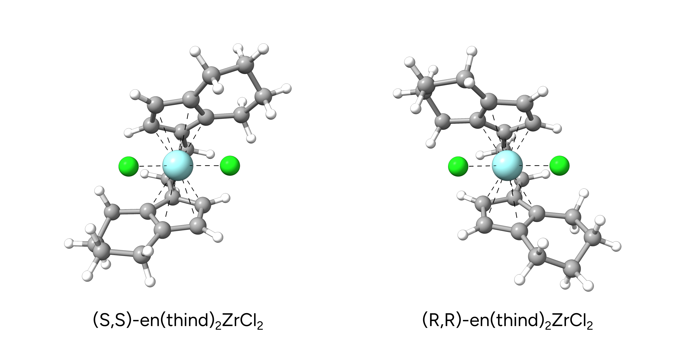
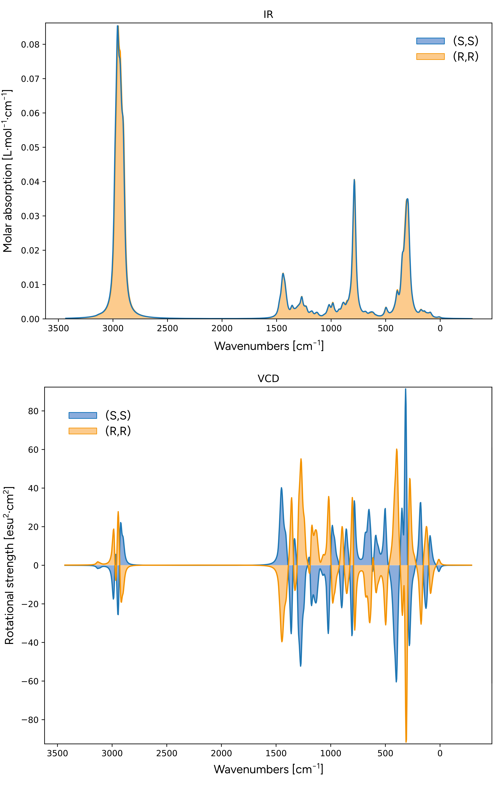

# 振动圆二色谱（VCD）

振动圆二色谱（vibrational circular dichroism, VCD）是一种强大而廉价的光谱方法，可用于获取任何化合物三维结构的信息。
在 ORCA 中，可以通过 `%FREQ` 块轻松请求计算 VCD 光谱

```text
! FREQ B3LYP D4 def2-TZVP

%FREQ
  DOVCD true
END
```

> **注意**
> 请注意，VCD 不能用 `NUMFREQ` 计算。

## 示例：桥联金属茂的 VCD 光谱

在本例中，我们将计算桥联金属茂（ansa-metallocene）配合物 en(thind)_2ZrCl_2 的 VCD 光谱。桥联金属茂最为人熟知的应用是作为
聚合催化剂（参见 Ziegler-Natta 催化）。由于由 ansa 桥连接的亚乙基双(4,5,6,7-四氢-1-茚基)配体的结构，
该配合物可获得不同的对映异构体。这里我们将比较 (S,S) 和 (R,R) 对映体。

[](../images/metallocene-ss-rr.png)

*图：en(thind)_2ZrCl_2 的 (S,S) 和 (R,R) 对映体。*

```mol
title: (S,S)-en(thind)2ZrCl2
theme: chem311
height: 360px
representation: ball-stick
--- xyz ---
47
structure
C              2.1742581678898598            -0.2445844120182100             0.0446091234872100
C              1.6154841777462501            -1.4976078340452299            -0.6336477249081500
C              0.4678430596774400            -2.1103038388773299             0.1815466920423200
C             -0.5619063759860100            -1.0560542982915799             0.4727325198560900
C              1.1236920945913600             0.8695454613127800             0.1809762903584500
C             -0.2428541847048000             0.3321324991342400             0.4914462883090400
C             -1.9636428631709599            -1.1965269423246900             0.6312436458244400
C             -1.4405982013668199             1.0450914898481500             0.6885943517151700
C             -2.5031691166377699             0.1096871555872400             0.7911376199599600
H              2.5438641351029698            -0.5164778729500100             1.0338529360910900
H              2.4083047594010800            -2.2368781301448299            -0.7613701065143700
H              0.8699588345188100            -2.5321329780628998             1.1070637455013199
H             -3.5443766990624099             0.3499255475529800             0.9428035438116900
H              1.2500470976467499            -1.2456076689939299            -1.6342778677240599
H              0.0112275687850600            -2.9378457183847502            -0.3639276498152700
H             -1.5346782841505999             2.1159153360942300             0.7595362119718300
H              1.4383731341169399             1.5938108219204199             0.9342790543835300
H              1.0528783830442601             1.4196993781035001            -0.7629242544785700
H              3.0271116983124702             0.1369715267215600            -0.5195790536371701
C             -2.7427912980150899            -2.4795713358849700             0.6640229626184601
C             -3.6515583603848900            -2.5147899113865200             1.9002146426382800
H             -3.3370908046764001            -2.5903312870566002            -0.2464734411828100
H             -2.0505128568850699            -3.3210854158662602             0.6901837806392700
H             -4.4888279720406201            -1.8298547432781000             1.7639078110995601
H             -4.0813424703970700            -3.5116341682427699             2.0287155800280501
Cl            -1.7515648287175600             1.9495941162672099             3.7728286542864700
C             -4.6234433837531803             0.5057853439889500             5.4175907654132400
C             -3.9062538879398798            -0.0626639931202600             6.6456824730135100
C             -2.4171051940022799            -0.3061458200530100             6.3612389063918098
C             -2.2626125295550801            -1.1062609166640300             5.1027419162485899
C             -4.5972172318803199            -0.4670032893788100             4.2286599013544199
C             -3.2759739349648100            -1.1703285217410000             4.1032520475770600
C             -1.2305730410587099            -1.9850550537681100             4.7247726337318303
C             -2.8787434014559801            -2.1125798347282001             3.1227304835072101
C             -1.5938683296279299            -2.5973241508562599             3.4975333555442401
H             -5.6608563494038497             0.7400672663088900             5.6629193535983502
H             -4.3790328207977902            -1.0048266341692900             6.9412543405992704
H             -1.9469752293237601            -0.8363293795062600             7.1916223544877402
H             -1.0088899964117699            -3.3255656095752300             2.9571418289416900
H             -4.0102838143067201             0.6228007049942900             7.4886123866631600
H             -1.9068036724548800             0.6558530849489200             6.2720504290409398
H             -0.3148118524222700            -2.1529076851973201             5.2667128968072499
H             -5.3697197490720301            -1.2311368186153699             4.3680208863684502
H             -4.8572150243891397             0.0568857437771900             3.3060903740698500
H             -4.1432088203003996             1.4425171386827600             5.1319389089623098
Zr            -1.2071901256747799            -0.2637425852592700             2.8451769027785700
Cl             1.1819895941834400            -0.2621157668015100             3.4469314985293300
```
```mol
title: (R,R)-en(thind)2ZrCl2
theme: chem311
height: 360px
representation: ball-stick
--- xyz ---
47
structure
C             -2.1914554215277899             0.2895605281534100            -0.1058945838212000
C             -1.6354448990404500             1.5488116625982999             0.5626695705890100
C             -0.4529995380189300             2.1241297568433701            -0.2294016906450000
C              0.5673012704932801             1.0472722203320599            -0.4699816282814900
C             -1.1556064195290801            -0.8437127577377300            -0.1730934585853200
C              0.2263969539247800            -0.3360550219188800            -0.4624892626472100
C              1.9763334233995000             1.1618733884694299            -0.5917944171627399
C              1.4168313767130500            -1.0719586932066700            -0.6136141903838400
C              2.4974922793981200            -0.1550591863937300            -0.7071593642384200
H             -2.5179051603665399             0.5423749913653499            -1.1155479777902899
H             -2.4191992954139501             2.3035632648325901             0.6480289388167200
H             -0.8222997305010700             2.5348601940346498            -1.1736502702334399
H              3.5378864282625302            -0.4153723950988500            -0.8283129319555100
H             -1.3064438733632000             1.3132588713501001             1.5797649466484101
H              0.0017908149911300             2.9551974539101300             0.3121553595803500
H              1.4954775569178400            -2.1455137474007100            -0.6582555892552500
H             -1.4592109318568800            -1.5888938303677100            -0.9099834734456600
H             -1.1203461016854599            -1.3600454028710001             0.7916978547841700
H             -3.0721241132136199            -0.0634044750563800             0.4335620279082300
C              2.7748349933510998             2.4334894011492199            -0.6347233460260000
C              3.6720382973084700             2.4609186073080900            -1.8803995163440299
H              3.3804593632589102             2.5347980647476600             0.2691366338909700
H              2.0945899574240001             3.2849524739536400            -0.6516340667064100
H              4.5023319059409301             1.7655791662235101            -1.7526205517316200
H              4.1130226931328098             3.4528682169118401            -2.0101242036810700
Cl             1.9925351554928901            -1.9977113886498701            -3.6642227250656800
C              4.6426143437406999            -0.4455267742606400            -5.4961647123921598
C              3.8569907704968598             0.1139095720864600            -6.6860488771203999
C              2.3708117734952201             0.2895759346758100            -6.3420260011193896
C              2.2354278511248702             1.0787756769961800            -5.0745690603738600
C              4.6124961242693301             0.4937909844131300            -4.2797834847542298
C              3.2757650619296999             1.1556026077879600            -4.1048103411467096
C              1.1971310611928001             1.9340165137842700            -4.6590705495322000
C              2.8823789576802898             2.0688448385277201            -3.0960032168269098
C              1.5793817915584600             2.5361873861894200            -3.4338624435920200
H              5.6809703762470596            -0.6228601483285500            -5.7819845571453801
H              4.2773224106211600             1.0804753854427001            -6.9820111394240900
H              1.8431586250757801             0.7989498603941600            -7.1503940062834701
H              0.9956140269250100             3.2479436145840501            -2.8713126423587099
H              3.9582816368405398            -0.5526054307064500            -7.5443874313386203
H              1.9092157491140200            -0.6951111481688100            -6.2347951975059903
H              0.2639075561679300             2.0895165946992100            -5.1742368833924104
H              5.3577885155940397             1.2853812187007101            -4.4130190781240604
H              4.9082246249208401            -0.0477550362699300            -3.3785324426294001
H              4.2190242864600496            -1.4112460957612101            -5.2185557557079498
Zr             1.2590641613056399             0.1893579966168900            -2.8030975385233501
Cl            -1.1011967102527500             0.0005996751150900            -3.4796167549262900
```

现在我们将在 B3LYP-D4/def2-TZVPP[C-PCM($CHCl_3$)] 水平上计算两种对映体在氯仿溶液中的 VCD 光谱：

```text
! FREQ B3LYP D4 def2-TZVPP CPCM(chloroform)

%FREQ
  DOVCD true
END

*XYZFILE 0 1 structure.xyz
```

计算成功后，可以在输出中找到 VCD 光谱：

```text
------------------------
VCD SPECTRUM CALCULATION
------------------------

Calculating the atomic axial tensor (analytic) ... done ( 0.151 sec)

---------------------------------
 Mode   Freq    VCD-Intensity
       (1/cm) (1E-44*esu^2*cm^2)
---------------------------------
    6     5.8         -3.66
    7    74.7          3.09
    8    90.5         13.12
[...]
```

> **重要**
> 为避免出现虚频，VCD 计算应在同一理论水平优化得到的几何结构上进行。

如果我们现在绘制两种化合物的 IR 和 VCD 光谱，就会发现：虽然两种对映体的 IR 光谱完全相同，但 VCD 光谱恰好完全相反，从而可以明确区分
(S,S) 和 (R,R) 对映体。

[](../images/metallocene-spectra.png)

*图：(S,S)- 和 (R,R)-en(thind)_2ZrCl_2 的 IR（上）和 VCD（下）光谱。*

> **重要**
> 为了与实验数据进行合理的比较，可能需要使用玻尔兹曼加权（Boltzmann-weighted）光谱。相应的构象集合可以用
> ORCA 中提供的 [GOAT](../prop/goat.md) 算法生成。
