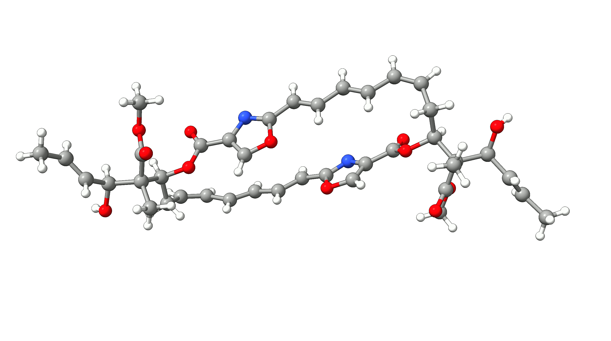
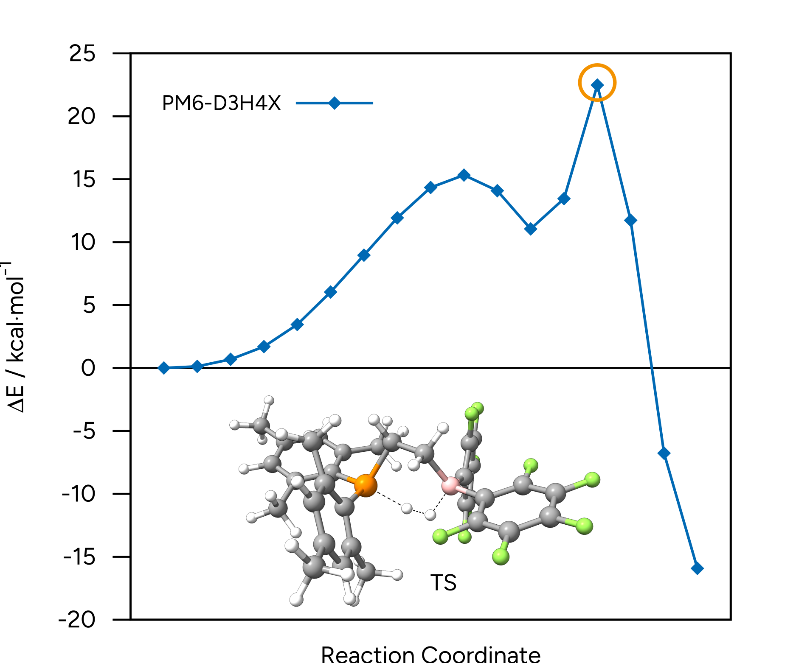
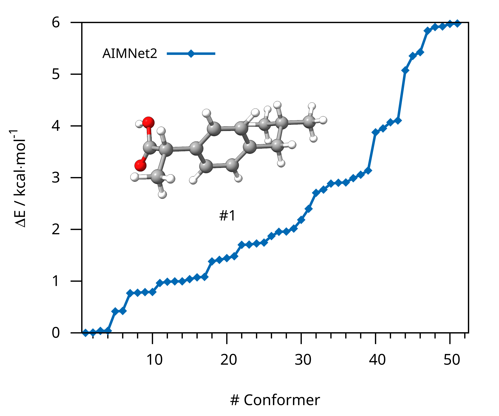
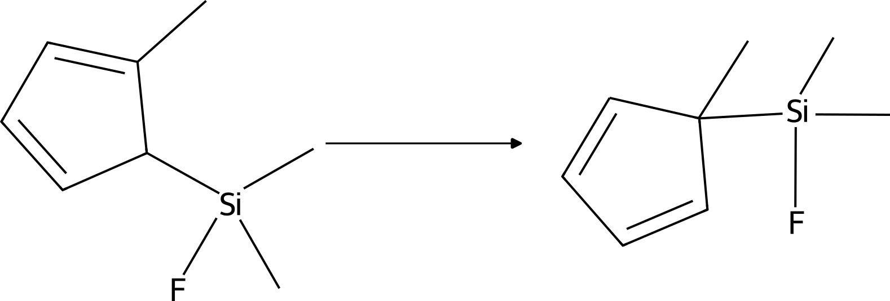
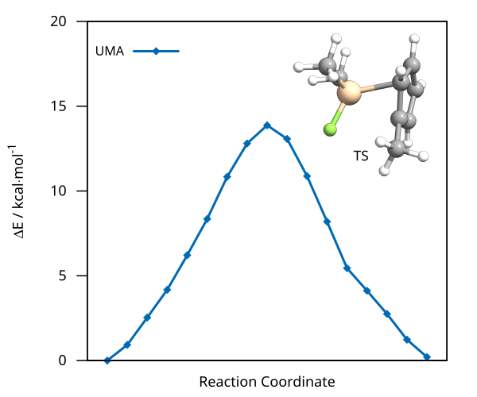
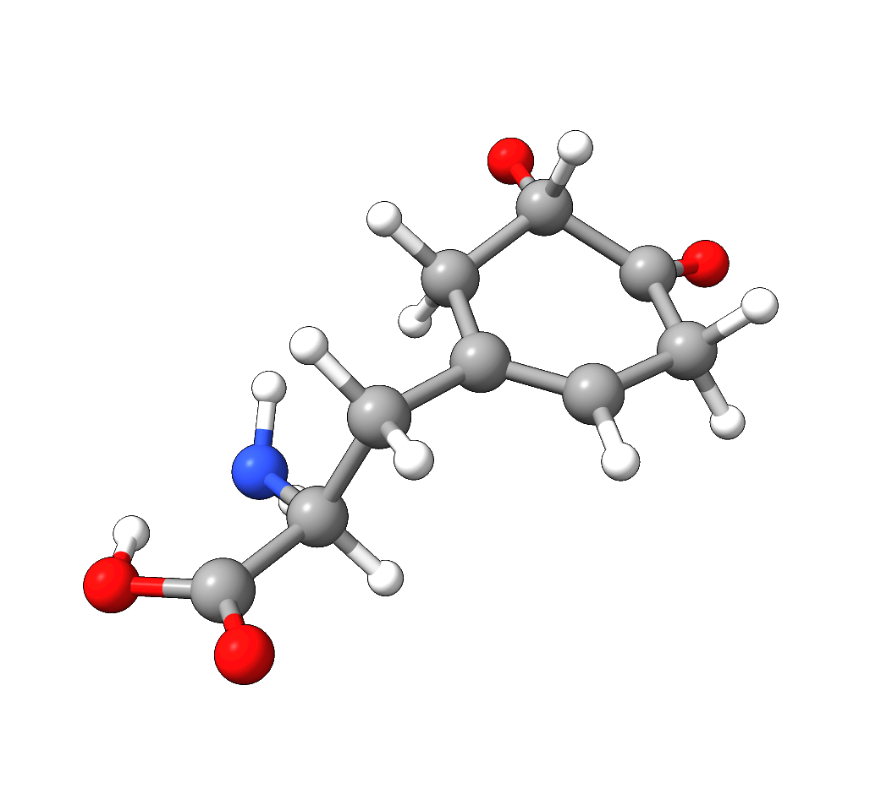

# ORCA 与外部方法（External Methods）

尽管 ORCA 拥有大量电子结构模型（electronic structure models），但它无法覆盖所有可用的方法。因此，ORCA 提供了一个
外部方法接口（interface to external methods），允许你将 ORCA 的优化基础设施与外部程序提供的电子结构方法和
模型势（model potentials）一起使用。这样一来，你就能在 ORCA 基础设施中利用最新的基于 MNDO 的半经验方法（semi-empirical methods）如 [PM7](https://link.springer.com/article/10.1007/s00894-012-1667-x)，或
神经网络势（neural network potentials）如 [AIMNet2](https://pubs.rsc.org/en/content/articlelanding/2025/sc/d4sc08572h) 和 [UMA](https://ai.meta.com/research/publications/uma-a-family-of-universal-models-for-atoms/)，例如用于[优化结构](../prop/geoopt.md)、用 [NEB-TS](../react/nebts.md) 搜索过渡态（transition states），或用 [GOAT](../prop/goat.md) 采样构象（conformers）。

外部方法基础设施可以通过 ORCA 简单输入关键词 `!ExtOpt` 访问，该关键词可以与其他常用关键词
（如 `!Opt` 或 `!GOAT`）组合使用。由于每个程序的输出通常具有不同的格式和风格，因此需要单独的包装脚本（wrapper scripts）来连接 ORCA 及其外部优化器基础设施。包装脚本的完整路径可通过 `%method` 模块提供：

```text
! ExtOpt

%method
  ProgExt "/full/path/to/wrapperscript"
  Ext_Params "optional command line arguments"
end
```

`Ext_Params` 关键词用于设置特定于程序的选项，如方法、模型或溶剂化。通过以 `-h` 标志调用相应的脚本（例如 `oet_mopac -h`）可以获取各包装脚本的可用选项详细列表。

> **重要**
> 部分包装脚本及其用法可以在我们的 [ORCA-External-Tools GitHub 仓库](https://github.com/faccts/orca-external-tools)中找到。该仓库向社区开放，非常欢迎贡献！

> **注意**
> 请注意，根据你的操作系统和基础设施，你可能需要对包装脚本做一些修改！

> **注意**
> 对于通过 Python 接口导入的方法（如 AIMNet2 和 UMA），可以使用两种不同的脚本。一种是独立脚本，由于大量导入可能会使你的计算变慢。另一种是服务器/客户端（server/client）方式。这里必须事先用相应的脚本启动服务器，然后客户端脚本就可以像其他脚本一样使用。更多信息见以下示例或 GitHub 上相应的 README 文件。

## 官方包装脚本

[ORCA-External-Tools GitHub 仓库](https://github.com/faccts/orca-external-tools)为 MOPAC 和 g-xTB 等程序以及 AIMNet2 和 UMA 等神经网络势提供了若干开箱即用的脚本。它还包含一个可以快速实现新方法的框架。

### 安装

仓库中包含一个 `install.py`，可简化安装过程。运行它会创建一个默认名为 `.venv` 的虚拟环境（virtual environment），其路径此后*不应*更改。此外，还会创建一个默认名为 `bin` 的文件夹，其中包含所有可与 ORCA 一起使用的可执行脚本。如果需要，这些脚本可以移动到其他位置。
你可以在安装过程中自定义虚拟环境路径和脚本目录：

```text
python install.py --venv-dir <path/to/venv/dir/> --script-dir <path/to/script/dir/>
```

如果你想使用基于 Python 的方法（如 AIMNet2、UMA 或 MLatom），可以添加 `-e` 标志来安装所需的依赖项：

```text
python install.py -e aimnet2
python install.py -e uma
python install.py -e mlatom
```

由于这些软件包可能存在不兼容的依赖项，建议通过指定不同的虚拟环境和脚本目录为每个软件包分别安装。

> **注意**
> 如果你维护多个环境，请记住在安装时显式设置脚本路径。否则，该过程可能会覆盖现有脚本。

## 示例 1：通过 MOPAC 用 PM7 优化 Disorazol Z1

在本例中，我们将在 ORCA 中优化 disorazol（一种潜在的抗癌药物），使用 [MOPAC](https://github.com/openmopac/mopac) 中 PM7 方法生成的能量和梯度。为此，我们只需添加 `!Opt` 简单输入关键词以及 mopac 包装脚本的额外参数 `--method PM7`：

```text
!ExtOpt Opt PAL4

%method
  ProgExt "/full/path/to/oet_mopac"
  Ext_Params "--method PM7"
end

*XYZFILE 0 1 structure.xyz
```

我们现在可以像往常一样通过 `orca basename.inp` 运行 ORCA 输入文件，外部优化器基础设施将生成两个输出文件：正常的 ORCA 输出 `basename.out` 和外部程序（这里是 MOPAC）的输出 `basename_EXT.out`。

我们现在可以检查 ORCA 输出中的收敛情况，并会找到典型的成功消息：

```text
***********************HURRAY********************
                    ***        THE OPTIMIZATION HAS CONVERGED     ***
                    *************************************************
```

MOPAC 输出也显示最后一次能量和梯度计算正常执行：

```text
**                              MOPAC v22.0.6                                **
 **                                                                           **
 *******************************************************************************
 **          Digital Object Identifier (DOI): 10.5281/zenodo.6511958          **
 **    Visit the DOI location for information on how to cite this program.    **
 *******************************************************************************

                              PM7 CALCULATION RESULTS

 *******************************************************************************
[...]
 **********************
 *                    *
 * JOB ENDED NORMALLY *
 *                    *
 **********************

 TOTAL JOB TIME:             0.62 SECONDS
```

PM7 优化后的结构像往常一样存储在 `basename.xyz` 文件中，优化轨迹则存储在 `basename_trj.xyz` 中。disorazol 的完整优化过程
如下面的动画所示。

[](../images/disorazolz1.gif)

*图：通过 ORCA 的外部优化功能，使用 MOPAC 对 Disorazol Z1 进行 PM7 优化。*

### 示例 1 的结构

### Disorazol Z1 未优化结构

```mol
title: extopt #7
theme: chem311
height: 360px
representation: ball-stick
--- xyz ---
100
structure
N      4.9056000000    9.4983000000    7.3808000000
N      3.7927000000    9.5666000000    2.0870000000
O      2.5573000000    8.0061000000    9.6644000000
O      3.3918000000   10.1213000000    9.7156000000
O      5.2191000000    7.4378000000    6.5692000000
O      8.0703000000    5.7271000000   -3.3425000000
H      8.4793000000    6.2292000000   -3.8777000000
O      3.8441000000    5.1815000000   -1.7983000000
O      4.1962000000    7.2585000000   -2.5227000000
O      5.7494000000    7.3570000000    0.0202000000
O      5.2928000000    9.5498000000   -0.3412000000
O      3.6351000000    7.8654000000    3.5190000000
O      0.1414000000    7.9363000000   13.2750000000
H     -0.0323000000    8.6062000000   13.7510000000
O      4.0052000000    5.9237000000   11.4984000000
O      4.1148000000    8.0439000000   12.1910000000
C      3.3498000000    8.9937000000    9.2481000000
C      4.1739000000    8.5676000000    8.1215000000
C      4.3556000000    7.3413000000    7.6276000000
H      3.9560000000    6.5429000000    7.9526000000
C      5.5061000000    8.8068000000    6.4792000000
C      6.3252000000    9.2591000000    5.4169000000
H      6.5409000000   10.1837000000    5.4085000000
C      6.8332000000    8.5052000000    4.4092000000
H      6.6774000000    7.5688000000    4.4252000000
C      7.5931000000    9.0500000000    3.3203000000
H      7.8827000000    9.9519000000    3.3933000000
C      7.9255000000    8.3786000000    2.2042000000
H      7.7777000000    7.4397000000    2.1753000000
C      8.5004000000    9.0299000000    1.0416000000
H      8.8888000000    9.8850000000    1.1815000000
C      8.5398000000    8.5555000000   -0.1902000000
H      8.9178000000    9.1235000000   -0.8513000000
C      8.0489000000    7.2107000000   -0.6584000000
H      8.1052000000    6.5656000000    0.0899000000
H      8.6358000000    6.8860000000   -1.3861000000
C      6.6079000000    7.2710000000   -1.1634000000
H      6.4818000000    8.0841000000   -1.7324000000
C      5.2131000000    8.5454000000    0.3262000000
C      4.4832000000    8.4751000000    1.5970000000
C      4.3950000000    7.4418000000    2.4632000000
H      4.7866000000    6.5835000000    2.3585000000
C      3.3035000000    9.1646000000    3.2191000000
C      2.4956000000    9.8742000000    4.1681000000
H      2.2882000000   10.7844000000    3.9959000000
C      2.0219000000    9.3133000000    5.2824000000
H      2.2487000000    8.4039000000    5.4406000000
C      1.2003000000    9.9627000000    6.2618000000
H      0.9438000000   10.8630000000    6.1060000000
C      0.7753000000    9.3696000000    7.3810000000
H      0.9868000000    8.4509000000    7.4986000000
C      0.0240000000   10.0149000000    8.4197000000
H     -0.3403000000   10.8681000000    8.2161000000
C     -0.2125000000    9.5385000000    9.6375000000
H     -0.7177000000   10.0976000000   10.2172000000
C      0.2270000000    8.2198000000   10.1989000000
H      0.1913000000    7.5389000000    9.4817000000
H     -0.4077000000    7.9461000000   10.9073000000
C      1.6423000000    8.2499000000   10.7851000000
H      1.8236000000    9.1522000000   11.1746000000
C      6.1247000000    6.0246000000   -1.9217000000
C      6.6730000000    6.0246000000   -3.3852000000
H      6.5642000000    6.9461000000   -3.7573000000
C      5.9542000000    5.0738000000   -4.2858000000
H      5.9810000000    4.1520000000   -4.0589000000
C      5.2885000000    5.4115000000   -5.3651000000
H      5.2418000000    6.3378000000   -5.5673000000
C      4.6049000000    4.4908000000   -6.2970000000
H      5.0371000000    4.5342000000   -7.1759000000
H      3.6641000000    4.7510000000   -6.3828000000
H      4.6600000000    3.5747000000   -5.9519000000
C      6.4819000000    4.7200000000   -1.1795000000
H      6.0961000000    3.9561000000   -1.6578000000
H      6.1195000000    4.7517000000   -0.2694000000
H      7.4560000000    4.6222000000   -1.1401000000
C      4.6014000000    6.0628000000   -2.0557000000
C      2.7629000000    7.3715000000   -2.6880000000
H      2.4485000000    6.6708000000   -3.2971000000
H      2.5461000000    8.2509000000   -3.0626000000
H      2.3245000000    7.2694000000   -1.8182000000
C      1.9499000000    7.1463000000   11.8547000000
C      1.5515000000    7.7172000000   13.2595000000
H      2.0156000000    8.5920000000   13.3965000000
C      1.9293000000    6.7865000000   14.3766000000
H      1.4671000000    5.9586000000   14.4302000000
C      2.8297000000    7.0217000000   15.2686000000
H      3.3353000000    7.8210000000   15.1781000000
C      3.1467000000    6.1272000000   16.4504000000
H      2.6361000000    5.2941000000   16.3758000000
H      2.9036000000    6.5858000000   17.2819000000
H      4.1052000000    5.9236000000   16.4580000000
C      1.2577000000    5.8417000000   11.5618000000
H      0.2911000000    5.9489000000   11.6841000000
H      1.5894000000    5.1510000000   12.1728000000
H      1.4415000000    5.5743000000   10.6365000000
C      3.4517000000    6.9453000000   11.8293000000
C      5.5498000000    7.9725000000   12.1232000000
H      5.8177000000    7.5826000000   11.2654000000
H      5.8841000000    7.4133000000   12.8554000000
H      5.9258000000    8.8744000000   12.2038000000
```

## 示例 2：用 MOPAC 的 PM6-D3H4X 进行 NEB-TS

在本例中，我们将在 ORCA 中运行 Erker 受阻路易斯对（frustrated Lewis pair，FLP）活化双氢的 [NEB-TS](../react/nebts.md) 过渡态搜索，使用 [MOPAC](https://github.com/openmopac/mopac) 中 PM6-D3H4X 方法生成的能量和梯度。PM6-D3H4X 是包装脚本中默认选择的方法。因此，无需进一步
定义方法。

[](../images/flp-reaction-path.svg)

*图：Erker 受阻路易斯对对双氢的活化。*

相应的 ORCA 输入包含 MOPAC 包装脚本 `mopac.py` 的完整路径和常见的 NEB-TS 输入：

```text
!ExtOpt NEB-TS PAL8

%method
  ProgExt "/full/path/to/oet_mopac"
end

%NEB
  NEB_END_XYZFILE "products.xyz"
  PreOpt true
  NImages 15
END

*XYZFILE 0 1 reactants.xyz
```

为了连接 ORCA 和 MOPAC，我们将使用可在 [ORCA-External-Tools GitHub 仓库](https://github.com/faccts/orca-external-tools/)中获得的 `mopac.py` 包装脚本。该脚本的完整路径必须通过 `%method` 模块中的 `progext` 关键词定义。

我们现在可以像往常一样通过 `orca basename.inp > basename.out` 运行 ORCA 输入文件，如果一切设置正确，ORCA 将通过包装脚本调用 MOPAC 来计算能量和梯度，并重新格式化为 ORCA 可读的格式。ORCA 的输出看起来与所选任务（这里是 NEB-TS）使用 ORCA 原生方法完成时完全一样。

NEB-TS 运行成功后，生成的最小能量路径（minimum energy pathway）存储为 `basename_MEP_trj.xyz`，可以使用多种
[图形用户界面](../first_steps/GUI.md)之一进行可视化，并绘制相对能量。

[](../images/flp-mep-ts.png)

*图：PM6-D3H4X 水平下的 NEB-TS 最小能量路径与过渡态初始猜测。*

### 示例 2 的结构

### 反应物

```mol
title: extopt #9
theme: chem311
height: 360px
representation: ball-stick
--- xyz ---
72
structure
P     -0.3662186668   -0.4096435953    2.4180808260
H     -2.3885845963    2.9955626038    5.4479529454
C      3.5664000355   -1.2461611941    0.0460721904
C      4.0345311647   -2.4799363070   -0.4218846155
C      0.5906956936    0.2741158964    0.9024119146
C      3.5926063693   -0.9405728379    1.4305609924
C      4.5295774292   -3.4308472274    0.4683424173
C      4.5577094567   -3.1556020395    1.8335312075
C      4.0922904559   -1.9282805675    2.3166260030
F      3.1102486338   -0.3601181140   -0.8720376588
F      4.0021101028   -2.7560478584   -1.7496868199
F      4.9741403016   -4.6268853216    0.0074899162
F      1.6609927682    2.4069841606    3.8673812046
C     -0.7759877333    0.8592881293    5.2072930505
C     -1.4939909110    1.0603727091    2.7564911367
C     -2.3065451624    1.7164461694    1.7700735919
C     -3.0879214210    2.8224332432    2.1412495307
C     -3.1135208398    3.2836385061    3.4572948761
C     -2.3445997439    2.6407919742    4.4247654087
C     -1.5404447670    1.5392172532    4.0953319641
C     -2.4846728629    1.2620308898    0.3401290842
H     -3.7127028087    3.3080989098    1.3989223051
C     -3.9915180710    4.4386702859    3.8472359970
C     -3.7015934076   -0.9976824375    2.7817835838
C     -1.4544914791   -1.7959121031    1.7030713575
C     -0.8119512656   -2.8653235985    0.9961802904
C     -1.5662737058   -3.8866609251    0.4051153805
C     -2.9470678924   -3.9294813072    0.5367618161
C     -3.5865139050   -2.9635810366    1.3034699798
C     -2.8773777715   -1.9059311104    1.9015453922
C      0.6819036932   -3.0332378272    0.8715721201
H     -1.0640870808   -4.6743923886   -0.1457984450
C     -3.7492527548   -5.0276088777   -0.0971420363
H     -4.6599624638   -3.0451075440    1.4349647467
B      3.0131350631    0.4514405801    2.0128430573
C      5.5998693277    1.5036915913    4.7858506455
F      5.0250895074   -4.0897589233    2.6989572953
C      3.6623672934    1.1516096769    3.3212470857
C      1.7990587780    1.1803087417    1.2101586227
C      3.5424989674    2.6717065465    5.2406955397
C      2.9450043758    2.0748303851    4.1243326081
F      5.8097090173    0.0955408361    2.9136274998
C      4.8629985399    2.3837814910    5.5735623559
C      5.0154824347    0.8944206734    3.6702979916
F      6.8964470055    1.2469203924    5.0950886633
F      5.4364357513    2.9702372312    6.6536309660
F      2.8327779615    3.5384554667    6.0062750205
F      4.0918640768   -1.7367717031    3.6606716382
H      0.9522007858   -0.5586335520    0.2878715846
H     -0.0387216445    0.8519353506    0.2211678560
H      1.4521972827    2.1118638057    1.6812212976
H      2.2187472490    1.5065174227    0.2373150753
H      1.2597087595   -2.3232278677    1.4806724365
H      0.9682076828   -4.0312044561    1.2673758660
H      0.9898144936   -2.9734141085   -0.1934005127
H     -4.7345601984   -1.3813207626    2.9216722406
H     -3.2485998390   -0.9334458836    3.7925050715
H     -3.8598668324   -0.0135626474    2.3409536060
H     -3.1033972147   -5.7316587228   -0.6633823322
H     -4.2901809290   -5.5978503546    0.6870174798
H     -4.4867829971   -4.5870722156   -0.8009478600
H     -2.0262115947    0.2848534207    0.1168859802
H     -3.5663902937    1.1076816015    0.1403115110
H     -2.1084885857    2.0393134711   -0.3581158096
H     -4.5580195499    4.8362082252    2.9777413749
H     -4.7247988658    4.1041275923    4.6121757931
H     -3.3732792824    5.2572015006    4.2701561221
H     -0.9351373579    1.3585919087    6.1869438451
H     -1.1222854849   -0.1908963403    5.3037483428
H      0.3093227895    0.8512713219    5.0034519911
H      0.7540838587   -2.8519089197    4.2554242046
H      1.2874419057   -3.0099218389    4.6931723926
```

### 产物

```mol
title: extopt #10
theme: chem311
height: 360px
representation: ball-stick
--- xyz ---
72
structure
P     -0.5141474859   -0.6146687557    1.7732495131
H     -2.3073527307    2.5415227122    5.2483856969
C      3.8976464054   -0.7736830433    0.6748291330
C      4.5247100662   -1.8426146794    0.0226708706
C      0.7960404084    0.5055582004    1.0062180750
C      3.4852219019   -0.9019184371    2.0229276441
C      4.7715428862   -3.0366122778    0.7012890616
C      4.3956596054   -3.1689505522    2.0378517298
C      3.7562694931   -2.1149435235    2.6966389400
F      3.7084071929    0.3775089920   -0.0174764085
F      4.9014355568   -1.7168802815   -1.2745115723
F      5.3877541089   -4.0650705258    0.0663580708
F      1.9047854228    2.1938758994    4.8731094145
C     -0.8427860787    0.3354249557    4.7853059771
C     -1.5308898507    0.8388913102    2.3740198414
C     -2.2590127333    1.6544577280    1.4587108400
C     -2.9713968215    2.7670210580    1.9330673660
C     -2.9841209658    3.0889912371    3.2918457138
C     -2.2844527789    2.2872147662    4.1946961177
C     -1.5588624833    1.1681184778    3.7562781608
C     -2.3425715705    1.3777010917   -0.0222948677
H     -3.5255341394    3.3828669768    1.2340679650
C     -3.7470530146    4.2814694178    3.7931113692
C     -3.8558392207   -0.9993416846    2.6178364960
C     -1.7438745807   -2.0168792915    1.4681251655
C     -1.2013404525   -3.1504470909    0.7739207164
C     -2.0139939380   -4.2447116719    0.4577087755
C     -3.3567024222   -4.2709212780    0.8086780201
C     -3.9001692448   -3.1972478291    1.5078030549
C     -3.1289717182   -2.0686592584    1.8469557506
C      0.2403947588   -3.2805834797    0.3178390294
H     -1.5914867403   -5.0883136780   -0.0793534987
C     -4.2188629803   -5.4446818188    0.4453839376
H     -4.9485595045   -3.2468255157    1.7801953312
B      2.7567394502    0.2837013655    2.8476373452
C      6.0177199541    1.8502977606    4.4413803101
F      4.6541406446   -4.3233386945    2.7015593213
C      3.7762991086    1.1673199976    3.7398485466
C      1.7418275425    1.2332396443    1.9746652311
C      4.0864550469    2.8327398877    5.5034165123
C      3.2433615125    2.0637578055    4.6968703954
F      5.7852925983    0.2434250342    2.7363841220
C      5.4699451414    2.7266087992    5.3767201544
C      5.1875367204    1.0730681512    3.6253815578
F      7.3653983211    1.7491256408    4.3236838833
F      6.2823210744    3.4726519303    6.1657947726
F      3.5558807405    3.6825160121    6.4180585237
F      3.4137698580   -2.2805742554    4.0010234345
H      1.3905441557   -0.1307651185    0.3307470817
H      0.3053046121    1.2541114761    0.3556310926
H      1.1294752714    1.8711165172    2.6397637822
H      2.3805453331    1.9199621863    1.3802760347
H      0.9033881401   -2.4347594800    0.5565380917
H      0.6932355562   -4.1780305532    0.7913133181
H      0.2691623290   -3.4079172290   -0.7846856501
H     -4.9025534621   -1.2872244579    2.8533990521
H     -3.3562237151   -0.8243962839    3.5890394907
H     -3.9449201055   -0.0828962455    2.0185058970
H     -3.6461985220   -6.2183222471   -0.1091328387
H     -4.6347687204   -5.9073257277    1.3660122938
H     -5.0549875324   -5.1032784554   -0.2011287679
H     -1.8025143116    0.4663469530   -0.3375470978
H     -3.4070932679    1.2362719138   -0.3068286369
H     -1.9328360358    2.2409662666   -0.5876555927
H     -4.2561256215    4.8200797514    2.9652184492
H     -4.5167210280    3.9535666366    4.5231508839
H     -3.0505409799    4.9872577739    4.2928544539
H     -0.9872448071    0.7306319616    5.8138247919
H     -1.2220341262   -0.7066181096    4.7622904255
H      0.2361316733    0.3321254109    4.5832569326
H      0.3630550367   -1.4428985924    2.5800866384
H      2.0804831254   -0.2794083001    3.6378813047
```

## 示例 3：用 AIMNet2 进行 GOAT

在本例中，我们将使用 [GOAT](../prop/goat.md) 为抗炎药物布洛芬（ibuprofen）生成构象系综（conformer ensemble）。为此，我们想使用 AIMNet2 以及我们的 [ORCA-External-Tools GitHub 仓库](https://github.com/faccts/orca-external-tools/)中提供的服务器/客户端脚本。
我们首先必须通过执行 `oet_server` 脚本来启动 AIMNet2 服务器：

```text
oet_server aimnet2 --nthreads 4
```

服务器运行后，我们就可以通过 ORCA 输入使用 `oet_client` 客户端：

```text
! EXTOPT GOAT PAL8

%method
  ProgExt "/full/path/to/oet_client"
end

*XYZfile 0 1 ibuprofen.xyz
```

> **注意**
> 一旦用 aimnet2 初始化了服务器，它就可以处理不同的模型/参数化。如果所选模型尚不存在，它将被安装到 `.venv` 目录中。根据你的下载速度，这可能需要几分钟。

我们现在可以像往常一样通过 `orca basename.inp > basename.out` 运行 ORCA 输入文件，如果一切设置正确，ORCA 将通过包装脚本调用 [AIMNet2](https://github.com/isayevlab/AIMNet2) 来计算能量和梯度，并重新格式化为 ORCA 可读的格式。

GOAT 运行成功后，最终的构象系综存储在 `basename.finalensemble.xyz` 中，可以使用 [Avogadro 2 或 ChimeraX 等](../first_steps/GUI.md)图形用户界面进行可视化。

[](../images/fig-ibuprofen-goat.png)

*图：使用 GOAT 和 AIMNet2 生成的布洛芬构象系综。*

### 示例 3 的结构

### 布洛芬输入结构

```mol
title: extopt #13
theme: chem311
height: 360px
representation: ball-stick
--- xyz ---
33
structure
 O      4.77890      0.19700      -0.13590
 C      3.44760      0.36080      -0.18720
 O      2.98080      1.45980      -0.37180
 C      2.53530     -0.82620      -0.01460
 C      2.77710     -1.46020       1.35670
 C      1.10060     -0.37560      -0.11370
 C      0.27900     -0.89600      -1.09610
 C     -1.03690     -0.48270      -1.18710
 C     -1.53140      0.45070      -0.29540
 C     -2.96590      0.90160      -0.39490
 C     -3.84720     -0.00780       0.46370
 C     -5.28200      0.52340       0.46260
 C     -3.82800     -1.42600      -0.11010
 C     -0.71030      0.97010       0.68790
 C      0.60460      0.55380       0.78130
 H      5.36430      0.95870      -0.24670
 H      2.74070     -1.55890      -0.79500
 H      2.57160     -0.72740       2.13710
 H      2.11720     -2.31870       1.48160
 H      3.81480     -1.78610       1.42840
 H      0.66540     -1.62530      -1.79280
 H     -1.67860     -0.88870      -1.95510
 H     -3.04930      1.92880      -0.03990
 H     -3.29230      0.84860      -1.43350
 H     -3.46650     -0.02390       1.48490
 H     -5.66270      0.53950      -0.55860
 H     -5.90980     -0.12450       1.07430
 H     -5.29560      1.53380       0.87140
 H     -4.20870     -1.41000      -1.13130
 H     -2.80580     -1.80450      -0.10930
 H     -4.45580     -2.07400       0.50160
 H     -1.09670      1.69900       1.38480
 H      1.24620      0.95960       1.54940
```

### 最低能量构象（AIMNet2）

```mol
title: extopt #14
theme: chem311
height: 360px
representation: ball-stick
--- xyz ---
33
structure
O 1.89452635 2.74670433 1.65572355
C 2.46303606 1.53295140 1.81204838
O 2.81273687 1.12664895 2.88780233
C 2.56653560 0.78194831 0.50376922
C 3.67292032 -0.2677785 0.58211167
C 1.21043688 0.17850005 0.18521759
C 0.58967299 0.43999279 -1.0301631
C -0.6381833 -0.1240209 -1.3336595
C -1.2811642 -0.9653700 -0.4309326
C -2.6219811 -1.5635546 -0.7724310
C -3.7803819 -0.5563511 -0.7566304
C -5.0633632 -1.2101279 -1.2514248
C -3.9762248 0.04151965 0.63159179
C -0.6572722 -1.2227643 0.78438489
C 0.57074353 -0.6587236 1.09158276
H 1.84341759 3.13327885 2.53789267
H 2.80120095 1.50308672 -0.2766971
H 4.63561284 0.19127026 0.79559752
H 3.45485252 -0.9812724 1.37145269
H 3.73685105 -0.8010212 -0.3632347
H 1.07240053 1.09458246 -1.7441201
H -1.1056964 0.08912162 -2.2866663
H -2.5624071 -2.0075727 -1.7680116
H -2.8439965 -2.3743134 -0.0758410
H -3.5241062 0.25577994 -1.4393043
H -5.3598696 -2.0216935 -0.5853775
H -5.8800866 -0.4903223 -1.2828498
H -4.9362753 -1.6233665 -2.2511528
H -4.2296101 -0.7416544 1.34806325
H -3.0700625 0.53470069 0.97775697
H -4.7862335 0.77030765 0.63151268
H -1.1397547 -1.8767264 1.50038281
H 1.03232592 -0.8650591 2.04830637
```

## 示例 4：用 UMA 进行 NEB-TS

在本例中，我们将对 5-（三甲基硅基）-2-甲基-1,3-环戊二烯的 σ 迁移重排（sigmatropic shift）进行 [NEB-TS](../react/nebts.md) 过渡态搜索。

[](../images/shift_react.png)

*图：5-（三甲基硅基）-2-甲基-1,3-环戊二烯的 σ 迁移重排。*

与 AIMNet2 类似，我们使用服务器/客户端设置。因此，我们首先通过 `oet_server` 启动服务器：

```text
oet_server uma
```

> **注意**
> 使用 UMA 模型要求你已登录 HuggingFace 账户（`huggingface-cli login`）并拥有 [UMA 仓库](https://huggingface.co/facebook/UMA)的访问权限。

然后，我们可以在 ORCA 输入中提供 `umaclient.sh` 脚本的路径：

```text
!ExtOpt NEB-TS PAL8

%method
  ProgExt "/full/path/to/umaclient.sh"
end

%NEB
  NEB_END_XYZFILE "products.xyz"
  PreOpt true
  NImages 15
END

*XYZFILE 0 1 reactants.xyz
```

> **注意**
> 一旦用 uma 初始化了服务器，它就可以处理不同的模型/参数化。如果所选模型尚不存在，它将被安装。根据你的下载速度，这可能需要几分钟。

我们现在可以像往常一样通过 `orca basename.inp > basename.out` 运行 ORCA 输入文件，如果一切设置正确，ORCA 将通过包装脚本调用 [fairchem](https://github.com/facebookresearch/fairchem) 来计算能量和梯度，并重新格式化为 ORCA 可读的格式。ORCA 的输出看起来与所选任务使用 ORCA 原生方法完成时完全一样。

NEB-TS 运行成功后，生成的最小能量路径存储为 `basename_MEP_trj.xyz`，可以使用多种
[图形用户界面](../first_steps/GUI.md)之一进行可视化，并绘制相对能量。

[](../images/shift.png)

*图：用 UMA 计算的 NEB-TS 最小能量路径与过渡态初始猜测。*

### 示例 4 的结构

### 反应物

```mol
title: extopt #17
theme: chem311
height: 360px
representation: ball-stick
--- xyz ---
23
structure
C           -4.61104849954373        3.18823292152475       -0.20905746507776
C           -4.17180337875678        1.93749036920139        0.02949708966923
H           -0.89770776274657        5.24823035215702        1.60091504658217
C           -3.43166084711657        4.08920288705507       -0.36851853894810
C           -2.73406540524902        1.91468693314661       -0.00834648022740
H           -4.78384342693541        1.07062903309282        0.20606897837631
C           -2.28086123037477        3.14997838257624       -0.27428642205396
H           -2.14144920376547        1.02885584393785        0.13908107847877
Si          -3.33332222092925        5.37907495289466        1.05277770096436
C           -6.02097164061157        3.66317446803335       -0.27653426232915
H           -1.25885613496678        3.45990279108919       -0.39136845245007
H           -6.12104057192362        4.48363161298959       -0.98515577017189
H           -6.35176539913037        4.01532788571936        0.70180780527581
H           -6.68040967896903        2.85226254487986       -0.57914614531044
C           -4.59856418636902        6.78018321279534        0.85045329008624
F           -3.72652768685745        4.59638629973297        2.42356736138995
C           -1.57323319430198        6.04135354820534        1.29568183762139
H           -5.61717266687775        6.41367954591729        0.93225375074929
H           -4.45932873451201        7.52935407107000        1.62422459431827
H           -4.50305527286240        7.27890449031607       -0.10935364145480
H           -1.17624027092519        6.48608325952275        0.38892789807178
H           -1.55496107155660        6.80247969646478        2.06985275156072
H           -3.44875735451884        4.63379919897783       -1.31332880312171
```

### 产物

```mol
title: extopt #18
theme: chem311
height: 360px
representation: ball-stick
--- xyz ---
23
structure
C           -4.69990994976011        3.20924065322322        0.09962483278590
C           -3.99840024883976        1.90401213276398        0.20416516977898
H           -2.37158991505561        3.22667232627870        2.41126692401130
C           -3.72694648280184        4.03533797051083       -0.66137023857848
C           -2.76428353419624        2.01160573997675       -0.32104212597326
H           -4.44231122338321        1.04008250088565        0.66262339362888
C           -2.59618051337500        3.33421765463529       -0.85922199874793
H           -2.01172244318102        1.24335106555387       -0.36018756997101
Si          -4.71935970533593        3.91779868936117        1.89798478659303
C           -6.10977295078427        3.14892887568830       -0.47700242310846
H           -1.70115130949351        3.67861323625581       -1.34731175401222
H           -6.53144611076232        4.14723750560114       -0.56923985079405
H           -6.75797855532321        2.55181698634220        0.16023505831658
H           -6.08132877026183        2.69487084388844       -1.46588884873030
C           -5.75674328208435        5.50195935857526        2.01424211607064
F           -5.52419505568003        2.80526301087179        2.78290540700344
C           -2.99119773357252        4.08564756120852        2.64875310499782
H           -6.80434705475406        5.29926403052655        1.81229976499256
H           -5.69377703675228        5.92291704242447        3.01272638872414
H           -5.42249276211225        6.26148436294309        1.31518712332358
H           -2.48112101016319        4.96988971061287        2.28209513286334
H           -3.05482787696738        4.16178477761192        3.72960656803603
H           -3.93181814405995        5.04388417875953       -0.97098171851138
```

## 示例 5：用 g-xTB 进行 NEB-TS

在本例中，我们将使用 [g-xTB](https://chemrxiv.org/engage/chemrxiv/article-details/685434533ba0887c335fc974) 对一个氢负离子转移（hydride transfer）反应进行 [NEB-TS](../react/nebts.md) 过渡态搜索。g-xTB 可执行文件可从 [Grimme 实验室](https://github.com/grimme-lab/g-xtb)获取，在 ORCA 中运行 g-xTB 的包装脚本可从我们的 [ORCA-External-Tools GitHub 仓库](https://github.com/faccts/orca-external-tools/)获取。下载 g-xTB 可执行文件后，必须将仓库中的参数文件添加到主目录 `~/` 或在 ORCA 输入中指定。然后即可通过以下方式启动 NEB 计算：

> **警告**
> g-xTB 可执行文件是初步版本，目前仅适用于基于 Linux 的系统。梯度通过数值方法计算。因此，梯度计算需要相当长的时间，会拖慢经常计算梯度的应用（如 GOAT）。

```text
!ExtOpt NEB-TS FREQ NUMFREQ

%method
  ProgExt "/full/path/to/oet_gxtb"
end

%NEB
  NEB_END_XYZFILE "product.xyz"
END

*XYZFILE -1 1 reactant.xyz
```

和之前一样，我们现在可以像往常一样通过 `orca basename.inp > basename.out` 运行 ORCA 输入文件，如果一切设置正确，ORCA 将通过包装脚本调用 [g-xTB](https://github.com/grimme-lab/g-xtb) 来计算能量和梯度，并重新格式化为 ORCA 可读的格式。ORCA 的输出看起来与所选任务使用 ORCA 原生方法完成时完全一样。

NEB-TS 运行成功后，生成的最小能量路径存储为 `basename_MEP_trj.xyz`，可以使用多种
[图形用户界面](../first_steps/GUI.md)之一进行可视化：

[](../images/hydride_gxtb.gif)

*图：用 g-xTB 计算的 NEB-TS 最小能量路径。*

### 示例 5 的结构

### 反应物

```mol
title: extopt #20
theme: chem311
height: 360px
representation: ball-stick
--- xyz ---
26
structure
C         1.075372    0.593011    1.070561
C         2.400034    0.861951    0.344585
C         3.262960   -0.389376    0.095361
C         2.336297   -1.332404   -0.764449
C         0.902274   -1.426701   -0.341781
C         0.305638   -0.558970    0.472502
H         0.306315   -2.251280   -0.737622
C        -1.169823   -0.650551    0.790263
C        -2.025300   -0.056133   -0.333804
H        -1.393212   -0.123082    1.724642
H        -1.481857   -1.685477    0.934655
C        -3.526989   -0.190041   -0.057081
O        -4.031191   -1.151571    0.455482
O        -4.239688    0.858934   -0.477431
N        -1.729463    1.338834   -0.683787
H        -1.848609   -0.653247   -1.233619
O         4.459293   -0.236543   -0.413208
O         2.673236    1.996721    0.023440
H        -3.565539    1.485831   -0.830121
H        -1.455642    1.864108    0.140364
H        -0.944726    1.390619   -1.322680
H         2.408545   -0.963628   -1.795585
H         2.809257   -2.318530   -0.767668
H         0.496836    1.522242    1.055312
H         1.287847    0.379685    2.125786
H         3.231045   -0.864118    1.129829
```

### 产物

```mol
title: extopt #21
theme: chem311
height: 360px
representation: ball-stick
--- xyz ---
26
structure
C         1.051874   -0.848598   -0.267729
C         2.598645   -0.805502   -0.564168
C         3.120016    0.372226    0.281378
C         2.418841    1.718563    0.046113
C         0.956912    1.612933   -0.274430
C         0.312284    0.455326   -0.403339
H         0.408475    2.545929   -0.392802
C        -1.163475    0.438406   -0.717988
C        -2.048393   -0.050235    0.440681
H        -1.352218   -0.207194   -1.585352
H        -1.502168    1.441778   -0.979784
C        -3.516320    0.254910    0.114235
O        -3.961146    1.368848    0.039359
O        -4.251921   -0.836174   -0.097995
N        -1.910568   -1.492712    0.686599
H        -1.797263    0.538460    1.326851
O         4.037141    0.320454    1.067845
O         3.173485   -1.974283   -0.439530
H        -3.620184   -1.580034    0.065611
H        -1.074783   -1.863714    0.250474
H        -1.841358   -1.697033    1.675761
H         2.584233    2.337228    0.934522
H         2.945797    2.222498   -0.774052
H         0.961210   -1.262690    0.744536
H         0.651768   -1.603074   -0.954904
H         2.647697   -0.342098   -1.603003
```

## 编写你自己的脚本

如果你想在 ORCA 中使用目前尚不可用的方法，你可以在 GitHub 上提交 issue，或者自己实现。
为了简化这一过程，[ORCA-External-Tools GitHub 仓库](https://github.com/faccts/orca-external-tools)提供了一个模块化框架。只需实现 ORCA 与你所选方法之间的接口。

添加新方法的步骤：

1. 创建一个继承自 `BasicSettings` 类的新计算器（calculator）类。
2. 重写 `calc` 例程以定义计算逻辑。
3. 按照现有计算器中提供的示例定义 `main` 例程。
4. 将你的新计算器添加到 `base_calc.py` 中的可用计算器列表中。

这些计算器通常无需进一步修改即可在所提供的服务器功能上运行。
